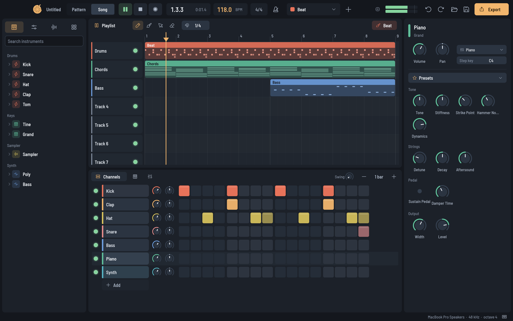
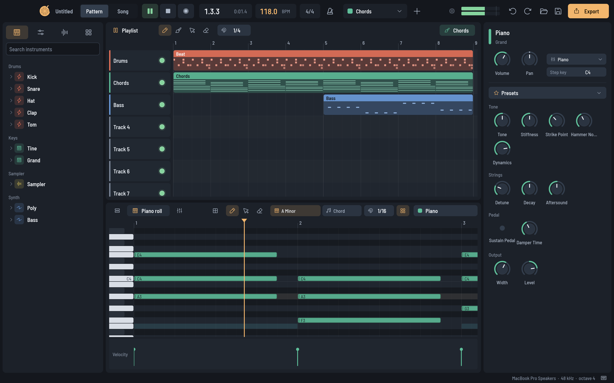
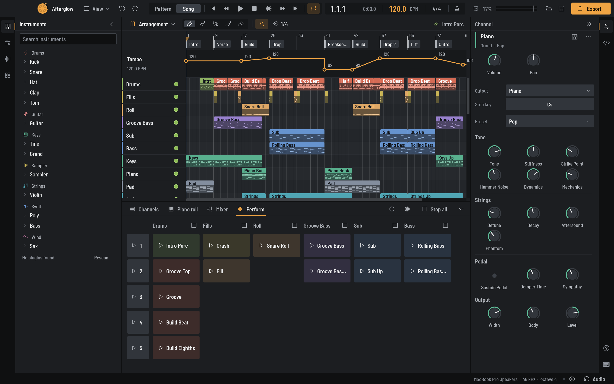

# Peel Studio

An open source, pattern-based music workstation for Windows, macOS and
Linux. Build a beat or a melody as a pattern, paint it into an arrangement,
change the source once and every instance follows.

Peel Studio is native Rust end to end: a `wgpu` interface (Metal, D3D12,
Vulkan), a lock-free realtime engine and project-owned instruments and
effects. There is no web view.



> Early development. The foundation (document model, realtime engine,
> native instruments and effects, UI toolkit and the core editors) works
> today; see [docs/ROADMAP.md](docs/ROADMAP.md) for what is next.

## What works today

- Pattern workflow: a Channel Rack step sequencer (with a velocity graph)
  and a Piano Roll edit the same notes; patterns are painted into the
  Playlist as linked clips, and Make unique splits one off.
- Thirteen native instruments (five synthesized drums, a polyphonic synth,
  a mono bass, a modelled tine electric piano, a modelled piano, a modelled
  electric guitar with its own amp and cabinet, a bowed violin with
  ensemble and pizzicato, a reed-modelled saxophone and a sampler) and
  fifteen effects (EQ with an interactive curve, compressor, multiband
  compressor, limiter, Bass Lift, delay, reverb, drive, filter,
  chorus, Vintage Chorus, flanger, phaser, Glitch for tempo-synced
  stutters, tape stops and gates, and utility), with over 200 factory
  presets in the Browser. Installed CLAP plugins show up next to them.
- A demo song, "Afterglow", opens on first launch: 80 bars of progressive
  house with tempo ramps, a slower breakdown, two drops and a key change,
  a drum bus, sidechain pumping, a mastering chain,
  reverb and delay returns, and automation of volume, pan, filters, pitch
  and effects.
- Arrangement: pattern, audio and automation clips; trims, fades, slicing,
  marquee selection, Alt-drag copies, markers, tempo changes, alternate
  arrangements; audio loops that follow the tempo; render to audio.
- Mixing: console-style strips with inserts, bus routing, post-fader sends,
  sidechain compression, gain reduction meters, pan, faders, meters, mute
  and solo; curved automation of any device parameter, track volume or pan.
- Performance: launch Playlist clips live by lane and scene on the next
  bar, and capture the performance as a new arrangement.
- Composing tools: legato, articulate, chop, arpeggiate, strum, flam,
  humanize, velocity levels, flip and tidy, previewed live before they
  apply.
- Playing and recording: computer keyboard and hardware MIDI keyboards with
  sustain, note recording into patterns, audio recording onto armed
  Playlist lanes with input monitoring, scales and chord stamping,
  quantize, swing, tap tempo.
- Exact rational musical time, sample-accurate playback that cannot drift,
  and a realtime audio path verified to make no allocations.
- Open project files with atomic saves, autosave and crash recovery,
  Standard MIDI File import and export, WAV, MP3, FLAC and AIFF export of
  the mix or stems,
  undo history.
- Screen reader support through AccessKit and keyboard focus traversal.

| Piano Roll with a scale | Mixer with a sidechain duck |
| --- | --- |
|  |  |

| Performance with tempo changes |
| --- |
|  |

## Build

You need Rust (the exact toolchain is pinned in `rust-toolchain.toml`, and
`rustup` installs it automatically).

```sh
cargo run --release            # the desktop app
cargo run -p peel-cli -- help  # headless tools
cargo test --workspace
```

The MP3 encoder is built from bundled LAME sources, so building also needs
a C compiler (Xcode Command Line Tools on macOS, Visual Studio Build Tools
on Windows, or a C toolchain on Linux). Audio export needs no external
encoder at runtime.

Linux also needs ALSA development headers (`libasound2-dev` on Debian and
Ubuntu) and a Vulkan driver.

To build a macOS app bundle and disk image in `dist/`:

```sh
scripts/package-macos.sh
```

Set `SIGN_ID` to a Developer ID identity to sign for distribution;
without it the bundle is ad-hoc signed for local use.

## Headless tools

```sh
peel render song.peelproj mix.wav --rate 48000 --bits 24
peel render song.peelproj mix.mp3 --bitrate 192 --normalize
peel render song.peelproj mix.flac --bits 24 --rate 96000
peel render song.peelproj mix.aiff --mono --tail 8
peel render --demo demo.wav       # the demo song
peel info song.peelproj
peel validate song.peelproj
peel devices                      # every native instrument and effect
```

## MCP

Agents can use Peel Studio through MCP to compose, arrange, mix, play,
record, import files and export audio. Launch `peel-studio --mcp` to share
a desktop session with an agent, or `peel-studio --mcp-headless` for a
silent session without a window. A separate `peel-mcp` executable supports
headless playback with `--audio`.

Edits use the app's undo history. The server discovers the current
instrument and effect catalog, exposes device parameters and presets,
and supports validated transactions across the full project document.
See [docs/MCP.md](docs/MCP.md) for client configuration, tools and examples.

## Export

Open Export from the toolbar or press Cmd/Ctrl+E. Choose a mix or one file
per mixer track, then the format and quality:

| Format | Quality |
| --- | --- |
| WAV | 16-bit or 24-bit PCM, or 32-bit float |
| MP3 | 128, 192, 256 or 320 kbps constant bitrate; 44.1 or 48 kHz |
| FLAC | Lossless 16-bit or 24-bit PCM; up to 96 kHz |
| AIFF | Uncompressed 16-bit or 24-bit PCM |

WAV and AIFF offer sample rates from 44.1 to 192 kHz; FLAC supports up to
96 kHz. Stereo or mono, effect tails and optional normalization are
available for every format.
Normalization adjusts each rendered file independently to -1 dBFS peak;
it isn't a loudness target. Leave it off for stems whose relative levels
you want to preserve. MP3 encoding can shift the decoded peak slightly.
TPDF dither can be enabled for integer PCM output.

The headless renderer chooses the format from the output extension and
accepts `--rate`, `--bits`, `--bitrate`, `--tail`, `--mono`, `--normalize`
and `--no-dither`. Existing WAV render commands still work.

## Layout

| Path | Contents |
| --- | --- |
| `crates/` | The Cargo workspace. [docs/ARCHITECTURE.md](docs/ARCHITECTURE.md) explains each crate |
| `assets/` | Fonts and icons, each with its license |
| `docs/` | Architecture, realtime rules, roadmap |
| `open-source-fl-studio-alternative-spec.md` | The full product specification |

## License

GPL-3.0-or-later. MP3 encoding statically links LAME through
`mp3lame-encoder` and `mp3lame-sys` (LGPL-3.0); FLAC encoding uses
`flacenc` (Apache-2.0). Bundled fonts and icons keep their own licenses; see
[assets/LICENSES.md](assets/LICENSES.md).

Peel Studio is an independent project. It is not affiliated with
Image-Line, and it does not use FL Studio code, artwork, presets or samples.
