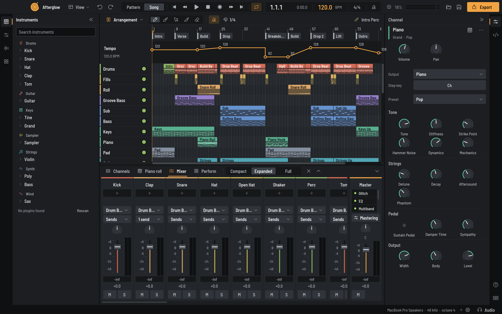

# Peel Studio

An open source, pattern-based music workstation for Windows, macOS and
Linux. Build a beat or a melody as a pattern, paint it into an arrangement,
change the source once and every instance follows.

Peel Studio is native Rust end to end: a `wgpu` interface (Metal, D3D12,
Vulkan), a lock-free realtime engine and project-owned instruments and
effects. There is no web view.


> Early development. The foundation (document model, realtime engine,
> native instruments and effects, UI toolkit and the core editors) works
> today; see [docs/ROADMAP.md](docs/ROADMAP.md) for what is next.

## What works today

- Pattern workflow: a Channel Rack step sequencer (with a velocity graph)
  and a Piano Roll edit the same notes; patterns are painted into the
  Playlist as linked clips, and Make unique splits one off.
- Twenty-one native instruments: a recorded acoustic kit, sustained and
  palm-muted guitars, recorded bass, five synthesized drums, a tuned 808
  sub bass that slides between notes, Mallet modal percussion, Poly and
  Cross synths, a mono bass, tine electric piano, acoustic piano, electric
  guitar with amp and cabinet, bowed violin, Zither plucked strings,
  saxophone and sampler. Twenty-one effects cover EQ, dynamics, delay,
  reverb, distortion, filtering and modulation, with Glitch, Transient,
  Gate, Tape, Crush, Resonator and Mastering for further shaping. Over 380
  factory presets are available in the Browser, alongside installed CLAP
  plugins.
- Four demo songs, each a finished arrangement with buses, sends,
  sidechains, automation and a mastering chain. "Afterglow" is 80 bars of
  progressive house with tempo ramps, a slower breakdown, two drops and a
  key change. "Night Shift" is trap built on the 808, with slides, hat
  rolls and a filtered break. "Neon Coast" is synthwave with a gated snare
  plate, an arpeggio and a gliding lead. "Corner Store" is swung boom bap
  through tape and a twelve-bit crusher.
- Arrangement: pattern, audio and automation clips; trims, fades, slicing,
  marquee selection, Alt-drag copies, markers, tempo changes, alternate
  arrangements; audio loops that follow the tempo; render to audio.
- Mixing: console-style strips with inserts, bus routing, post-fader sends,
  sidechain compression, gain reduction meters, pan, faders, meters, mute
  and solo; curved automation of any device parameter, track volume or pan.
- Performance: launch Playlist clips live by lane and scene on the next
  bar, and capture the performance as a new arrangement.
- Composing tools: legato, articulate, chop, arpeggiate, strum, flam,
  humanize, velocity levels, flip and tidy, previewed live before they
  apply.
- Playing and recording: computer keyboard and hardware MIDI keyboards with
  sustain, note recording into patterns, audio recording onto armed
  Playlist lanes with input monitoring, scales and chord stamping,
  quantize, swing, tap tempo.
- Exact rational musical time, sample-accurate playback that cannot drift,
  and a realtime audio path verified to make no allocations.
- Open project files with atomic saves, autosave and crash recovery,
  Standard MIDI File import and export with MPE expression, WAV, MP3, FLAC
  and AIFF export of the mix or stems, undo history.
- Screen reader support through AccessKit and keyboard focus traversal.

| Piano Roll with a scale | Mixer with a sidechain duck |
| --- | --- |
|  |  |

| Performance with tempo changes |
| --- |
|  |

## Projects

File > New project starts blank, with no instruments or notes. File > New
from template offers Rap, Trap, Hip-hop, Synthwave, EDM and Rock / Metal
song starters, alongside House and Beat and melody. Rock / Metal opens
Channels on a one-bar Double kick pattern with the step grid at 1/16T, so
the six-kick bursts on beats one and three line up with the steps. Trap
uses the 808 instrument and slides it up an octave at the end of each hook
bar; Synthwave and Hip-hop use the gated and dusty drum presets. The demo
songs are a separate choice.
File > Close project returns to the start screen. New, Open and Close ask
before replacing unsaved work; cancelling Save As keeps the current project.

File > Save as template… stores a copy of the open project under a name you
choose: instruments and their settings, plugin state, mixer routing,
patterns, recorded expression and the arrangement. Audio comes along too,
including files the project only referenced, so the template still works if
the original project or those files move. Saving a template leaves the open
project as it was, with the same file, title and unsaved changes. Names must
be unique; an existing template is never replaced.

Your templates are listed under File > New from template > My templates and
behind the My templates button on the start screen. Picking one starts a new
Untitled project. The first save asks where to put it and copies its audio
there, so the template itself is never changed. Templates live in a
`Templates` folder next to the app's settings (on macOS,
`~/Library/Application Support/Peel Studio/Templates`). There's no rename or
delete in the app yet; remove a template's `.peelproj` file and `.peeldata`
folder by hand.

Acoustic Kit plays real recordings of kick, snare, closed/open hats, ride,
crash and toms, with four velocity layers and three alternate takes per
piece. Choose its Full Kit preset for a GM drum keyboard, or a piece preset
for a Channel Rack row. New Rock / Metal songs use the recorded kit.
They also use Recorded Guitar for sustained power chords, Palm-Muted Guitar
for chugs and Recorded Bass for a picked bass line. These instruments use
bundled multisamples, with alternate takes, velocity response and no
external sample files. The guitars include clean and amplified sounds.
Palm-Muted Guitar uses dedicated palm-muted recordings from Guitar-TECHS
under CC BY 4.0. Exports do not generate credit files; the licence still
requires attribution when publishing audio that uses these recordings. See
[sample credits](assets/strings/palm-muted/README.md).
Kick, Snare, Hat and Tom also offer modeled acoustic and 808/909 circuit
sounds. Existing projects and older presets retain their sound.

In Channels, **Steps** sets the drum grid; the bar count sets the pattern's
length. Choose 1/32 or 1/64 for fast repeated kicks. The Piano Roll has
separate **Grid** and **Note length** controls, with quarter notes, eighths,
sixteenths, finer divisions and triplets. Note length also offers dotted
values. Changing the grid leaves existing notes untouched. Cmd/Ctrl+wheel
zooms the Piano Roll; Shift+wheel scrolls a long step grid sideways.

## 808

The 808 instrument is a tuned sub bass: a sine that drops onto its note for
the punch, holds, then decays, through a drive stage and a tone filter. It
plays one note at a time. With Glide on Legato, a note that starts while
another is still held slides to the new pitch instead of restarting, so a
slide is two overlapping notes in the Piano Roll: lengthen the first until
it runs under the second. Always also slides between separate notes; Off
restarts every note. Glide Time is the same for any interval.

Note Off chooses Release (the key gates the note; a short Release chokes
it) or Ring (the decay always runs out, like a one-shot sample). Decay
Track shortens higher notes. Drive offers Warm, Tube, Clip and Fold;
Shape and Octave add harmonics before it so the bass reads on small
speakers. Fourteen presets run from Clean Sub to Fuzz. The Trap starter
and Night Shift use Slide.

## Presets

Hat, Snare, Clap, Kick, Bass, Poly, Cross, Mallet and Tine have presets
for trap, boom bap and synthwave: Trap Tight and Trap Open hats (Open is
cut by the note's length), Dusty drums, Rim Click and Finger Snap, a Gated
snare and clap, Trap Bell, Flute Lead, Synth Brass, PWM Pad, Night Lead,
Cowbell and more. Reverb, Delay, Compressor and Mastering have presets to
match, such as Snare Plate, Neon Hall, Worn Echo and 808 Duck.

## Tape and Gate

**Tape** adds saturation, a head bump, a high cut, wow, flutter and hiss
that only sounds under a signal. **Gate** mutes or ducks a track below a
threshold, with hold, hysteresis and a sidechain: put it after a reverb on
a return and key it from the dry snare for a gated reverb.

## Clip editing

Right-click an arrangement clip for Duplicate, Copy or Cut. Use the Select
tool or Shift-click to work with a group. Cmd/Ctrl+D repeats the selection
with its timing and lane spacing intact.

Right-click an empty lane to paste at that grid position, or point at the
destination and press Cmd/Ctrl+V. Cmd/Ctrl+A selects every arrangement clip.
Copies share their source pattern; use Make unique to edit one independently.

## Build

You need Rust (the exact toolchain is pinned in `rust-toolchain.toml`, and
`rustup` installs it automatically).

```sh
cargo run --release            # the desktop app
cargo run -p peel-cli -- help  # headless tools
cargo test --workspace
```

The MP3 encoder is built from bundled LAME sources, so building also needs
a C compiler (Xcode Command Line Tools on macOS, Visual Studio Build Tools
on Windows, or a C toolchain on Linux). Audio export needs no external
encoder at runtime.

Linux also needs ALSA development headers (`libasound2-dev` on Debian and
Ubuntu) and a Vulkan driver.

To build a macOS app bundle and disk image in `dist/`:

```sh
scripts/package-macos.sh
```

Set `SIGN_ID` to a Developer ID identity to sign for distribution;
without it the bundle is ad-hoc signed for local use.

## Headless tools

```sh
peel render song.peelproj mix.wav --rate 48000 --bits 24
peel render song.peelproj mix.mp3 --bitrate 192 --normalize
peel render song.peelproj mix.flac --bits 24 --rate 96000
peel render song.peelproj mix.aiff --mono --tail 8
peel render --demo demo.wav       # the first demo song
peel render "--demo=Night Shift" night.wav
peel render --template=Trap trap.wav
peel render song.peelproj drums.wav --solo "Drum Bus" --dry-master
peel songs                        # demo songs and song starters
peel info song.peelproj
peel validate song.peelproj
peel devices                      # every native instrument and effect
peel audition peel.bass.808 808.wav --key 33
```

`--solo` renders only the named mixer tracks (a stem) and `--dry-master`
leaves out the master track's effects. `peel audition` plays one native
device on its own, preset by preset, and prints each preset's level: an
instrument plays a note, an effect processes a drum hit and a chord.

## MCP

Agents can use Peel Studio through MCP to compose, arrange, mix, play,
record, import files and export audio. Launch `peel-studio --mcp` to share
a desktop session with an agent, or `peel-studio --mcp-headless` for a
silent session without a window. A separate `peel-mcp` executable supports
headless playback with `--audio`.

Edits use the app's undo history. The server discovers the current
instrument and effect catalog, exposes device parameters and presets,
and supports validated transactions across the full project document.
See [docs/MCP.md](docs/MCP.md) for client configuration, tools and examples.

## Scripts

Run JavaScript, Lua and Python actions from **Scripts** in the status bar
or **F8**. Actions edit a project snapshot and apply successful changes as
one undo step. Releases bundle JavaScript, Lua and a private Python runtime
with PyTheory, so no extra installation is needed. A custom Python
interpreter can be selected for additional packages. Factory examples,
installation and the API are in [docs/SCRIPTING.md](docs/SCRIPTING.md).

## Export

Open Export from the toolbar or press Cmd/Ctrl+E. Choose a mix or one file
per mixer track, then the format and quality:

| Format | Quality |
| --- | --- |
| WAV | 16-bit or 24-bit PCM, or 32-bit float |
| MP3 | 128, 192, 256 or 320 kbps constant bitrate; 44.1 or 48 kHz |
| FLAC | Lossless 16-bit or 24-bit PCM; up to 96 kHz |
| AIFF | Uncompressed 16-bit or 24-bit PCM |

WAV and AIFF offer sample rates from 44.1 to 192 kHz; FLAC supports up to
96 kHz. Stereo or mono, effect tails and optional normalization are
available for every format.
Normalization adjusts each rendered file independently to -1 dBFS peak;
it isn't a loudness target. Leave it off for stems whose relative levels
you want to preserve. MP3 encoding can shift the decoded peak slightly.
TPDF dither can be enabled for integer PCM output.

The headless renderer chooses the format from the output extension and
accepts `--rate`, `--bits`, `--bitrate`, `--tail`, `--mono`, `--normalize`
and `--no-dither`. Existing WAV render commands still work.

## Layout

| Path | Contents |
| --- | --- |
| `crates/` | The Cargo workspace. [docs/ARCHITECTURE.md](docs/ARCHITECTURE.md) explains each crate |
| `assets/` | Fonts and icons, each with its license |
| `docs/` | Architecture, realtime rules, roadmap |
| `open-source-fl-studio-alternative-spec.md` | The full product specification |

## License

GPL-3.0-or-later. MP3 encoding statically links LAME through
`mp3lame-encoder` and `mp3lame-sys` (LGPL-3.0); FLAC encoding uses
`flacenc` (Apache-2.0). Bundled fonts and icons keep their own licenses; see
[assets/LICENSES.md](assets/LICENSES.md).

Peel Studio is an independent project. It is not affiliated with
Image-Line, and it does not use FL Studio code, artwork, presets or samples.

Mixing, EQ, mastering, instruments, MIDI and recording are covered in the
[audio tools guide](docs/AUDIO_TOOLS.md).
