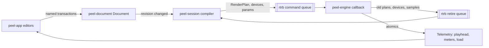

# Architecture

Peel Studio is a native Rust application. There is no web view and no
scripting runtime in the audio path. The full product specification is
[`open-source-fl-studio-alternative-spec.md`](../open-source-fl-studio-alternative-spec.md);
this document describes how the code is organized today and which parts of
the specification each crate owns.

## Stack

| Layer | Choice | Why |
| --- | --- | --- |
| Language | Rust 1.99 (pinned in `rust-toolchain.toml`) | Ownership and explicit concurrency for the engine and document model |
| Windows | `winit` 0.30 | Native windows on Windows, macOS and Linux |
| Rendering | `wgpu` 30 | Metal on macOS, D3D12 or Vulkan on Windows, Vulkan on Linux |
| Text | `glyphon` 0.12 (`cosmic-text`) | GPU text with proper shaping and fallback |
| Widgets | `peel-ui` (project-owned) | Dense music editors need custom rendering and input |
| Audio I/O | `cpal` 0.18 behind `peel-engine`'s backend | Core Audio, WASAPI, ALSA/PipeWire today; dedicated ASIO and HAL adapters later |
| Engine queues | `rtrb` | Bounded, wait-free SPSC ring buffers |
| Media | `symphonia` decode, `hound` WAV encode | Pure Rust, offline |
| Persistence | JSON manifest plus content-addressed shards, `blake3` hashes | Open, inspectable and recoverable |

## Crates

| Crate | Owns | Must not depend on |
| --- | --- | --- |
| `peel-time` | Rational musical time, tempo map, meter | anything else |
| `peel-document` | Project model, ids, validation, undo checkpoints | devices, engine, GUI |
| `peel-dsp` | `Device` trait, parameter descriptors, DSP primitives | engine, GUI, document |
| `peel-instruments` | Native instruments | engine, GUI, document |
| `peel-effects` | Native effects | engine, GUI, document |
| `peel-devices` | Registry of every native device type | engine, GUI |
| `peel-engine` | Audio callback, transport, sequencer, mixer graph, telemetry, offline render | document, GUI |
| `peel-media` | Decoding, resampling, WAV export, waveform peaks | engine, GUI |
| `peel-project` | `.peelproj` save/load, atomic writes, asset collection | engine, GUI |
| `peel-midi` | Standard MIDI File import/export | engine, GUI |
| `peel-session` | Document to engine bridge: plan compiler, device slots, sample loading | GUI |
| `peel-ui` | GPU renderer, text, input, theme, widgets | document, engine |
| `peel-app` | The desktop application and its editors | — |
| `peel-cli` | Headless validation and rendering | GUI |

## Data flow

1. Editors never touch engine memory. They run named transactions on the
   `Document` (`edit("Move 8 notes", |p| ...)`). Each transaction stores an
   undo checkpoint; heavy collections are `Arc`-shared so a checkpoint only
   copies what changed.
2. When the document revision changes, `peel-session` compiles a new
   `RenderPlan`: notes realized to absolute beat positions per pattern
   instance and loop iteration, channel and mixer routing in processing
   order, gains and mutes. Compilation runs on the UI thread and is cheap.
3. Devices live in stable engine slots. Creating a device, preparing it and
   applying its parameters happens on the control side; the engine receives
   a ready `Box<dyn Device>`. Parameter turns send `SetParam` directly so a
   knob never waits for a plan rebuild.
4. The engine swaps in the new plan at a block boundary and returns the old
   one through the retire queue, so nothing is freed on the audio thread.
5. The UI reads telemetry atomics each frame for the playhead, meters and
   processing load.

## Time

The document stores positions as reduced rationals of quarter notes
(`peel_time::Time`). Triplets and imported MIDI ticks stay exact. The
compiler converts to `f64` beats; the engine converts beats to samples from
absolute anchors every block, so a looping pattern cannot drift. Tempo
ramps are linear in BPM against beats, integrated exactly
(`60/k * ln((B0 + kq)/B0)`).

## Process model

The specification calls for the engine in its own process. Today the engine
runs on the audio callback thread inside the application process, but every
interaction already goes through owned messages, so moving it behind an IPC
boundary does not change the editors or the document.

## UI toolkit

`peel-ui` renders everything with two pipelines: instanced signed-distance
shapes (rounded rectangles, borders, circles, arcs, lines, triangles) and
`glyphon` text. Widgets use an immediate-mode API with stable ids. Hit
testing uses the previous frame's interaction regions so overlays and
popups always win over what is under them. The application repaints only
when input arrives or while something animates (playback, meters), so an
idle window costs nothing.

## Not done yet

See [ROADMAP.md](ROADMAP.md) for what is implemented and the order the rest
of the specification is planned in.
