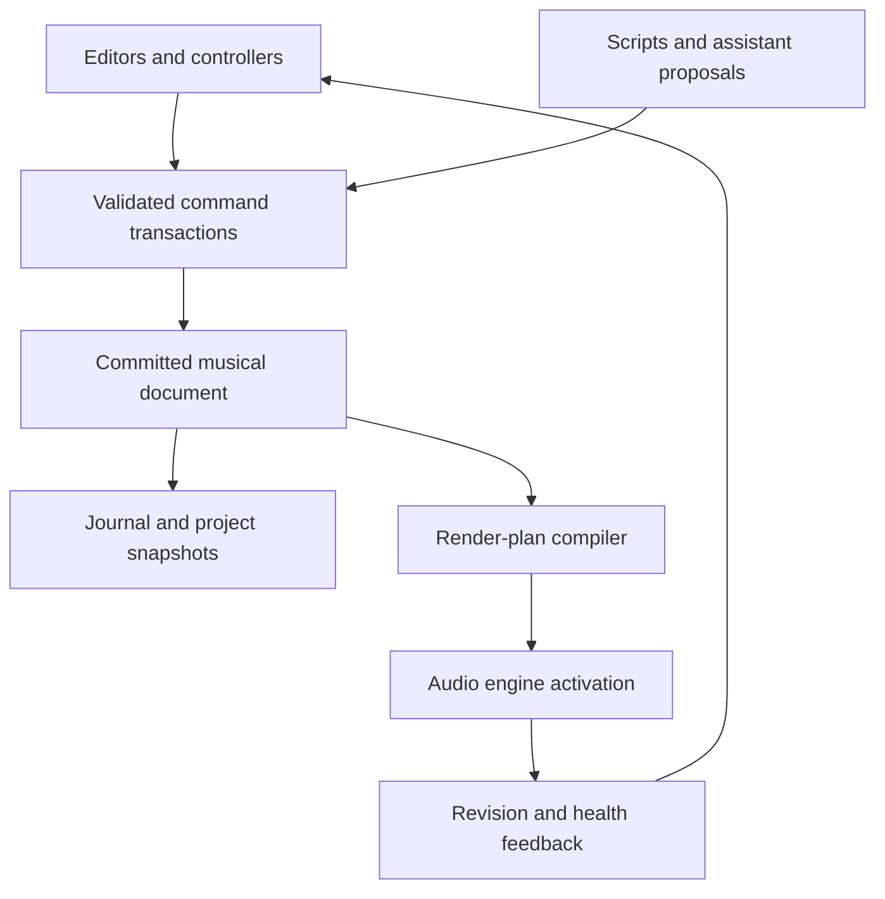

# Open Source Pattern Workstation

**Complete product and technical specification**

This document specifies a complete, open source digital audio workstation for Windows and macOS, with the breadth of FL Studio All Plugins Edition and its associated creative workflows. Its central interaction is pattern composition: build a beat or melody, reuse that pattern by placing and painting instances into an arrangement, edit the shared musical idea, and make individual variations when needed. Recording, linear editing, mixing, sound design, live performance and mastering are equally complete parts of the application.

The product is referred to as **the workstation**. Open Source Pattern Workstation and the `opw` identifiers are descriptive working labels, not a cleared commercial name. FL Studio and Image-Line names appear only to identify research and functional comparison targets. All application branding, interface artwork, source code, presets, samples and documentation supplied by this project are original or separately licensed for redistribution.

The document describes the intended completed product. Requirements use **must** for mandatory behavior, **should** for a recommended implementation where an alternative can meet the same acceptance criteria, and **may** for a user-selectable capability or an explicitly optional external integration. Every mandatory capability is in scope; conditional availability describes an external dependency or compatibility boundary, not a deferred delivery commitment. Numerical audio durations, latency budgets, buffer sizes and musical timing are technical requirements, not delivery estimates.

The specification separates three kinds of statement. **Research basis** records behavior verified in primary documentation. **Product requirement** defines what this workstation must implement. **Compatibility boundary** identifies circumstances in which another vendor's binary, format, licensed content, operating system or service controls interoperability. A requirement for an equivalent creative capability is not a claim that proprietary DSP, factory sounds or undocumented project data can be reproduced exactly.

## Contents

| Section | Specification |
| --- | --- |
| 1 | [Product scope and governing decisions](#product-scope-and-governing-decisions) |
| 2 | [Prior research and design conclusions](#prior-research-and-design-conclusions) |
| 3 | [Complete user journeys](#complete-user-journeys) |
| 4 | [Research baseline and meaning of parity](#research-baseline-and-meaning-of-parity) |
| 5 | [Transport, musical timing and live input behavior](#transport-musical-timing-and-live-input-behavior) |
| 6 | [Channel Rack, patterns and step sequencing](#channel-rack-patterns-and-step-sequencing) |
| 7 | [Piano roll, note expression and compositional tools](#piano-roll-note-expression-and-compositional-tools) |
| 8 | [Arrangement, clips and editing behavior](#arrangement-clips-and-editing-behavior) |
| 9 | [Recording, take management and retrospective capture](#recording-take-management-and-retrospective-capture) |
| 10 | [Automation, modulation and control mapping](#automation-modulation-and-control-mapping) |
| 11 | [Mixer, routing and audio workflow requirements](#mixer-routing-and-audio-workflow-requirements) |
| 12 | [Browser, content organization and project exchange](#browser-content-organization-and-project-exchange) |
| 13 | [MIDI interchange and hardware integration](#midi-interchange-and-hardware-integration) |
| 14 | [Performance mode and arrangement capture](#performance-mode-and-arrangement-capture) |
| 15 | [Scripting, macros and extension behavior](#scripting-macros-and-extension-behavior) |
| 16 | [Remote control and workstation-as-plugin](#remote-control-and-workstation-as-plugin) |
| 17 | [Local assistance, content services and learning](#local-assistance-content-services-and-learning) |
| 18 | [Video, visual output and auxiliary workflow](#video-visual-output-and-auxiliary-workflow) |
| 19 | [Functional acceptance scenarios](#functional-acceptance-scenarios) |
| 20 | [Visual design and interaction system](#visual-design-and-interaction-system) |
| 21 | [Screen specifications: composition and editing](#screen-specifications-composition-and-editing) |
| 22 | [Screen specifications: projects, devices and services](#screen-specifications-projects-devices-and-services) |
| 23 | [Accessibility, localization and interface performance](#accessibility-localization-and-interface-performance) |
| 24 | [Bundled instruments, effects and creative tools](#bundled-instruments-effects-and-creative-tools) |
| 25 | [Additional hardware, transport and interchange parity](#additional-hardware-transport-and-interchange-parity) |
| 26 | [Musical document model and command architecture](#musical-document-model-and-command-architecture) |
| 27 | [Project format, durability and media ownership](#project-format-durability-and-media-ownership) |
| 28 | [Native architecture and audio engine](#native-architecture-and-audio-engine) |
| 29 | [Plugin hosting and application-as-plugin operation](#plugin-hosting-and-application-as-plugin-operation) |
| 30 | [MIDI, controllers, expression, and synchronization](#midi-controllers-expression-and-synchronization) |
| 31 | [Audio formats, media interchange, and rendering](#audio-formats-media-interchange-and-rendering) |
| 32 | [Build, distribution, security, and engineering acceptance](#build-distribution-security-and-engineering-acceptance) |
| 33 | [Analysis, transcription and assisted creation implementation](#analysis-transcription-and-assisted-creation-implementation) |
| 34 | [Scripting, controller SDK and extension security](#scripting-controller-sdk-and-extension-security) |
| 35 | [Optional services, remote control and distribution](#optional-services-remote-control-and-distribution) |
| 36 | [Repository, builds and open source maintenance](#repository-builds-and-open-source-maintenance) |
| 37 | [Integrated validation and release acceptance](#integrated-validation-and-release-acceptance) |
| 38 | [Research source register](#research-source-register) |

## Product scope and governing decisions

### Complete music creation without additional purchases

A full installation must allow a user to disconnect from the internet, start a project, play an acoustic piano with the computer keyboard or MIDI controller, program drums, add bass and synthesizers, record microphones or instruments, arrange patterns and audio, automate parameters, mix, master and export a finished song. No account, paid instrument, paid codec, external audio application or content download is required for that workflow. The full installer contains the core sound library. A separate small installer may offer the identical library as a download, but the application must state clearly which installer includes the sounds.

The application must not impose edition restrictions on track count, recording, automation, instruments, export or project saving. The user chooses CPU load, plugin quality and disk use within actual machine limits. A stopped or missing optional network service cannot prevent a local project from opening or exporting.

The completed feature surface includes pattern sequencing, a Channel Rack, a deep Piano Roll, a Playlist arrangement editor, reusable audio and automation clips, multiple arrangements, audio and MIDI recording, take lanes and comping, a modular mixer, native instruments and effects, third-party plugins, sample and pitch editors, time warping, stem separation, live clip launching, video scoring and visualizer rendering, controller integration, scripting, an assistant, project backup and content management. The detailed parity matrices below are part of the requirements, not an illustrative selection.

### Architecture decisions

| Area | Required decision | Reason and consequence |
| --- | --- | --- |
| Main implementation | Rust for the application model, scheduler, audio graph, native DSP, media orchestration and user interface | Rust ownership and explicit concurrency support a disciplined implementation; they do not themselves prove real-time safety or make third-party native plugins safe. |
| Operating systems | Windows 11 x64 with a minimum product target of 24H2; macOS 14 or later on Apple silicon and Intel | These are product support requirements. Native installers, hardware testing and plugin-worker binaries are required for each supported architecture. Build manifests record the actual SDK and minimum OS requirements. |
| Desktop interface | Native `winit` windows, `wgpu` rendering, a retained semantic widget tree, `cosmic-text`/`glyphon` text, `taffy` layout and AccessKit | A shared visual system must coexist with native dialogs, menus, accessibility and plugin editor windows. These components are building blocks, not a finished DAW toolkit. |
| Audio | Dedicated engine service and native platform backends | Device callbacks and DSP scheduling never depend on repainting, document serialization, a network request or a scripting interpreter. |
| Plugins | Full VST3 and CLAP hosting on both platforms; Audio Units on macOS | Legacy VST2 is a separate, legally constrained compatibility target. A plugin binary is compatible only with the relevant OS, architecture and API. |
| Native devices | Project-owned, versioned DSP implementations with one shared parameter and preset system | Native devices participate in per-note expression, deterministic rendering, portable state and accessibility without requiring the generic plugin ABI. |
| Project storage | Open, versioned `*.opwproj` manifest plus a managed `*.opwdata` directory; portable `*.opwbundle` archives | Projects remain inspectable, recoverable, portable and independent of a hosted database. |
| Catalog storage | SQLite for local indexed metadata, search, plugin scan results and preferences | SQLite is not the authoritative musical document or an audio-thread dependency. No PostgreSQL server or Node.js runtime is required to create music. |
| Source license | GPL-3.0-or-later for the application, with reviewed third-party plugin hosting permissions for project-owned code where needed | SDK, dependency and asset licenses retain their own terms. The legal requirements section governs distributions. |
| Sound library | Original recordings, synthesis and explicitly redistributable assets with per-file provenance | Royalty-free use in songs and redistribution inside software are different permissions and must both be documented as appropriate. |
| Cloud and assistant | Optional, replaceable adapters with local operation as the default | The workstation includes the interfaces and self-hostable components without depending on Image-Line services or a commercial model account. |

The graphics choice follows `wgpu`'s documented native Metal and DirectX support, while AccessKit supplies a semantic accessibility bridge that still requires application-specific implementation. [P04][P05] Rust audio libraries offer useful primitives, but the engine and complete plugin hosts remain substantive project-owned engineering. [P07]

### Functional parity and proprietary compatibility

The target is the union of documented FL Studio creative capabilities, including features associated with its highest edition, native device suite and integrated services. The reference is the public FL Studio 2026 feature documentation, the detailed manual, the comparison page and the individual plugin manuals. Preview-only research is labeled explicitly in the parity section and must not be presented as a stable FL Studio feature. [FL-BASIS-01][FL-BASIS-02][FL-BASIS-03]

The implementation must produce a feature ledger with one entry per parity row and device mapping. Each entry links its user interface, domain objects, processing implementation, file serialization, help article and acceptance fixture. A visible control with no processing or persistence behind it does not satisfy a row. A backend capability with no usable interface does not satisfy a user-facing row either.

Compatibility has four levels, recorded per format or plugin rather than hidden behind a general import claim:

| Level | Meaning | Required user experience |
| --- | --- | --- |
| Native | The workstation owns and documents the complete representation | Full editability and round-trip support under a versioned schema. |
| Standards-based | A published interchange or plugin standard is implemented | Report negotiated capabilities and unsupported extensions; preserve information where possible. |
| Best-effort proprietary import | A lawfully implemented reader handles a documented subset of another product's format | Produce a migration report and preserve the original. Never silently substitute different sounds or discard events. |
| External authorization required | An SDK, encrypted library, service or unsupported binary controls access | Explain the exact missing dependency and offer standards-based audio/MIDI transfer or a functional native replacement. |

Image-Line's project files, native plugin state, preset packs and cloud account are not prerequisites for normal use. Exact loading of arbitrary FLP files and exact playback of Image-Line instruments are not guaranteed. Every corresponding musical capability must still have an implemented original equivalent. Legacy compatibility work must not bypass encryption, DRM or SDK distribution terms.

## Prior research and design conclusions

### Research methodology

Use the feature comparison to discover categories, the manual to resolve actual behavior, and individual device documentation to clarify synthesis and processing. Marketing descriptions and aggregate device counts are not sufficient technical specifications. Some official pages retain descriptions from different versions; when they disagree, record the conflict in the feature ledger and use an explicit workstation requirement instead of guessing which historic value to copy.

The design does not copy FL Studio's visual assets or attempt a pixel-for-pixel skin. It retains the productive pattern workflow and provides an original, coherent interface. Comparisons with other open source DAWs inform architecture and interaction decisions rather than establishing an intention to merge their code without license review.

| Prior art | Verified relevance | Design conclusion for this product |
| --- | --- | --- |
| FL Studio official manuals and edition comparison | Pattern editing, sequencing, native creative tools, integrated services and device scope | Maintain a detailed capability crosswalk and test music workflows end to end. [FL-BASIS-01][FL-BASIS-02][FL-BASIS-03] |
| LMMS | Open source pattern-oriented composition with song, piano-roll and beat editing | Preserve fast beat construction and pattern reuse, while defining recording, audio editing and plugin compatibility explicitly. Do not assume a similar editor implies complete FL parity. [P01] |
| Ardour | Recording, routing, automation, comping, export, video and control-surface workflows | Treat recording reliability, graph routing and interchange as core engineering disciplines with their own acceptance tests. [P02] |
| Zrythm | Integrated MIDI, chord, audio and automation editing with flexible routing | Use consistent editing semantics across media types and make harmonic context visible without forcing notes into a scale. [P03] |
| `wgpu` and native window libraries | Cross-platform GPU and window primitives | Own the application scene model, layout, input dispatch, rendering invalidation and low-power behavior. [P04] |
| AccessKit | Accessibility schemas, actions and platform adapters | Expose a stable semantic tree, including music-specific navigation, rather than assuming a drawn control is accessible. [P05] |
| Iced | A Rust desktop UI framework with a message-driven model | Reuse suitable architectural ideas; the selected shell remains explicit because dense music editors and plugin windows require specialized rendering and input. [P06] |
| CPAL and RustAudio | Cross-platform audio I/O primitives | Evaluate components against the required device clocks and host features. Generic audio output alone is not an ASIO/CoreAudio production engine. [P07] |

### Research conclusions that affect implementation

The product is several connected systems: a musical document editor, a real-time scheduler, a plugin host, a collection of DSP products, a media pipeline, a content library and a desktop application. Rust is an appropriate core language if unsafe boundaries, lifetime handling and real-time behavior are audited. It does not remove the need for small C/C++ or Objective-C adapters where vendor SDKs and native window contracts require them.

A useful full specification must define copy and paste, pattern identity, plugin state, delay compensation, media ownership, timing precision and failure recovery as carefully as the instrument list. Otherwise a visually convincing sequencer can still corrupt projects, misalign recordings, change repeated patterns unexpectedly or export a different mix from the one the user heard.

The highest-risk interoperability cases have first-class product behavior: missing plugins, architecture mismatches, invalid plugin state, sidechain routing, dynamic bus changes, plugin crashes, sample-rate changes, unavailable media, unsupported sampler formats and codec failures. The workstation must remain editable and preserve recoverable state in every case.

## Complete user journeys

### Create a song from the full installer

The Welcome screen offers an Empty project and clear creative templates. Beat and melody opens with a playable acoustic piano, a drum machine, a bass instrument and a polyphonic synth, each routed to a named mixer strip. The project is usable immediately with the system audio output. A compact first-use card provides an optional device check and keyboard note map; dismissing it never disables sound.

The user clicks kick and snare steps, opens the piano instrument's Piano Roll, draws a melody and presses Play in Pattern mode. Switching to Song mode moves auditioning to the arrangement without changing the pattern. Selecting a pattern in the Pattern Picker and clicking or dragging in the Playlist paints instances. A duplicate variation is created with Make unique; editing the original then affects only its linked instances. The user records a vocal, comps takes, adds an automation lane, balances the Mixer and exports WAV and M4A. Reopening the project with the network disconnected must restore the complete result.

This journey is a release acceptance fixture. The shipped tutorial project, screenshots and help instructions must use only resources actually present in the full installer. Demo projects cannot hide missing paid dependencies.

### Bring an existing MIDI composition to life

The user imports a Standard MIDI File. An import preview displays tracks, note ranges, tempo and meter events, controller data and detected program/bank information. The user chooses one arrangement or a set of patterns. The workstation maps General MIDI programs to its bundled General MIDI bank when requested and maps percussion to the appropriate channel/bank rules. Unsupported or unknown metadata appears in an import report, not a generic success toast.

Notes, durations, sustain, expression, bends, instrument changes and tempo transitions remain editable. The user may replace any instrument while keeping the note data. Exporting the composition as MIDI provides choices about merged or separate tracks, arrangement versus selected pattern, resolution and expression conversion. A MIDI-only file is never described as containing the rendered sounds.

### Record instruments and vocals

The user selects an input, checks its meter, chooses monitoring behavior and arms one or more tracks. The recording view makes input source, channel layout, available disk space, count-in, punch region and latency state visible. Recording creates durable take files and a take-group document. Playback and monitoring are independent controls. A user-selected Hardware direct monitor mode disables software monitoring to avoid doubling. Device-specific direct-monitor control is available only where a supported interface exposes it; the application cannot discover or disable every hardware monitoring path.

The user records successive passes over a loop, auditions takes and swipes a comp. Edits are nondestructive, include adjustable crossfades and retain the original takes. A hardware instrument may be sequenced through MIDI Out and recorded into a paired audio return. A calibration loop measures round-trip delay and the result is stored per device route, not globally applied to unrelated devices.

### Design and reuse an instrument

The user loads samples into the multisampler, maps key and velocity ranges, adds round robins, sets release behavior and creates macros. The instrument can be wrapped in the modular patcher with note effects, synthesis, external plugins and audio processing. The user saves a self-contained native preset package with permitted samples, a preview and tags. Missing third-party plugins are listed explicitly in the package manifest.

An acoustic piano preset loads promptly by streaming long tails while retaining attack preloads. Switching a preset during playback uses a documented policy: retain old voices to completion within a resource budget, or apply a short crossfade and release them. Preset changes cannot release files still used by active voices.

### Perform and capture an arrangement

The user opens the Performance view, assigns patterns and audio to cells, sets launch quantization, maps a controller and launches scenes. The launch scheduler respects tempo, meter and synchronization rules. Recording the performance writes an ordinary editable arrangement with source references and automation. A failed controller connection does not stop audio, and reconnecting does not duplicate note-on events or replay a queued scene unintentionally.

### Move a project between Windows and macOS

Collect and package creates a portable bundle containing every permitted local dependency and a manifest of external plugin requirements. Opening the bundle on the other platform resolves native devices by stable identifier and external plugins by declared plugin identity plus a verified compatible build. File paths are normalized without losing original filename metadata.

If a Windows-only plugin has no compatible Mac build, its state and tracks remain intact and the project opens with a placeholder. Freeze renders or exported stems can play in its place. A plugin with the same display name is never automatically trusted as an equivalent. The original project is not rewritten until the user saves a new native project or accepts a migration.

### Recover an unfinished idea

The user can recover recent MIDI input and recent master audio from bounded retrospective buffers, subject to the recording preferences and visible status. These buffers are separate from autosave. The recovery command inserts a new take with its original timing relationship, provides a preview and never overwrites an existing take. A crash recovery screen lists durable project snapshots, journal replay status, incomplete recordings and available plugin-state checkpoints.

## Research baseline and meaning of parity

The reference product is the desktop FL Studio feature set across its editions, including the capabilities sold with additional Image-Line instruments, effects and editors. The official release material identifies FL Studio 2026 as the current major product, and the stable changelog exposes 26.1.7.5. The comparison page and manual are the principal feature inventory; historical entries are retained where they identify an otherwise missing capability. Edition gates are not reproduced. [FL01] [FL02] [FL03]

The public 2026.2 beta manual separately documents expanded dynamic effect chains, revised pattern splitting and shortcut customization. These are included as requirements of the workstation, without representing them as already shipped stable FL Studio features. The workstation must support at least 500 active mixer buses and 25 insert effects on a bus, subject to available processing capacity, with dynamically allocated resources rather than a permanently populated fixed grid. Higher configurable limits are permitted by the engine architecture. [FL04] [FL05]

Feature parity means that a musician can perform the corresponding composition, recording, editing, sound design, mixing, performance and delivery tasks. It does not mean copying proprietary source code, preset banks, samples, artwork, visual identity, undocumented binary state, commercial cloud entitlements or exact sound-generating algorithms. The required built-in devices use independent implementations and redistributable content. Every documented reference feature must map to an implementation requirement, an explicitly described equivalent or an interoperability limitation. It must never disappear behind a broad claim such as full DAW support.

The requirements following the evidence table are original product and engineering decisions. The references establish the existence and scope of the reference capabilities; the workstation deliberately defines its own consistent semantics where the reference product has historical behavior, platform differences or conflicting documentation.

### Audited core capability map

| ID | Reference capability established by official documentation | Required workstation coverage | Evidence |
| --- | --- | --- | --- |
| FL-C01 | Configurable toolbar, transport, Pattern/Song modes, record filters and typing keyboard performance | Persistent global transport, editable toolbar, keyboard performance mode, independently selectable recording streams and clear mode indication | [FL06] |
| FL-C02 | Shared Channel Rack with step and Piano roll data inside multichannel patterns | One project instrument rack; patterns address any subset of its channels; step and note views edit the same underlying musical events | [FL07] |
| FL-C03 | Pattern cloning, grouping, splitting, transposition and audio rendering | Searchable pattern library, linked instances, independent copies, loss-aware split/merge and render-in-context operations | [FL08] |
| FL-C04 | Piano roll draw, paint, selection, slice, scale, chord stamp and expressive native notes | Fast grid editor, contextual tools, native note-expression events, explicit translation for external plugins | [FL09] |
| FL-C05 | Quantize, articulate, chop, arpeggiate, strum, flam, randomize, riff generation and note transforms | Previewable deterministic transformations, editable results, presets and cancellation without changing committed data | [FL10] [FL11] |
| FL-C06 | Chord progressions, chord analysis and generated basslines | Offline harmony editor with chord alternatives, voicing, bassline generation, locked passages and ordinary note output | [FL12] |
| FL-C07 | Piano roll scripting and score-sheet export | Transactional note-processing API, embedded script editor and printable notation export | [FL10] [FL13] |
| FL-C08 | Flexible Playlist containing patterns, audio and automation; optional linked track modes | Free arrangement lanes plus linked instrument/audio tracks, alternate arrangements, source-aware editing and folding groups | [FL14] |
| FL-C09 | Per-instance clip properties, fades, gain, reversal, pitch and slicing | Independent clip transforms over immutable media, direct waveform editing handles and distinct source-wide editing commands | [FL15] |
| FL-C10 | Audio recording, loop takes, internal recording and consolidation | Multitrack capture, punch recording, take folders, comping, resampling, non-destructive consolidation and freeze | [FL16] [FL17] |
| FL-C11 | MIDI recording, typing keyboard input and retrospective note recovery | Timestamped note/expression capture, independent input quantization, step entry and recoverable performance buffers | [FL18] |
| FL-C12 | Retrospective master-audio logging | A bounded local rolling buffer with an explicit capture point, visible enable state and recover-to-clip action | [FL19] |
| FL-C13 | Pattern event automation and separate automation clips | Pattern-relative and arrangement-relative automation, conversion in either direction, target identity and visible precedence | [FL20] [FL21] |
| FL-C14 | Hardware links, global focus-sensitive links and internal controllers | MIDI learn, project and global mappings, pickup modes, modulation connections, scaling and multi-parameter macros | [FL22] [FL23] |
| FL-C15 | Dynamic mixer, track routing, sidechains, external I/O and monitoring | Add/remove buses, arbitrary validated routing, multi-output instruments, cue mixes, input monitoring and track presets | [FL05] [FL24] [FL25] |
| FL-C16 | Plugin delay compensation, automation compensation and recording offsets | Graph-wide latency accounting, correctly timed automation, calibrated external loops and explicit low-latency monitoring | [FL17] [FL26] |
| FL-C17 | Browser indexing, tags, sample audition, project content and plugin database | Unified searchable local library, background analysis, tempo-aware preview, project dependency inspection and content provenance | [FL27] |
| FL-C18 | Plugin hosting including VST2, VST3, AU and CLAP | Verified modern format hosting, controlled legacy compatibility, plugin scan isolation and documented cross-platform state rules | [FL28] [FL29] |
| FL-C19 | Project files, zipped projects, component export and collected project data | Native open project format, portable packages, selective component exchange, media consolidation and missing dependency repair | [FL30] [FL31] |
| FL-C20 | Audio and MIDI rendering, separate track output and tail options | Audio format matrix, multiformat render jobs, stems, MIDI files, deterministic region handling and validated output reports | [FL32] |
| FL-C21 | MIDI import into projects and individual editors | Import wizard for tracks, channels, tempo and controller data; loss reporting; editable General MIDI playback | [FL33] [FL34] |
| FL-C22 | Performance mode with clips, scenes, triggering modes and captured performances | Dedicated clip-launch view, quantized triggering, follow rules, controller feedback and arrangement recording | [FL35] |
| FL-C23 | Controller scripting and bidirectional hardware support | Supported controller profiles plus a documented extension API for transport, displays, meters, pads and encoders | [FL36] |
| FL-C24 | Remote control layouts on phones and tablets | Paired local-network remote client with editable layouts, transport, pads, mixer and clip-launch control | [FL37] |
| FL-C25 | FL Studio running inside another DAW | Workstation-as-plugin builds with host transport, multiple outputs, state persistence and recursion protection | [FL38] |
| FL-C26 | Stem extraction, remix setup and source analysis | Local stem-separation job, tempo/key analysis, aligned output tracks and an editable remix project | [FL14] [FL19] |
| FL-C27 | Loop Starter and generated rhythm ideas | Genre and role-based loop assembly using bundled or user-authorized material; locked parts and editable patterns | [FL39] |
| FL-C28 | FL Cloud sounds, mastering, distribution and plugins | Independent content catalog, local mastering assistant, provider adapters and export packages; no promise of Image-Line service access | [FL40] [FL41] |
| FL-C29 | Project backup through FL Cloud | Provider-neutral remote backups, dependency manifests, restore preview and persistent local ownership | [FL01] [FL30] |
| FL-C30 | Gopher help and actions | Optional assistant grounded in the workstation manual and typed commands, with reviewable edits and no required account for music creation | [FL01] |
| FL-C31 | Video synchronized to the arrangement | Frame-aware video reference, audio extraction, synchronization controls and scored-video export through the rendering system | [FL42] |
| FL-C32 | Themes, UI scaling, shortcut settings and detached windows | Accessible themes, resizable native windows, multiple displays, keyboard remapping and layout recovery | [FL43] [FL44] |
| FL-C33 | Per-channel key range, polyphony, gate, swing, pitch and cut groups | Consistent channel utilities for built-ins and supported external instruments, with explicit native-only expression controls | [FL45] |
| FL-C34 | User sample processing and embedded sample metadata | Sample editor, root and loop metadata, precomputed transforms, stretch/pitch analysis and source relinking | [FL46] |
| FL-C35 | Help, tutorials, diagnostics and performance inspection | Searchable offline documentation, guided editable projects, task diagnostics and actionable per-node performance data | [FL47] [FL48] |

The device inventory elsewhere in the specification supplies the corresponding named instrument, effect, editor, controller and legacy-function crosswalk. The core audit and device inventory must be evaluated together. A name match alone is insufficient: the relevant sound-generation method, routing behavior, editable controls and save/restore behavior must all be covered.

## Transport, musical timing and live input behavior

### Transport contract

The transport has explicit Song, Pattern and Performance contexts. Song plays the active arrangement. Pattern loops the selected pattern using its declared length. Performance plays launch lanes against the active clock and can record the result into an arrangement. Changing the visible editor must never silently change the transport context. The transport mode, current pattern or arrangement, playback position, loop range, recording state and clock source remain visible throughout ordinary editing.

Play, pause, stop, return to last start, return to start, rewind, fast-forward, scrub and locate-by-position are separate commands. A single Stop stops transport while honoring configured release tails; a Panic command terminates notes and queued launches, resets sustain, sends appropriate note-off/reset events to external destinations and clears transient feedback state. Panic must not delete notes or automation. Transport seek chases sustained notes, controller state, program changes and automation according to a project setting. Notes chased midway through a clip must use the same stable note identities and expression state as notes started normally.

Loop boundaries use half-open musical intervals. Events exactly on the loop end belong to the following iteration or adjoining clip, not both. The engine must define behavior for notes crossing a loop boundary: retrigger, continue with a retained voice, or cut at the boundary. The project default is retrigger with release-safe note termination; individual clips may override it. Count-in and pre-roll occur before the record range without moving the musical content. Punch markers change the capture gate; they do not stop the timeline.

Tempo accepts typed BPM, tap tempo, tempo automation, imported tempo maps and external clock. Display precision must not become storage precision. Time signatures may change within an arrangement or pattern; tuplets, compound meter, pickup bars and custom bar numbering must remain addressable. The metronome has selectable sound, accent, subdivision, volume and destination bus. Preview and metronome routes are explicit and excluded from export unless intentionally routed into a recorded mix.

Separate display units are available for musical position, sample position, elapsed audio and video timecode. Changing units does not change event placement. Scrubbing uses the preview route and never starts external hardware unexpectedly. Tempo ramps must be integrated by the engine timing model rather than approximated by moving visible grid lines.

### Recording filter and monitoring contract

Audio, notes, automation and clip-launch capture have independent enable switches. Arming audio must not implicitly record every mixer movement. Playing along on a keyboard while recording a singer must be possible with note capture disabled. The application must show which armed destinations will receive data and which hardware inputs they use before playback begins.

Input monitoring has Off, Auto and On states. Auto follows arm and punch status with a user-selectable tape-style or software-instrument behavior. Hardware direct monitoring is represented separately; software monitoring cannot claim to disable a device's own direct-monitor path. The input meter can remain active without audible monitoring. A record preparation check identifies a missing input, denied microphone access, disconnected device, unwritable target or insufficient space using a concrete recovery action.

Typing-keyboard performance provides keyboard layouts, base octave, fixed or key-specific velocity, sustain, pitch controls and scale layouts. Text fields and script editors always retain typing focus. The toolbar makes performance-keyboard state obvious, and shortcuts that conflict with musical keys are either remapped or temporarily suspended. On-screen piano and drum pads provide the same events as external MIDI input and are operable without audio hardware beyond the normal system output.

## Channel Rack, patterns and step sequencing

### Shared instruments and musical containers

A channel represents a sound generator or control generator, not an arrangement lane. A pattern is a reusable container of note, step and pattern-relative control events addressing one or more channels. A pattern clip is an instance of a pattern placed in an arrangement. A mixer bus receives audio from channels, audio clips or other buses. These four concepts remain distinct even when an instrument-track convenience mode presents them together.

Adding a channel does not create copies of that instrument in every existing pattern. It adds one generator to the project rack and allows any pattern to reference it. Selecting a pattern changes the musical data displayed across the rack while preserving the generators and their state. A multichannel drum pattern and a piano pattern may therefore coexist without separate duplicate drum instruments or misleading track ownership.

The rack displays name, color, icon, mute, solo, level, pan, destination, input activity, selection and either steps or a note preview for each channel. Filtering by group, type, used in current pattern, unused in project and selected arrangement is non-destructive. Reordering the visible rack does not alter stable channel identities or MIDI routing. The rack supports bulk rename, color gradients, grouping, cloning, replacement, routing and channel-template operations.

Replacing an instrument preserves musical data and the channel identity. Compatible automation targets are matched only by stable parameter identifiers and explicit migration metadata, never by the current ordering of visible knobs. Unsupported targets remain as unresolved automation with a repair action. Channel cloning offers instrument-only, current-pattern data or all-pattern data; the selected choice appears in the command label and undo entry.

### Step grid and graph editing

The initial drum pattern presents a readable 16-step bar in common time. Users can change the division, pattern length and individual channel cycle length. The display accommodates triplets, dotted divisions, odd meter and polymetric rows without requiring tiny fixed-width buttons. Step groups follow musical beats rather than assuming four groups of four in every meter.

A step stores active state, note, velocity, release velocity, gate, fine pitch, pan, timing offset, repeat/ratchet count, probability, condition and supported expression values. The graph editor shows these properties below aligned steps and supports freehand draw, ramps, selection, numeric entry, copy/paste, scale, invert and randomize. Muting a step retains its properties. Deleting a step's data is a separate operation. Empty and inactive steps are visually different from active silent notes.

Click toggles a step; dragging paints steps with one consistent on/off intention based on the first step touched. This prevents dragging back across a step from unpredictably toggling it twice. Alternate drag erases. Dragging a sample onto a channel replaces its sample while preserving the pattern. Dropping between rows inserts a new sampler channel. Dropping multiple files offers one channel per file, layered instrument or drum-pad mapping, with a preview of the result.

Pattern swing offsets the intended subdivisions, and each channel has a swing multiplier. Channel shift, per-step offset and swing are combined in a documented order. The resulting event time must be clamped or wrapped according to an explicit pattern policy. A ratchet creates a sequence of retriggers inside the step gate, with selectable velocity decay and timing curve. Probabilities and conditional triggers use a project seed plus event identity and iteration index so an offline render can reproduce the same performance. A deliberate Re-seed action changes the outcome.

Pattern cycles can extend beyond the visible row width. A loop-range handle defines the active range independently from hidden events; shrinking the loop does not destroy those events. A row may stop, loop or follow the pattern length. When the instrument consumes note durations, every step has an actual gate in the engine. The UI may offer a short drum trigger representation, but must not use zero-duration note events as an engine ambiguity.

### Pattern management and arrangement paste

The pattern selector supports new, rename, search, duplicate, reorder, group, delete, find unused, select all arrangement instances, transpose, split by channel, merge, render and export. Names need not be unique; identities must be. A pattern's usage count is visible, and opening it from an arrangement shows whether edits affect other instances.

Ordinary copy and paint create linked pattern instances. Editing the source changes every linked instance. Make Unique creates a new pattern source and retargets the selected instances. Duplicate Pattern creates a source copy without rearranging the song. Copy Events copies the notes and automation. These commands must not share an ambiguous label.

Pattern paint places instances at snapped boundaries, avoids overlapping duplicate inserts at the same location unless explicitly requested and previews the resulting repeats before commit. Dragging the end of an instance can trim, repeat or stretch according to an active tool, with a distinct cursor for each action. A trim changes the visible playback region; it does not rewrite the underlying pattern. Repetition has a stored source loop range rather than physically duplicating every note.

Split by channel creates one pattern per participating channel and offers aligned lanes, linked instrument tracks or a preserved stack. Any automation with clear single-channel ownership follows that channel. Shared or multi-target automation stays in a separately named control pattern so it is not duplicated across every output. Merge preserves original offsets and does not multiply shared automation. The original patterns are retained until the user explicitly removes unused sources.

A pattern render has a defined context: isolated pattern with chosen initial parameter values, or arrangement instance with tempo, routing and automation active at that location. Render-and-replace stores the source pattern, routing snapshot and render settings so the operation is reversible. The resulting audio must not pass through an already-baked insert or master chain a second time by accident.

## Piano roll, note expression and compositional tools

### Editing surface and event semantics

The Piano roll edits one channel's notes inside a pattern while allowing ghost notes from related channels or selected patterns. A ghost can be made editable only through an explicit target switch; clicking through translucent content must not alter an unselected instrument. Used-pitch folding, scale folding, drum names, custom key labels, octave labels and an optional conventional keyboard view are available.

Every note retains pitch, start, duration, attack velocity, release velocity, channel or expression group, mute state, label and expression curves. Native instruments also receive per-note pan, tuning, timbre and other supported dimensions. Pitch is stored independently of the displayed note name so alternate octave-label conventions and microtonal displays do not transpose the music.

Tools include draw, paint, monophonic paint, drum paint, erase, mute, selection, slice, stretch selection, audition and scrub. The user can move or resize one note or an entire selection from either edge. Nudge, rotate within a loop, transpose, octave shift, scale transpose, duplicate, mirror, reverse, trim, insert space, delete time and glue are explicit commands. A selection's relative timing and velocities survive copy/paste unless a transformation requests a change.

Snap is independent for editing, input recording and note length. It supports musical divisions, tuplets, absolute positions, relative offsets, transient or marker references where applicable and a temporary bypass modifier. Zoom must not silently quantize existing events. Existing out-of-scale notes remain unchanged when a scale is selected; a separate command conforms them to the scale. Live input scale correction is independently switchable and keeps an optional record of the original played pitch.

The lower editor can display note properties, channel-wide MIDI events, parameter automation or per-note curves. These data types have different selection semantics and must look different. Editing the velocity stems for selected notes does not overwrite unrelated continuous controller data. Curves show their target, range, units and supported destination capabilities.

### Native slide and external expression

Native slide events are control events aimed at an existing note group. They do not trigger a second audible note by themselves. A slide declares its target pitch or expression values and duration, and affects matching active notes according to the channel's slide policy. Portamento attaches a transition to a new note onset; mono-legato mode defines whether envelopes retrigger and how overlapping notes return to the previous held key.

The host advertises a capability mask for each destination: native per-note expression, CLAP note modulation, VST3 Note Expression, MPE, MIDI 2.0 or ordinary channel-wide MIDI. The editor displays controls that can be delivered and identifies unsupported dimensions. A MIDI-only plugin cannot receive independent per-note pan simply because the workstation has a pan field. The export or routing adapter can allocate MPE member channels when supported, bake selected effects into audio, or report loss. It must never silently flatten polyphonic expression into a single channel bend that detunes unrelated notes.

Expression associated with a note must survive slicing, duplication and time stretching. Slicing creates correctly rebased curves and an intentional retrigger policy. Deleting a note removes its dependent per-note curves but not a shared channel-wide controller lane. Note-off, release velocity and pedal events must be ordered consistently when events share an exact sample position.

### Transform dialog contract

All compositional tools share a common non-destructive preview model. Opening a tool captures the original selection and relevant pattern version. Parameter changes produce a preview layer that can be auditioned without adding undo entries. Accept commits one transaction. Cancel restores the original state. If another action modifies the same notes, the tool must either rebase visibly or request a fresh preview rather than overwrite the newer change.

The following tools are mandatory. Their presets are ordinary portable data and their results remain editable notes.

| Tool | Required controls and behavior |
| --- | --- |
| Quantize and groove | Grid or groove reference, start/end/duration targeting, strength, swing, sensitivity, range, preserve duration and per-property influence; extract groove from selected MIDI or detected audio transients |
| Articulate and legato | Gate scaling, minimum gap, overlap, same-pitch versus next-note matching, release behavior and preserve phrase boundaries |
| Chop and ratchet | Division or rhythm template, gate, accent curve, alternating pitch, tuplets and remainder handling |
| Arpeggiate | Up/down/random/custom order, range, octave spread, inversion, gate, rhythm template, latch and deterministic seed |
| Strum | Direction, timing spread, velocity spread, note-on or note-off spread, alternating strokes and chord-group detection |
| Flam | Grace-hit count, spacing, velocity curve, before/after placement and choke interaction |
| Claw or rhythmic re-time | Periodic removal/retrigger/reordering masks, grid alignment and independent timing versus note-value changes |
| Randomize and humanize | Pitch/scale constraints, timing, length, velocity, pan and expression ranges, distribution, correlations, seed and lockable properties |
| Scale levels | Offset, multiply, inversion, compression of range, curve mapping and explicit clamp behavior |
| LFO/event generator | Waveform, rate, phase, skew, amplitude, offset, synchronization and start/end ramps; apply only to compatible continuous data |
| Flip, mirror and limit | Temporal reverse, pitch inversion around a chosen center, range folding, scale preservation and explicit handling of expression curves |
| Riff builder | Modular rhythm, pitch, chord, arpeggio, articulation and accent generators with locked modules; preview through the selected sound and output ordinary pattern data |
| Chord and rhythm stamp | Chord dictionary, inversions, voicings, top-note and bass-note anchors, scale-derived choices and reusable user stamps |
| Deduplicate and tidy | Remove exact duplicates, resolve unintended overlap, preserve intentional stacked voices and show a change summary |

### Harmony and bassline workspace

The harmony workspace provides a chord lane with editable chord symbols, root, quality, extensions, inversion, bass, voicing range and duration. Analysis can infer candidates from selected notes without replacing them. Ambiguous analysis returns alternatives and confidence rather than declaring one spelling objectively correct. Enharmonic spelling follows the project key and user selection.

Generation accepts key, scale, phrase length, harmonic complexity, repetition, movement and voice-leading constraints. Users can lock individual chords, regenerate only selected passages and preserve a melody or bass anchor. Chord alternatives can be auditioned through the destination instrument. Existing notes can be retained, replaced or moved to a separate layer; the dialog states the chosen operation.

Bassline generation references the chord lane and exposes register, rhythm density, syncopation, chord tones, passing notes, octave movement, approach notes, rests, gate and articulation. Generated bass and chord voices can target different channels. A user can derive a chord template from existing notes and reuse it as a stamp. The algorithm is local, deterministic when seeded, and independent from any assistant or online service.

The workstation includes readable notation export for selected patterns or arrangements. Export supports title, author, instrument names, clefs, key and meter changes, bars, rests, tied notes, basic articulations and chord symbols. A quantization preview controls notation readability without rewriting performance timing. PDF and MusicXML outputs are generated from the same notation model. The score view is an editing and interchange aid, not a claim that arbitrary expressive MIDI uniquely determines engraved notation.

## Arrangement, clips and editing behavior

### Lane and clip model

Free lanes accept pattern, audio and automation clips together. Linked instrument tracks associate an instrument channel, arrangement lane and mixer bus for convenient conventional recording. Audio tracks bind an input, monitoring policy, recording destination and mixer bus. Folder lanes group visibility and edits without secretly changing audio routing. A bus group and a visual folder are independent concepts with an explicit Link Group action when both are desired.

Track headers expose name, color, icon, mute, solo, arm, monitoring, input and output as appropriate. Child lanes can display takes, automation or layered parts. Multi-selection offers batch operations. Deleting a linked track shows which arrangement objects, generators, routing and automation will be affected and permits keeping the underlying instrument and media. Unlinking a track never silently deletes sound sources.

The arrangement provides a clip picker, minimap, markers, regions, loop and punch ranges, tempo and meter lanes, track-height controls, scrolling modes and zoom presets. Alternate arrangements share project instruments and source media but preserve their own placements and arrangement-specific control data. Switching arrangements must display which tempo and routing context is active; playback cannot combine hidden arrangements accidentally.

Selection can be by clip, source, type, track, time range, region, color or group. Edit tools support draw, paint, erase, mute, slip, slice, stretch and audition. Operations include cut/copy/paste, repeat, duplicate, trim, extend, resize, move, replace source, quantize starts, rescale placements, split on transients or markers, merge, ripple insert/delete, group and ungroup. Editing a time range states whether intersecting clips are split, trimmed, moved or left unchanged.

### Audio clip state and source ownership

Audio source files are immutable by default. A clip references a source range and owns local start, duration, offset, gain, pan, transpose, fine tune, reverse, stretch, mute and fade state. Source-wide processing creates a new derived source plus provenance and retargets only the chosen references. The clip inspector distinguishes instance values from shared-source metadata so changing one slice's pitch does not unintentionally change every occurrence of the original recording.

Clip gain is applied before track inserts. Gain automation is distinct from normalization metadata and mixer gain. Group normalization preserves relative levels; individual normalization changes each selected clip independently. Both commands report the applied gains and do not overwrite the media. Clip pitch and duration can be coupled for resampling or independent for time stretching, with formant handling shown explicitly.

Fade handles support linear, curved and equal-power forms, numeric entry, linking, copy/paste and automatic crossfades. An automatic crossfade requires actual overlapping playable source ranges. A user-set manual fade is not silently replaced by later clip movement. A phase-coherent group edit applies identical timing changes to all channels or related microphone tracks. Zero-crossing snap is optional and its displacement from the requested musical cut remains visible.

Slip editing changes the source range while retaining the arrangement interval. Reverse specifies whether it reverses the selected range or the entire source coordinate system. Stretch anchors map source positions to musical positions; pinned endpoints do not drift during internal edits. Any transform that cannot be previewed in real time uses a cancelable background render and a temporary preview, without replacing the original until completion.

Overlapping pattern clips emit independent events keyed by instance identity. Overlapping audio clips sum unless contained in an exclusive take or comp lane. Overlapping automation clips use the explicit precedence rules in the automation contract. Layer order in the editor must not become an accidental audio or automation priority rule.

### Consolidation, freeze and source retention

Consolidate selection renders a specified arrangement range with its active tempo, automation and routing context. Users choose dry source, through inserts, through bus or through master. The inspector records the tap point and whether later routing includes those processors. Stems and consolidated clips always preserve a shared origin so their alignment survives re-import.

Freeze retains the editable source graph and stores a cache keyed by musical content, media hashes, parameter state, tempo map, plugin identities and render settings. Editing a dependency invalidates the relevant cache. Unfreeze restores the original path. Commit creates a permanent editable audio result while retaining a recoverable source snapshot until the user explicitly cleans it. A frozen external-hardware track is a recorded print with hardware provenance, not an offline recalculation.

## Recording, take management and retrospective capture

### Audio capture and take management

Each armed track records the selected input or internal tap into a recoverable media file. Available taps include hardware input, pre-insert summed input, post-insert, post-EQ and post-fader/track output. Recording the hardware input is the default for a microphone track so previous takes and playback buses do not accumulate into new takes. The tap location and channel layout appear next to the arm control.

Multitrack record creates one coordinated recording session with a common clock origin and independent per-input files. It supports mono, stereo and supported multichannel layouts. Recorded media defaults to float PCM where appropriate; selectable integer depths do not change the hardware converter's actual resolution. The application stores device latency, manual alignment correction, engine graph latency and transport origin so post-recording placement can be explained and corrected.

Loop recording creates take lanes with explicit loop iteration numbers and source references. Users can choose overdub, replace visible take, keep all takes or stacked layered recording. New takes do not erase old files. A take folder can audition one take at a time, allow deliberate layers or create a comp. Recording another pass leaves the previous comp intact until a new selection is made.

Comping selects ranges from takes into a non-destructive comp lane. Swipe-to-comp, boundary adjustment, take cycling, mute, audition and crossfades are supported. Multi-microphone groups edit together to preserve phase relationships. A comp segment remembers its take and source interval. Flattening renders a new source; returning to takes remains possible through the retained snapshot.

Punch recording captures guard material before and after the visible punched region where the selected mode permits it. The audible comp uses the punch range, while handles allow repairing entry and exit points. Metronome and cue outputs are separately controlled. Count-in cannot be accidentally printed unless the record tap includes it intentionally.

Canceling or undoing a recording removes its placement from the arrangement, not the only recoverable copy of the take. Recorded files stay in the session's recovery area until an explicit cleanup operation evaluates references and presents the candidates. Disk-full, device removal and process interruption must preserve completed audio blocks and enough journal metadata to recover the final file.

### MIDI and controller capture

MIDI recording preserves original timestamped events, including note-offs, release velocities, channel pressure, polyphonic pressure, pitch bend, sustain, controllers, supported system messages and per-note expression. Quantized playback data is a derived view until the user commits quantization. The recording inspector can recover original timing.

Destinations can be the active pattern, a new pattern on the armed track or a new take for each loop. Multiple input devices can target separate instruments simultaneously, with explicit port and channel filters. Focus follows the user-selected input policy; opening a plugin editor must not steal a keyboard locked to a different performance instrument.

Step entry supports note/rest entry, chord entry, advance-on-release, fixed or performed velocity and configurable step duration. Sustain can be retained as controller data or baked into note lengths through an explicit conversion, never intercepted invisibly. Recording automation and recording note expression are distinct capture paths even when both originate from the same controller.

### Recoverable performance log

The note log is local and bounded by configurable event capacity and musical duration. The audio log records the workstation's master engine signal at a clearly indicated pre-master or post-master tap. It does not activate an unarmed microphone, request network access or upload content. The default audio history is 120 seconds with selectable longer memory or disk-backed history; memory usage is shown before increasing it.

The recovery panel displays the recent waveform or notes, transport context and the region to recover. Recover inserts a new clip or pattern and can trim leading silence. Recovery keeps the original tempo context and records whether tempo changed while the log was running. Clearing a log is immediate and separate from deleting saved recordings. The log's capture state survives normal layout changes but its persistence across application restarts is a deliberate user setting, not an implicit recording policy.

## Automation, modulation and control mapping

### Automation ownership and evaluation

Every automatable target has a stable identifier, declared data type, normalized representation, display-unit conversion, default value, legal range, interpolation policy and capability flags. Enumeration, boolean and trigger parameters are not interpolated as if they were continuous frequencies. Device replacement or migration must either remap a target through an explicit schema or retain an unresolved target with the original data.

There are three distinct control layers: the saved base value, time-dependent automation and modulation. Manual editing changes the base value when automation is inactive; while automation is active, a manual gesture is a temporary override or a recorded write according to the selected mode. Modulation is applied through declared mappings after the authoritative automation value and before final range handling. Multiplicative gain modulation is not treated as an arbitrary additive normalized offset.

Arrangement automation and pattern event automation use the same target schema and curve evaluator. A pattern event is evaluated in each pattern instance's local musical coordinates. An arrangement lane is evaluated against the active arrangement. An automation clip may be reused and can drive multiple mapped targets. Conversion between event data and a clip preserves points, interpolation and a specified error tolerance when dense captured data is simplified.

Each target has one visible authority at a musical instant. The default precedence is a live write/touch override, then an enabled explicit arrangement override lane, then a selected active automation-clip binding, then pattern event automation, then the saved base value. Competing bindings at the same level require a visible priority and a conflict indicator. The engine never selects a winner based on render-thread execution order, window focus, object memory address or track height. Relative additive and multiplicative modulation can coexist only through explicitly labeled connections.

Automation boundaries have selectable Hold, Return to base and Continue behavior. The default for a bounded automation clip is Hold its last value until another authoritative source takes over. Seeking computes the correct value directly from the timeline and boundary policy; it does not require playing through the entire song. Removing a clip shows whether its initial value or target binding will remain, preventing unexplained controls that reset themselves later.

The automation editor supports straight, held, smooth and tension-controlled segments; typed values and musical positions; point and segment selection; freehand draw; step draw; curves generated from LFOs, envelopes or analyzed audio; copy/paste; flatten; reverse; scale; offset; invert; normalize; simplify; and align to transients or markers. Repeated curves share a source until made unique. The editor must show real units such as Hz, dB, percent or semitones rather than making users calculate hidden normalized values.

### Automation recording modes

Read plays existing data. Write records the selected target while transport runs. Touch records only during a gesture and returns to existing automation with a configurable return curve. Latch continues the last touched value until stop or an explicit release. Trim records an offset or ratio over the existing curve using the target's declared semantics. Off ignores playback automation while retaining data. Modes are target- or lane-specific with visible state.

Every native control supports create automation, edit automation, copy value, paste value, type value, reset, MIDI learn and inspect links where those operations make sense. External plugins expose the same actions through a host parameter list and last-touched-parameter service. A plugin that floods parameter notifications cannot continuously hijack last-touched selection; only a recognized user gesture or explicit parameter selection qualifies.

Automation recording writes a capture buffer on the control path and commits outside the audio callback. The recorded representation retains sample-accurate offsets where the destination API supports them. Automation sent to a delayed processor is aligned with the audio arriving at that processor. Changing latency, tempo or buffer size must not shift automation by an entire block.

### Controller links and modulation sources

Controller input identification includes device identity, endpoint, group or port, MIDI channel, message type and controller number. Two devices transmitting the same CC on channel 1 remain separate sources. A project mapping takes precedence over a global mapping. Focus-dependent mappings explicitly declare their scope and update controller feedback when focus changes.

MIDI learn supports one source to one target, one source to many mapped targets and sequential multi-learn. Users can inspect and remove mappings without finding the original control. Mappings support minimum/maximum, inversion, curves, dead zone, smoothing, absolute values, common relative-encoder encodings, toggle, gate, momentary and pickup behavior. Pickup shows when the physical controller has not yet crossed the software value. Motorized faders use feedback suppression to avoid echo loops.

Internal modulation sources include envelopes, LFOs, step sequencers, key and velocity trackers, expression lanes, audio followers, mathematical formulas and XY/XYZ controls. Each connection defines polarity, amount, units and composition mode. A connection inspector shows every source affecting a target. Formula controllers use a restricted expression evaluator with deterministic supported functions, bounded computation and no file, process or network access.

Channel utilities expose key range, transpose, root note, velocity curve, polyphony, mono/legato policy, portamento, gate, channel shift, swing amount, choke/cut groups and MIDI routing. Where the host cannot impose a native expression feature on a third-party instrument, the control explains the capability boundary and offers an applicable MIDI or audio alternative.

## Mixer, routing and audio workflow requirements

### Bus and strip behavior

The mixer allocates buses as required. It provides master, instrument, audio, group, return, sidechain, cue and analysis roles without restricting ordinary routing to a fixed bus number range. Track identity survives reorder, insertion, deletion and renaming. Track lists, mixer strips and routing views resolve the same identifiers.

Each strip offers input trim, polarity, stereo balance or dual pan, width, insert chain, integrated EQ, sends, fader, mute, solo, arm, monitoring and meters. The internal signal path and available taps are visible. Gain stages use consistent unit entry and include negative infinity where silence is meaningful. A float path may exceed full scale internally; export and device-output clipping are measured at the relevant boundary.

Effect slots are dynamically allocated, reorderable, replaceable and duplicable. Each slot exposes bypass, wet amount, input/output meters, reported latency, CPU estimate, presets and crash state. Slot dry/wet mixing compensates the dry path for the plugin latency. Bypass has an explicit latency-preserving mode, and a hard disable releases the processor only when the engine can safely reconfigure the graph. Plugin tails are not cut merely because an input becomes silent.

Mixer selections support group level changes, relative or absolute adjustment, link faders, rename/color, route selected channels, create subgroup, create send, save/load a channel strip and remove unused buses. Solo supports exclusive/additive modes, solo safe, and pre-fader or after-fader listening. Muting and soloing use the declared bus graph so a soloed source remains audible through its required returns while unrelated sources do not leak through a shared effect.

### Routing and external hardware

Routing supports one-to-many sends, many-to-one buses, parallel processing, explicit sidechain ports, multi-output instruments, independent cue mixes and hardware sends/returns. A connection has source tap, destination port, channel map, gain, mute and latency metadata. Sidechains are processing inputs and dependencies even when they are not audible in the destination's main mix.

The routing editor validates every change before it reaches the render graph. Zero-delay cycles are rejected with the path that caused the cycle. Controlled recursive audio is only available through a dedicated feedback processor that supplies an explicit delay and bounded gain policy. Connecting a physical output back to an input requires an external-loop object whose round-trip latency and monitoring behavior are visible.

Hardware input/output names are saved with stable device identifiers and channel descriptions. A missing device does not silently route a microphone to a different source or an output to an unexpected speaker. Reconnection restores a matching configuration only after verifying identity and channel availability. A project can open in a silent repair mode while its routing remains intact.

External instrument objects pair MIDI output with audio return, patch selection, controller definitions and measured latency. A calibration action can measure a loopback reference where the hardware path permits it; otherwise users enter a documented offset. Real-time export records the hardware response. A purely offline render cannot synthesize the audio of a disconnected hardware instrument and must report that dependency.

### Delay compensation and performance visibility

Latency compensation includes instruments, effects, send branches, sidechains, parallel dry paths, hardware loops and automation. The mixer displays cumulative latency, source of the latency and user offsets. A low-latency monitoring mode bypasses or suspends specified high-latency processors on live paths, shows the resulting difference and restores the normal processing path when the mode ends.

Per-plugin performance inspection reports useful audio-thread cost, peak excursions, latency, suspension state and recent failures. It distinguishes audio processing load from overall system CPU. An overload offers direct actions such as freeze the track, increase the hardware buffer, bypass an identified processor or reduce a device's oversampling. Diagnostics must not claim that average CPU below 100 percent guarantees uninterrupted audio.

An analysis bus can follow the selected mixer track for meters or recording without changing the audible mix. Metering covers sample peaks, true peaks where enabled, RMS or equivalent average energy, integrated and short-term loudness, correlation, spectrum, stereo field and clipping history. Meter state is cleared independently from music data. Export includes its own post-encoding measurements where supported.

## Browser, content organization and project exchange

### Unified browser and audition

The browser has local files, factory content, user collections, plugins, presets, current project, recent items, favorites and connected catalogs. Tabs and saved searches are customizable. It supports text, tags, instrument role, genre, key, tempo range, duration, file type, provider, license and availability filters. Searches do not depend on manually opening each folder.

Background indexing uses incremental file changes and bounded resource consumption. Corrupt or unsupported media is quarantined as a failed analysis item without blocking the entire catalog. The original file remains visible with its error. Rescanning can target one folder or item. Symlink loops, removed drives, duplicate filenames and renamed files are handled without duplicate endless traversal.

Audition supports waveform scrubbing, start/end range, loop, tempo sync, key transposition, volume and destination bus. Preview can follow transport or play independently. Previewing a file does not modify it or add it to the project. Loading a sample commits the exact file identity and settings heard during preview where the user chooses that option.

The drag destination determines the operation and displays a preview: arrangement creates an audio clip, rack creates a sampler, drum pad assigns the pad, multisampler opens zone mapping, waveform editor opens an edit session, and empty workspace offers explicit choices. Dragging a plugin onto an occupied slot offers replace or insert, while dragging a preset identifies the compatible target. A file cannot be interpreted as a plugin solely by a misleading filename extension.

Current Project lists patterns, clips, channels, buses, automation, controller bindings, samples, plugin states, notes, references and undo history. Every dependency offers find usages, reveal source, replace, collect, export and inspect license where applicable. Unused items can be selected but are not deleted until a cleanup command evaluates references, including alternate arrangements, frozen sources and recoverable takes.

### Portable project and component workflows

The native format must preserve music, routing, plugin state, media references, automation, mappings, scripts, notes and layout. A portable package includes the manifest and all authorized dependencies required to reopen the project. Collection is based on content identity, not basename, so two different samples named kick.wav cannot overwrite each other. Hash validation detects missing or changed media.

Project Components export is the equivalent of exporting reusable project parts. It includes selected channels and their states, mixer strips, rack graphs, patterns, automation templates, scores, grooves and required media as independently importable objects. Import shows the dependency graph and lets the user resolve naming, destination and mapping conflicts. It is a normal editor operation with undo, not a blind overwrite of existing buses.

Missing-media repair searches approved roots by stored identity, then filename and metadata as weaker suggestions. The UI distinguishes exact content matches from plausible substitutes. Repair can apply to all related references or only selected uses. Missing plugins retain opaque state, parameter mappings, ports, routing and cached audio where available. Saving an unresolved project never deletes the information needed to recover it.

The application offers Save Copy, Save Portable Package, Collect Dependencies, Consolidate Media, Export Components and Restore Snapshot as separate operations. Their consequences are described in the dialogs. Selecting a cloud backup destination does not make local project access contingent on an account or network connection.

### FL Studio and other proprietary interoperability

The workstation's open format is authoritative. FL Studio project, preset, score, envelope, groove, sliced-grid and mobile formats are not assumed to be interchangeable merely because their extensions are recognizable. The reference manual names .flp, .zip, .fst, .fsc, .fpr and .zgr among its file types; it does not establish that a third-party implementation can completely reconstruct arbitrary proprietary plugin state. [FL31] [FL49] [FL50]

A compatibility importer must parse supported records in a separate worker, retain unknown records in an attached provenance object and generate a migration report. Recoverable notes, arrangement placements, sample references, tempo data, routing, automation and plugin identifiers can be imported only when their interpretation is validated. Unknown state stays attached and is never described as successfully converted sound.

The import report separates recovered, approximated, substituted and unavailable elements. Every substitution is disclosed before commit. Native Image-Line devices require an equivalent device mapping or a user-supplied rendered stem; this specification does not authorize distributing those devices or decrypting protected content. A bundled clean-room equivalent is not presumed to load an arbitrary proprietary preset or match its waveform.

MIDI, aligned audio stems, ordinary samples, supported plugin presets and explicit project-component exports provide the dependable exchange path when binary project reconstruction is incomplete. The workstation must not advertise full .flp round-trip compatibility or exact playback without a corpus demonstrating the supported record versions, plugins and musical behaviors. This is an interoperability boundary, not a reason to omit the corresponding music-making feature.

## MIDI interchange and hardware integration

### Import and export semantics

MIDI import distinguishes importing a whole song from adding a phrase to the active editor. Whole-song import reads standard file structure, track and channel data, tempo, meter, key, names, program/bank selection, controllers, pitch bend, pressure, lyrics, markers and supported system events. Type 0 can be split by channel, Type 1 by tracks or channels, and asynchronous Type 2 sequences become separately selectable patterns or arrangements. Unsupported or proprietary events are retained as metadata where safe and listed in the import report.

The wizard previews track names, instrument suggestions, channel allocation, drum assignment and whether to adopt the imported tempo map. Appending MIDI to an existing song never changes its tempo map without the selected option. Importing into the Piano roll can include or exclude controllers and determines whether to preserve source offset, align to playhead or align to a selected bar. Overlapping notes, incomplete note pairs and malformed lengths produce explicit repairs rather than parser crashes.

A complete General MIDI-compatible instrument map is supplied through the built-in content or a redistributable bank. An imported file can therefore produce recognizable music without external plugins. Program changes, channel-10 percussion conventions and bank selection are handled through a documented mapping, with missing programs shown visibly. The user can replace the suggested sounds without changing the imported notes.

MIDI export supports song, arrangement, selected patterns, selected channels and selected region. It writes appropriate tempo and meter metadata and offers merged or multitrack layouts. Note effects, arpeggiators, probability and generative devices can be baked into the MIDI event stream using the chosen seed and performance context. External-plugin MIDI output can be captured when the plugin format and plugin actually provide it.

Expression export has an explicit loss preview. Ordinary MIDI files can carry supported channel data, but do not represent every native per-note dimension, arbitrary plugin state or audio effect. Export can use MPE channel allocation where the target supports it, store richer data in the native interchange bundle, or bake audio. MIDI export never replaces the project's instruments just to create a file.

### Hardware and synchronization contract

Device setup supports multiple input and output endpoints, stable names, hot-plug detection, independent enable states, port/channel filters and a visible activity monitor. Users can lock an input to an instrument, select by active track, split by keyboard range or distribute by MIDI channel. Reconnecting a controller restores its profile and feedback without replaying stale input messages.

The base protocol includes notes, controllers, bank/program changes, pitch bend, channel and polyphonic pressure, sustain and supported system messages. High-resolution CC, RPN/NRPN, SysEx, MPE and MIDI 2.0 are routed through typed event paths with declared backend support. Message lengths and queues are bounded, and malformed SysEx cannot allocate unbounded memory. Hardware feedback does not return to the musical input path unless intentionally routed.

Clock and synchronization settings support internal clock, MIDI clock master or follower, start/continue/stop, song-position handling, MIDI Time Code where available and network synchronization through documented adapters. Each sync source has one authority at a time. Loss of clock presents a hold, stop or free-run policy. Sync offsets and jitter indicators are visible, and no service claims sample-accurate distributed audio merely because devices share a tempo.

The hardware monitor displays input/output messages, timestamps, ports, filters, handled/unhandled status and decoded controller names. It can record a bounded diagnostic trace and replay it against a test project. Private SysEx dumps are treated as user assets and are never uploaded with diagnostics automatically.

## Performance mode and arrangement capture

The performance view presents clips in launch lanes and scenes. It is another view of project clips and instruments rather than an isolated sequencer with a different sound engine. Audio, pattern and automation clips can all be launched. One exclusive clip plays in a lane by default; layered launches require explicitly separate lanes or a layered lane mode.

Launch behavior includes trigger, toggle, gate/hold, retrigger, one-shot, loop and queued launch. Quantization can be immediate, musical division, bar, scene or clip-relative. Position synchronization can restart from the beginning, continue its current phase or join the song-relative phase. Pending launch and stop actions are visibly distinct from currently playing clips.

Scenes launch a selected collection of lane clips with optional tempo and meter requests. A scene can leave unspecified lanes playing, stop them or replace only matched lanes. Follow actions include stay, advance, wrap, stop, random, exclusive-random and a stored queue. Random actions use deterministic project seeds when captured or rendered. An invalid follow graph cannot spin an unbounded number of launches at one timestamp.

Performance recording creates arrangement clips and automation representing the actual accepted launch decisions, including quantization, offsets, repetitions, source changes and manual mixer gestures selected for capture. It must not merely record the button presses and hope that a later performance resolves them identically. The captured arrangement can be edited, consolidated or rendered without the controller connected.

Controller integration supplies pad colors, clip status, scene labels, bank offsets and transport feedback. Touch layouts can be customized for performance without changing the arrangement. A stage layout has large targets, visible pending actions, a clear Panic control and a protected mode that prevents accidental dragging or deleting while retaining the controls needed for the performance.

## Scripting, macros and extension behavior

The workstation provides three distinct extension surfaces: offline editor scripts, controller scripts and real-time device/event processors. They have different execution and safety rules. A scripting language in the UI must not be called directly from the audio callback.

Editor scripts operate on typed snapshots of selected notes, events, clips, tracks and metadata, then return a validated transaction. They can create parameter dialogs with declared field types, defaults and bounds. Preview, Accept and Cancel follow the same behavior as built-in compositional tools. Scripts can be repeated with the last parameters, saved as presets, documented inline and opened in an external editor.

Controller scripts receive device events and bounded state updates, then produce control commands or feedback messages. They can handle an event or pass it through to the normal mapping path. APIs cover transport, selected track/pattern, channel/mixer values, clip launching, display text, meters, LED colors, encoder feedback and device lifecycle. Every API is versioned and has capability discovery so a controller profile can degrade gracefully.

Real-time event processors use a constrained runtime or compiled extension ABI with bounded execution, preallocated buffers and no arbitrary I/O. Offline Python or other general-purpose scripts can generate their data or configuration, but cannot execute an unbounded interpreter inside the render callback. The patching environment can host an event processor with declared ports and publish macro controls as a reusable device.

Macro recording captures semantic commands and selected parameters, not a brittle stream of screen coordinates. A macro can be bound to a shortcut, controller or remote pad. Destructive or external actions are included only when explicitly enabled. Undo groups the macro as one operation when its commands support a common transaction; irreversible file actions are separated and shown in the macro inspector.

The extension manager shows source, version, author, license, requested capabilities, compatibility and installation state. Scripts from an imported project are present but disabled until trusted. Merely opening a song cannot execute embedded code. Network and file access, when granted, belong to a separate extension worker with scoped paths and endpoints. Crashes, timeouts and excessive event output disable the offending extension while retaining its configuration.

## Remote control and workstation-as-plugin

### Local-network remote

The remote client works on phone and tablet browsers and may be packaged as native shells. The desktop displays a pairing code or QR code, the remote proves possession and the desktop lists connected devices with revoke controls. Discovery alone does not authorize control. Connections stay on the local network unless the user explicitly configures a remote-access provider.

Default layouts include transport, piano keyboard, drum pads, harmonic grid, mixer, clip launcher, XY controls and cue-mix controls. The layout editor supports pages, groups, labels, knobs, faders, buttons, encoders, pads, keyboard ranges, color and parameter mapping. Controls expose absolute/relative behavior, snap-back, touch/release events and defaults. Layouts can be stored globally or associated with a project.

Feedback includes names, values, meter summaries, clip states and transport status at rates appropriate to the network and device. Remote input is timestamped and ordered; a dropped packet must not leave a held note or gate stuck indefinitely. A disconnected remote releases its owned active notes according to a visible policy without terminating notes from other controllers.

A remote can control an assigned cue mix without access to project deletion, plugin installation or file export. More privileged layouts declare their scope. Connection state and active touches are visible on the desktop. The remote protocol is documented and the client is part of the open-source project.

### Hostable workstation instance

The workstation also ships instrument-plugin builds in the supported modern formats. A plugin instance uses the host's audio processing callbacks, sample rate and block size. It does not open a second hardware audio driver or send its own clock to the host. Its internal transport follows host play, stop, seek, loop, tempo and meter where supplied, with an explicit independent-clock mode for compatible hosts.

The plugin can output the master mix or route internal buses to multiple host outputs. It receives MIDI and supported note-expression data, exposes a stable bank of automatable macro parameters and can map host events to instruments or performance lanes. Plugin state stores the complete internal project plus a dependency manifest, with embedded or collected media options and a missing-media repair UI.

Opening and closing the plugin editor never starts or stops its audio processing. Multiple instances remain independent, while immutable factory assets can be shared safely. Instance duplication and host undo restore valid state. The plugin cannot load itself recursively, directly or through a nested rack. Offline host rendering follows the host's processing mode, and external hardware dependencies require real-time processing or recorded substitutes.

## Local assistance, content services and learning

### Loop assembly and remix setup

The loop builder works with bundled and user-owned samples without an account. A user chooses tempo, key and style, then fills roles such as drums, percussion, bass, harmony and melody. Individual roles can be locked while others regenerate. Loops can be time-stretched and transposed with visible quality settings. One-shots generate editable step or note patterns rather than a single opaque audio result.

Every suggested sound shows its source and license. Replacing a sound preserves the relevant pattern and can match level and root note. The user can drag personal sounds into a role and include them in similarity search or random selection. Committing creates ordinary channels, patterns, clips and routing with one undo operation.

The remix command accepts an audio file, analyzes tempo and key, offers source-separation targets and creates aligned editable tracks with the original retained. Stem extraction runs in a background worker with cancel, progress and device selection where supported. Its output is labeled estimated separation; bleed and artifacts are not hidden. The source, model identity, settings and alignment offsets remain in provenance. Existing project edits remain usable while the job runs; commit checks whether the insertion context has changed.

### Mastering assistant

The mastering workspace analyzes a mix or current master path, offers target loudness and true-peak settings, reference comparison, broad tonal balance and dynamics suggestions, and creates an inspectable native processing chain. A loudness-matched bypass comparison prevents louder from being presented as automatically better. Every processor and setting can be edited independently.

The default mastering workflow is local. A connected provider can return a rendered master or parameter suggestions only with explicit authorization to transmit the selected material. Provider output is a new version and never overwrites the source mix. Target presets are descriptive delivery settings, not a guarantee that a streaming platform will preserve the same playback loudness or accept a release.

### Assistant behavior

The assistant is optional and can use a supported local model or a user-configured provider. It answers questions using the bundled manual, device documentation and current command schema, with citations to the relevant local help entries. It can inspect a selected project summary only when the user grants that context. Audio files and private plugin state are not automatically transmitted merely because a question is asked.

Actions are typed commands with explicit targets and a reviewable change set: create a track, add an effect, rename selected channels, propose routing, set a parameter or generate a note-processing script. The assistant cannot bypass validation, plugin scan policy, file permissions or undo. A proposed action shows which objects will change. Reversible edits can run under a user-selected authorization mode; destructive file operations, external uploads and publishing require separate confirmation.

Generated scripts open in the script editor with a preview of their effect. They are not executed on creation. An unsupported request produces a concrete limitation and an available alternative rather than claiming a change was made. All assistant features have ordinary UI and command equivalents so users can complete the same music-making tasks without AI.

### Catalog, backup and distribution adapters

The content catalog supports signed pack manifests, resumable downloads, checksums, license text, attribution, installed version and update compatibility. Factory sounds remain available after installation without subscription validation. Third-party commercial plugins are represented as external dependencies or provider-managed downloads under their own terms; open-source licensing of the workstation does not make those binaries redistributable.

Backup providers implement a documented interface for encrypted upload, version listing, integrity checks and restore. The local project remains the source of truth while a backup is pending. Restore previews the package and opens it as a recoverable copy before replacing active work. Provider errors do not block Save. Users can export a complete backup manifest and retrieve their music without the workstation's original hosting service.

Distribution is a provider adapter plus a complete export handoff. The release workspace collects audio master, alternate versions, cover art, artist/contributor credits, language, explicit-content declaration, track ordering, identifiers and rights confirmations. It validates the chosen provider's actual requirements and shows a reviewable package. Where no supported publishing API exists, the application generates the files and metadata for manual submission rather than claiming an unavailable integration. Store submission and commercial acceptance remain controlled by the distributor.

Service accounts, transfer history and credentials are separate from native project files. A collaborator does not receive the creator's access token when a project is shared. Core composition, bundled instruments, editing, mixing and export function without accounts, paid services or external model access.

### Documentation and learning

Context help opens the exact control, device or workflow entry. The manual is searchable offline and includes keyboard actions, accessibility navigation, routing examples, signal-flow diagrams, parameter units and troubleshooting. Built-in tutorials use editable demonstration projects with licensed audio and ordinary devices. Completing or leaving a tutorial never resets unrelated personal projects.

Guided tasks cover making a drum pattern, adding a piano, writing a melody, arranging repeated patterns, recording audio, comping, controller setup, automation, sidechain routing, loading a plugin, importing MIDI and exporting a mix. A diagnostic assistant checks actual route and device state for silence, latency, missing media and overload problems. It must distinguish observation from suggestion, for example no armed input versus a hypothetical faulty cable.

## Video, visual output and auxiliary workflow

The video reference view loads supported local media, chooses the audio stream, sets the picture start offset and follows the arrangement clock. It provides frame stepping, scrubbing, loop range, aspect-fit display, detached/full-screen viewing and timecode. Variable-frame-rate sources are identified and can be converted to a predictable edit proxy. Audio extraction creates a normal editable source with its original offset and sample-rate conversion recorded.

The rendering subsystem can mux a scored soundtrack with the selected video or produce a visualizer video from the built-in visual graph. It distinguishes copying compatible video packets from re-encoding and reports the resulting codec, frame rate, resolution and audio layout. The visualizer receives audio-analysis snapshots and transport data without blocking the audio thread. Shader/effect failures leave audio export available.

Project notes support formatted text, links, lyrics, cue notes and references with safe local rendering. Imported HTML cannot execute arbitrary scripts or fetch remote resources silently. A large clock, spectrum, waveform, tuner and visual meters can be detached for rehearsal or recording. Optional animated characters, RGB lighting or device-specific visual effects map to generic licensed asset and device-output systems; their historical vendor artwork and proprietary SDK rights are not assumed.

## Functional acceptance scenarios

The following scenarios are specification-level acceptance requirements. They exercise musical results and data integrity rather than mirroring implementation details.

| ID | Scenario and required result |
| --- | --- |
| CORE-A01 | Start the offline full-content installation, create a drum pattern and piano melody, arrange repeated linked clips, add automation and export a playable WAV and M4A without downloading a plugin or creating an account. |
| CORE-A02 | Paint several instances of one multichannel pattern, change one drum hit and observe all linked instances change. Make one instance unique and verify subsequent edits affect only the intended sources. |
| CORE-A03 | Give three channels different cycle lengths, apply swing and ratchets, then render twice with the same seed. Event placement and probabilistic results match exactly under the deterministic render configuration. |
| CORE-A04 | Slice an audio source into multiple clips, reverse and pitch one slice, alter another's gain, then undo. Other instances and the original media remain unchanged. |
| CORE-A05 | Record several microphone inputs through multiple loop passes, build a grouped comp, consolidate it and recover the original takes. Editing one group boundary preserves the other microphones' relative sample alignment. |
| CORE-A06 | Record a sustained expressive keyboard performance with tempo changes, recover the unquantized timing, route it to a native instrument and an MPE destination, and show any unsupported expression when exporting ordinary MIDI. |
| CORE-A07 | Automate a plugin behind a latent processing branch and sidechain it from another bus. Playback and render align the audio and control events; changing the reported plugin latency recalculates the graph without silently shifting the musical intent. |
| CORE-A08 | Overlap conflicting automation sources, touch the target and delete the visible clip. The active authority and remaining base/hold value are explainable in the target inspector at every step. |
| CORE-A09 | Launch clips with quantization and follow actions, record the performance, disconnect the controller and render the captured arrangement. It reproduces the accepted launch decisions. |
| CORE-A10 | Export project components, collect media with duplicate filenames, move the package to the other supported OS and reopen it. Built-in devices and bundled media resolve; incompatible external plugins retain state and appear in the repair report. |
| CORE-A11 | Import a multitrack MIDI song containing program changes, sustain, tempo changes and percussion. It plays using bundled sounds, remains editable and exports without replacing the project's instruments. |
| CORE-A12 | Open a project containing an untrusted script and a failing external plugin. No embedded script executes automatically; the scanner or plugin worker fails independently and the remaining project opens with retained state. |
| CORE-A13 | Pair two remote clients, assign one a cue-only role and disconnect it during a held pad. Its active note is released, the second client keeps working and the restricted client cannot modify files or project structure. |
| CORE-A14 | Load the workstation plugin in a compatible host, seek and loop, automate a macro, render offline, save/reload and duplicate the instance. Each instance preserves its own state and follows host timing without opening a hardware device. |
| CORE-A15 | Export a selected arrangement range with effect tails, stems and a master simultaneously. All files share the declared musical origin, their filenames are unique and the report records which processing was baked into each output. |
| CORE-A16 | Interrupt a recording or asset transfer and reopen the application. Recoverable audio and completed packages remain discoverable; incomplete packages cannot be mistaken for valid finished assets. |
| CORE-A17 | Run the harmony generator and a user editor script on an existing selection, cancel each and verify committed notes remain unchanged. Accept each and verify a single undo restores the starting state. |
| CORE-A18 | Open a partially supported proprietary project. The migration report distinguishes recovered notes, substituted devices and unavailable state, and a subsequent native save retains unresolved provenance. |

## Visual design and interaction system

### Design direction

The application must feel like a polished musical instrument and editing environment. Use a restrained graphite interface, crisp typography, clear track colors and generous separation around the currently active editor. Dense information is appropriate in a DAW, but unrelated borders, shadows, gradients and permanent labels must not compete with notes, waveforms or the playhead. Avoid copying FL Studio's logos, icon shapes or exact panel artwork.

The default workspace places the Browser on the left, the Playlist in the main area, the Inspector on the right and a resizable lower editor dock. The Channel Rack, Piano Roll, Mixer, audio editors and performance grid can occupy the lower dock, replace the main view or detach into native windows. A compact transport remains visible at the top. Every panel remembers its position, size, zoom, filter and selection per workspace; project musical data is independent of a user's window layout.

| Token | Default value or behavior |
| --- | --- |
| Application background | `#14171D` |
| Standard panel | `#1C2129` |
| Raised control or active lane | `#252D38` |
| Strong text | `#F1F4F8` |
| Secondary text | `#ACB7C7`, with measured contrast on its actual background |
| Selection and keyboard focus | Cyan `#60D6E8`, with a visible outline and non-color cue |
| Primary action | Warm amber `#F2B66D` |
| Recording or destructive attention | Coral `#F07880`, paired with text and a distinct icon |
| Spacing | A 4 px base unit, with 8, 12, 16 and 24 px groups |
| Typography | A redistributable variable sans font for text; tabular digits for musical positions, frequency and level |
| Control sizing | Compact pointer targets of at least 24 logical px; standard controls at least 32 px; touch mode at least 44 px |
| Corners | 4 to 8 logical px depending on container scale; no excessive pill shapes |
| Animation | Short state transitions that do not move edit targets; reduced-motion mode removes decorative motion |
| Scaling | Independent OS scaling and application zoom, with integer-safe physical pixel alignment for rulers and thin lines |
| Themes | Dark, light, high contrast and user-adjustable accent/track palettes |

All values above are initial design tokens and must be evaluated together in the implemented screens. Text must meet a product contrast target of at least 4.5:1 for normal text and 3:1 for large text. Essential control outlines, focus indicators and waveform distinctions must remain legible in grayscale and high-contrast modes. A selected clip must be identifiable through its outline and handles as well as its fill. The text contrast targets adopt W3C guidance as a design benchmark for the desktop interface. [P08]

Draw waveforms from cached multiresolution peak pyramids; draw MIDI previews from actual event data; draw mixer meters from decimated engine telemetry. GPU rendering must not read live DSP buffers or hold a reference that prevents the engine reclaiming a buffer. Repaint a static region only when its data changes. Meter and playhead animation may repaint their own layers without rebuilding the project view.

### Input consistency

Primary-click selects or performs the active tool. Drag moves the selected objects; dragging a resize handle resizes; a dedicated slip modifier changes media offset without moving the clip. Context menus expose the same commands as menus and the command palette. Destructive erase has an undoable action and a tool-specific cursor. A click that begins editing must not unexpectedly start audio preview at full volume.

Double-click opens the object's primary editor. Enter edits the selected object's principal value. Escape cancels the current gesture, exits a transient mode or closes the topmost nonmodal popover in that order. Keyboard focus must remain visible. Text entry captures typing, while explicitly designated global transport shortcuts remain configurable. Closing a plugin window returns focus to the editor that opened it.

Control/Command follows the platform convention for standard document actions. Windows uses Control for copy, paste, undo and save; macOS uses Command. Music-specific shortcuts are mapped by a command registry, not embedded in view code. Default and FL-familiar shortcut profiles are provided with editable bindings and conflict detection. Plugin focus rules can temporarily suspend host musical typing while preserving an explicit escape-to-host shortcut.

Number fields support drag adjustment, wheel adjustment when deliberately focused, direct typing, units and arithmetic expressions such as `-3 dB`, `440 Hz` or `1/8`. Display precision and internal precision are separate. Fine adjustment uses a consistent modifier. Double-clicking a knob returns to its documented default only when that control's profile uses that gesture; direct text entry remains available from its value label.

### Shared screen contract

Every screen must define an empty state, a loading state, a useful error state, a keyboard route, a help target and persistence behavior. Long jobs run outside the GUI thread and expose progress, cancellation and the intended output location. Cancellation removes uncommitted outputs without deleting previously existing files. A failure preserves the editable inputs and provides an actionable diagnostic.

The Inspector is the consistent place for detailed properties of the selection. Mixed values show a mixed state and changing a field applies only that field to the selection. The Undo History names the operation in musical terms, for example Move 8 notes or Create drum variation. It must not expose internal object IDs or implementation terminology in ordinary product flows.

## Screen specifications: composition and editing

### S01: Welcome and project launcher

**Layout.** A focused opening window has Recent projects, New project, Templates, Tutorials and Open project. Each recent project shows its name, location, thumbnail, required devices and recovery status. Missing external drives remain visible with Reconnect and Locate actions. A search filters names and tags without reading every media file.

**Behavior.** A template preview describes its instruments, intended workflow and content footprint. Create makes a new project identity and independent media references; it never edits the template. The default template contains the complete piano, drums, bass and synth setup described in the user journeys. Open accepts native projects, bundles and supported interchange files, routing non-native formats into an import preview.

**State.** Resume reopens the last selected arrangement and workspace when enabled. A crashed session shows recovery choices before opening unsafe third-party plugins. The launcher can be disabled for users who prefer a new empty project at startup.

### S02: First-use sound and device setup

**Layout.** Present audio output, input, buffer size, sample rate and MIDI devices with live status. Advanced driver controls remain available but do not obscure a simple Test sound action. Microphone permission is requested only when recording or input testing requires it.

**Behavior.** Choose a functioning system output automatically. The test signal uses a conservative gain and can be stopped immediately. Show a playable keyboard, a MIDI activity indicator and the selected device name. A missing ASIO driver does not prevent WASAPI playback. A missing external audio interface falls back according to the user's explicit fallback preference.

**Failure.** Explain device-busy, unavailable sample-rate, permission and disconnected-hardware errors separately. Retry does not discard preferences. The user can continue without an input device and still compose with bundled instruments.

### S03: Main workspace and transport

**Layout.** The transport contains Play, Stop, Record, Pattern/Song mode, tempo, meter, position, loop controls, metronome, count-in, quantization and a compact master meter. The status area exposes audio device health, processing load, underruns and background jobs. The toolbar may collapse secondary controls without hiding transport state.

**Behavior.** Pattern mode auditions the selected pattern, while Song mode follows the selected arrangement. Switching modes follows a configurable boundary policy and never alters source notes. Stop once stops; a configurable second stop returns to the start marker and sends a safe note-off/reset sequence. Position display can use bars/beats/ticks, elapsed time, samples or timecode while preserving the same underlying playhead.

**Workspace.** Compose, Record, Mix, Perform and Sound design are editable layout presets. A reset restores panel positions without changing the project. Detached windows remain usable across displays and different DPI settings. Reconnecting a monitor restores remembered positions only if they remain visible.

### S04: Channel Rack and step sequencer

**Layout.** Each row shows channel enable, meter, name, color, device, volume, pan, mixer destination and a step grid. A row can switch between steps and a miniature note preview. Step groups show beat and bar boundaries without assuming four beats per bar. The header selects the active pattern, pattern length, swing, channel group and grid resolution.

**Behavior.** Clicking a step toggles a note; dragging paints or clears a run according to the initial gesture. A step inspector sets velocity, duration, offset, probability, repeat/ratchet, pitch, pan and native expression. Row lengths and start offsets can differ for polymeters. Changing a row length preserves out-of-range events in the source and previews the chosen truncation or looping result.

**Editing.** Context actions include fill every N steps, rotate, reverse, randomize with a stored seed, copy/paste rhythm, copy/paste full events, convert to Piano Roll, split by channel, merge channels and route to new mixer strips. Muting a channel affects that instrument's playback, while hiding/filtering does not. Deleting a channel with referenced notes identifies all affected patterns and offers archive, replace or remove behavior.

**Audio files.** Dropping a one-shot creates a native sample channel. Dropping a loop offers a loop clip, slicer or sampler. The chosen interpretation is visible; file extension alone does not determine musical intent.

### S05: Pattern Picker and variation manager

**Layout.** Display patterns as searchable rows or tiles with name, color, duration, used-channel icons and a small note/step preview. Usage badges show the number of linked arrangement instances. An optional tree groups variations under a source family without making edits propagate between different pattern IDs.

**Behavior.** Select a pattern, then click or paint in the Playlist. Repeated placement creates instances of the same pattern source by default. Make unique duplicates the source and retargets only the selected instance or selection. Duplicate pattern creates a separate source before any placement. Rename and recolor distinguish source metadata from an optional instance label.

**Management.** Find all uses highlights references across arrangements. Delete offers removing the source and its instances or keeping an archived source; it cannot leave dangling references. Rendering a pattern to audio preserves the source and annotates the new clip with its origin and render settings.

### S06: Playlist and arrangements

**Layout.** A time ruler sits above lanes for patterns, audio, automation, markers, tempo, meter, chords and optional video. Tracks have headers with name, color, mute, solo, arm, monitoring, routing summary and fold controls. The Pattern Picker and clip palette can be shown beside the Browser. A navigator shows the complete arrangement with zoom handles.

**Behavior.** Support draw, paint, select, slip, slice, mute, stretch and erase tools, with explicit cursors and command equivalents. Copy/paste retains relative positions and routing intent. Paste at playhead and paste at original position are separate actions. Repeated paste can advance by selection length. Multi-selection supports vertical movement while preserving internal offsets, with an option to keep track assignment fixed.

**Audio editing.** Clips expose trim, source offset, gain, fades, crossfades, warp and reverse status. Moving a clip is distinct from slipping its contents. Track overlap policy is explicit: mix, replace by lane priority, comp or crossfade. Ripple editing has selected-track and all-tracks modes with visible scope. Lock position, lock content and lock both are separate properties.

**Organization.** Folders, track groups, arrangements, markers, sections and arranger blocks support large sessions. Alternate arrangements share underlying patterns and media unless made unique. Switching arrangements preserves each arrangement's playhead and loop region. Muting a lane must have a defined relationship to its routed mixer strip and cannot accidentally mute other lanes sharing that strip.

### S07: Piano Roll

**Layout.** The keyboard or drum map is on the left, the note canvas in the center and one or more editable event lanes below. The header selects pattern, channel, tool, grid, scale, quantization, note length and expression mode. Ghost notes from selected other channels provide harmonic context with selectable visibility and editability.

**Behavior.** Draw, resize, move, duplicate, slice, glue, mute and select notes using consistent gestures. Legato, quantize, humanize, transpose, invert, strum, arpeggiate, chop, flam, ratchet, scale correction, articulation, randomization and limit/fit operations open previews with reversible commits. A transform previews its result against the original and stores any random seed so reopening or rendering does not change the composition.

**Expression.** Notes may carry velocity, release velocity, pan, pitch curve, pressure, timbre and native modulation lanes. The editor displays whether the target device supports each dimension. Native slide and portamento behavior is explicit. Sending the same notes to an external plugin uses supported note expression or MPE conversion; unsupported per-note information is retained in the project and explained.

**Navigation.** Zoom to selection, fit notes, follow playback, keyboard scrolling, chord selection, same-pitch selection and next/previous-note navigation must work without a pointer. A numerical event editor provides an accessible alternative to dragging. Drum mode shows instrument names, articulations and velocity layers instead of only piano-key labels.

### S08: Note properties, event lanes and event list

**Layout.** The lower editor can show velocity, note release, pitch, pan, pressure, timbre, MIDI CC, program/bank changes or native parameters. A tabular event list shares selection with the canvas and exposes position, duration, type, channel, note identity and value.

**Behavior.** Draw bars, ramps and curves, scale values relative to their current range, and edit only selected notes. Copying a lane can copy its points independently from the notes. Invalid conversions, such as per-note expression to an ordinary channel-wide CC, require a named conversion mode. Raw MIDI inspection preserves unknown messages as data without inventing a graphical meaning.

**State.** Event lane visibility is a workspace preference; event content is project data. Opening a different channel keeps the user's preferred lane arrangement while substituting the actual available parameters.

### S09: Chord, scale and harmony panel

**Layout.** Provide root, scale, mode, tuning, chord quality, inversion, voicing, range and voice-leading controls beside a keyboard and chord progression lane. Detection shows a primary interpretation and alternatives when the notes are ambiguous.

**Behavior.** Generate or stamp chords, audition them through the selected instrument, drag a progression into a Piano Roll and transform voice leading with a before/after preview. Harmonic labels follow selected notes or live MIDI input according to the chosen mode. Scale highlighting never changes notes unless a correction command is committed.

**Scope.** Distinguish equal-tempered chord naming from microtonal tuning maps. Store user spellings, enharmonic preferences and note labels separately from the sounding pitch. A chord is an editable musical object with a stable relationship to generated notes, not an image or an irreversible assistant response.

### S10: Groove and transformation workbench

**Layout.** A reusable dialog presents source notes, transformed notes, quantization grid, groove template and amount controls for timing, velocity and duration. Templates can be extracted from MIDI or transient analysis and displayed before use.

**Behavior.** Apply strength independently to timing, length and dynamics. Preserve deliberate offsets unless the chosen mode removes them. A groove has a defined period, beat reference and meter handling. Humanization uses bounded distributions and a stored seed, with an option to preserve chord alignment or move voices independently.

**Acceptance.** Cancel leaves the exact prior document intact. Commit creates one undo item. Exporting and reopening a groove preserves its effect at the same musical tempo and documents how it scales with a different tempo or meter.

### S11: Audio clip inspector

**Layout.** Show the waveform, source metadata, selected region, start offset, length, gain, pan, fades, stretch mode, pitch, tempo interpretation, reverse and routing. The original media path, content identity and any derived render are available through a disclosure panel.

**Behavior.** Clip-level changes are nondestructive. Replace source can preserve positions, fades and warp points where valid, and reports mappings that no longer fit. Detect tempo and key provide confidence and manual overrides. Normalize is a gain decision with peak or loudness mode and headroom, not an unexplained destructive rewrite.

**State.** The inspector distinguishes source-wide edits from instance edits. Editing a shared source opens the dedicated audio editor and clearly identifies the number of linked uses. Make unique creates independent edit history without unnecessarily duplicating identical source bytes.

### S12: Waveform and spectral editor

**Layout.** A large waveform/spectrogram canvas includes a sample ruler, selection readout, region list, transport, process chain and analysis panel. Tabs switch among waveform, spectral and combined views. The editor can record directly from a selected bus or input.

**Behavior.** Required editing includes cut, copy, paste, trim, crop, insert silence, fade, normalize, reverse, polarity invert, DC removal, resample, convert channels, denoise, de-click, de-clip with documented limits, transient marking and loop construction. Spectral selection supports isolated attenuation or repair with preview. Commands operate on an immutable source plus an edit recipe until an explicit rendered replacement is committed.

**Integration.** Drag a selection to the Playlist, a sampler, the slicer or the file browser. Export selection includes the actual processing and metadata choices. Processed audio is a new asset and the old source remains recoverable. Destructive external editing is routed through a versioned copy and never silently changes every existing clip.

### S13: Pitch and vocal editor

**Layout.** Display detected pitch regions on a piano grid with the waveform behind them. Controls include scale, correction strength, transition, vibrato amount, pitch drift, formant, gain and region boundaries. Confidence or unpitched regions use a different visual treatment.

**Behavior.** Edit note targets, split and join regions, adjust timing and pitch transitions, preserve formants when selected and audition in the full arrangement. Audio-to-MIDI creates a separate note source with analysis provenance. The editor distinguishes monophonic note detection, polyphonic transcription and actual independent polyphonic pitch editing; these are separate capabilities with separate algorithms and quality tests.

**Rendering.** All edits reference the original asset and analysis version. Changing the algorithm invalidates the derived cache and preserves the user's correction decisions where a valid region mapping exists. Unsupported or low-confidence material remains playable and editable as ordinary audio.

### S14: Time and warp editor

**Layout.** Show source time and project musical time with editable warp anchors, transient markers and a stretch-ratio readout. Linked multi-microphone clips can be shown together with one reference lane.

**Behavior.** Move a transient to a beat, pin neighboring anchors, stretch a selection and choose transient-preserving, tonal, mixed, speech or resampling behavior. Moving one anchor cannot reverse source order unless reverse is explicitly selected. Extreme ratios display a quality warning while remaining an intentional user choice.

**Phase and timing.** Grouped recordings use one time map and phase-consistent processing. Tempo changes update musical anchors while absolute anchors remain fixed. Commit may keep live processing or render a cache; both must follow the same stored map and preserve source offsets.

### S15: Stem separation and remix workspace

**Layout.** Present the source, model, stem configuration, quality/resource options, output destination and preview region. A results panel shows aligned waveforms, solo/mute controls, sum monitoring and an optional difference signal against the source.

**Behavior.** Separate supported categories such as vocals, drums, bass and remaining instruments; expose model-specific categories accurately. Detect tempo and harmonic context independently of separation. Commit inserts stems at the source position, optionally routes them to a group and mutes the original. The operation retains the original asset, chosen model hash and settings.

**Failure.** Missing or incompatible models have a repair action. The full installer includes a legally redistributable baseline model or an equivalently complete local implementation. A remote service is an additional option, never the only route. CPU inference works when an accelerator is unavailable. Cancellation leaves the source and arrangement unchanged.

### S16: Recording and take-comping workspace

**Layout.** A recording strip shows input, gain/meter, arm, monitoring, recording destination and input latency. The main area expands take lanes with an active comp lane above them. Punch boundaries and the loop region remain visible while the editor is zoomed in.

**Behavior.** Swipe a region from a take into the comp, trim transitions, audition alternatives, promote a whole take and flatten a comp to a new audio asset. Grouped tracks share selection boundaries to preserve the phase relationship of multi-microphone recordings. Crossfades can be edited together or individually.

**Reliability.** Display storage and recording faults while keeping already-written takes recoverable. A failed input must not silently continue recording a different device. Input monitoring changes are click-free and clearly indicate hardware versus software monitoring. Freeze and render jobs cannot seize a device needed by an active recording.

### S17: Retrospective audio and MIDI capture

**Layout.** Two tabs show recent MIDI events and recent monitored/master audio, with a clear recording indicator, retention setting, source choice and insert/export controls. The timeline relates captured material to the project transport when that relation exists.

**Behavior.** Recover a selected interval into a new pattern or audio take. When MIDI began before the selected interval, include a bounded note chase or mark the truncated onset according to the chosen recovery mode. Audio recovery does not imply isolated stems; a captured master mix remains a master mix.

**Policy.** Set default master-audio history to 120 seconds and MIDI history to 30 minutes as explicit product choices, adjustable within a displayed memory/disk budget. Retrospective input recording requires an enabled preference and follows OS input permissions. Clear history is immediate and does not delete previously recovered project clips.

### S18: Mixer

**Layout.** Strips show meter, fader, pan/balance, mono/stereo layout, name, color, insert summary, sends, arm and routing. A selected strip expands its effects rack, EQ overview, input/output chooser and notes. The master and monitor sections are visually distinct. Large sessions support pinned strips, banks, filters and compact mode.

**Behavior.** Add, reorder, duplicate, bypass and replace effects with clear state and automation handling. Dragging an effect moves it; a duplicate modifier copies its state and creates new automation target identities. Fader gangs and VCAs are distinct from audio summing groups. Solo behavior supports exclusive/additive choices, safe tracks and pre/post-fader listen.

**Metering.** Peak, true peak, RMS, loudness, stereo correlation and gain-reduction meters identify their tap points. A clipping indicator is latched until acknowledged. The monitor section provides dim, mute, mono, channel audition, cue buses and speaker calibration that are excluded from normal mix exports unless explicitly selected.

### S19: Routing matrix and signal graph

**Layout.** Offer a source/destination matrix for fast connections and a graph for detailed audio, MIDI, sidechain and control flow. Port labels display channel layouts and bus names. Selected paths show total reported latency and compensation.

**Behavior.** Create pre/post-fader sends, parallel chains, multichannel routes, sidechains and hardware inserts. A connection preview explains incompatible layouts and offers an explicit channel mapping. Feedback is permitted only through a declared feedback/delay node with its stability controls. Plain cyclic routing is rejected with the offending path highlighted.

**Editing.** Connection changes commit atomically at a safe engine boundary. Deleting a bus identifies downstream orphaned destinations and offers rerouting. The diagram is another view of the same routing document used by the Mixer; it cannot maintain independent, conflicting routing state.

### S20: Automation and modulation editor

**Layout.** Display parameter target, units, current value, recorded envelope, clip boundaries, interpolation and read/write mode. Multiple lanes share a ruler and can be overlaid with labeled scales. A modulation view shows base value, automation value and applied modulation separately.

**Behavior.** Create automation from any registered automatable control, draw curves, edit point tension, paste ranges, loop envelopes and convert recorded controller movement into clips. Support Read, Touch, Latch, Write and Trim with documented start, release and stop behavior. Touch return uses a user-set return duration; Write never activates accidentally from a plain parameter click.

**Conflicts.** Overlapping lanes use the explicit rules in Automation ownership and evaluation and the canonical clip/control contract. Orphaned targets retain their envelopes and offer rebinding. Previewing a preset must not permanently replace automation or its initialization state. Native and plugin parameters expose different precision and scheduling capabilities accurately.

### S21: Device and plugin window

**Layout.** A common wrapper surrounds each native or third-party device with name, preset controls, bypass, wet/dry where valid, routing, automation, CPU/latency, MIDI configuration and a menu. The device can display its native editor or a searchable generic parameter panel.

**Behavior.** A/B comparison keeps two state snapshots and a clear active state. Preset audition is reversible until committed. A device that changes its bus layout prompts a routing remap when necessary. MIDI input and output indicators help diagnose silent instruments without requiring a separate debugger.

**Isolation.** A third-party native editor may be a separate owned window. The interface must not promise impossible cross-process native-view embedding. A crashed device becomes a persistent placeholder offering restart, safe bypass, restore last checkpoint and replace. Its recorded automation and last known state remain in the project.

### S22: Plugin manager and compatibility diagnostics

**Layout.** Show a table of discovered plugins with vendor, API, architecture, version, location, instrument/effect type, bus capabilities, last scan result and quarantine state. Search, tags and user collections are independent of the scan database.

**Behavior.** Scan in disposable processes with per-plugin timeouts and cancellation. Rescan changed binaries by content fingerprint; a plugin's display name is not its identity. Standard locations and user paths are supported. Manage duplicate versions without deleting the user's installed binaries.

**Diagnostics.** Explain missing dependency, incompatible architecture, signature/quarantine issue, scan crash, state failure and unsupported API separately. An explicit retry clears only the selected quarantine record. Projects resolve compatible IDs and versions, preserve unresolved references and offer manual substitutions with an auditable change report.

### S23: Modular patcher

**Layout.** A node canvas contains instruments, effects, MIDI processors, modulation sources, mixers, splitters and outputs. Separate port styles distinguish audio, notes, parameter control and analysis. A left library adds nodes; a right panel edits the selection; a companion Surface tab builds performance controls.

**Behavior.** Connect ports, group nodes, collapse a subpatch, expose macros, parallelize effects and save a reusable instrument or effect. Graph validation catches illegal type conversions, zero-delay cycles and unresolved plugins before activation. The preview names every new external dependency.

**State.** Node IDs and parameter mappings are stable across layout changes. Nested patches have a maximum supported depth and resource budget, with an explicit error instead of unbounded recursion. Audio-rate modulation and event-rate control are separate port contracts. Moving a node visually does not rebuild the audio graph.

### S24: Control-surface designer

**Layout.** The Surface canvas offers knobs, sliders, buttons, XY pads, keyboards, meters, labels and group panels. An inspector sets range, units, scaling, styling, accessibility label and parameter bindings. Layout guides help produce clean native device panels.

**Behavior.** One macro can map to multiple destinations with independent curves, polarity and bounds. A destination can expose its modulation relationship without losing its base value. MIDI learn uses a preview to avoid binding to stray controller traffic. Relative encoders, pickup and feedback LEDs have explicit modes.

**Persistence.** Surface layouts are data, not arbitrary executable UI code. Exported surfaces include versioned bindings and a missing-target report. A generic accessible parameter list is always available even when a surface author omitted a visual control.

### S25: Native instrument and effect family screens

Each native device uses the common wrapper and the detailed controls in the bundled-device chapter. Simple devices provide a single focused panel; complex synths use named pages for oscillators/operators, filters, envelopes, modulation, effects and performance. Parameters retain stable IDs regardless of page arrangement.

A keyboard and voice meter are available on instruments. Sound-changing controls support automation, reset, typed values and documented modulation. Menus must distinguish saving a device preset, a channel preset and a patcher preset. Factory presets are read-only originals with Save copy; user presets are editable and tagged.

### S26: Multisampler and drum mapping editor

**Layout.** The key/velocity map shares space with waveform editing, zone lists, round-robin groups, articulations and sample metadata. The drum machine shows pads, pad chains, choke groups, mixer outputs and per-pad pattern access.

**Behavior.** Drag samples, auto-map from filenames or metadata, create key and velocity ranges, normalize zone gain, set loop/release points and audition transitions. Overlapping zones have explicit layer or alternation rules. Round-robin state can reset at playback start for deterministic rendering or continue in live mode.

**Content.** The acoustic piano screen exposes tone, dynamic response, pedal, sympathetic resonance, release noise, mic/perspective options where present, tuning and resource use. The drum machine contains playable factory kits immediately. Autosampling captures authorized plugin or hardware output into a new instrument with a reviewable note/velocity plan and provenance.

### S27: Browser, search and sample audition

**Layout.** Browser sections cover Project, Files, Samples, Loops, Instruments, Effects, Presets, MIDI, Grooves, Templates, Packs, Favorites and Downloads. Results show tags, waveform or MIDI previews, key, tempo, duration, license and local availability where applicable.

**Behavior.** Full-text and faceted search combine type, tempo range, key, instrument, creator, tags and content pack. Audition has its own volume, stop control, tempo-sync and pitch-sync options. A browser preview uses a dedicated preview bus; it is excluded from recording and exports unless deliberately routed.

**Scale.** Index changes incrementally and virtualize long result lists. File watching can invalidate a record without blocking search. Moving a folder updates references through content identity where possible, while an unavailable network drive returns a clear offline status. Audition must not destructively convert the source.

### S28: Content library and pack manager

**Layout.** Installed, available, downloading and repair views show pack name, creator, version, size, license, required engine version and included presets. Core content is distinguishable from optional community packs and externally licensed content.

**Behavior.** Download, verify, pause, resume, install, rollback and uninstall packs through signed manifests and content hashes. Removing a pack reports affected projects known to the local catalog and offers collecting needed assets first. A failed update cannot leave an instrument half-installed.

**Trust.** Content packages cannot execute installers or arbitrary scripts merely by being opened. Devices, scripts and samples have different trust classifications. Community authors can publish compatible packs using the documented format; the project must not imply that Image-Line pack access is included.

### S29: Performance and live clip launcher

**Layout.** A matrix places tracks horizontally and scenes vertically, with a scene launch column, stop buttons, queue indicators and master quantization. The view can switch to a pad-oriented layout for touch and controllers.

**Behavior.** Launch, gate, toggle, retrigger, legato-switch and stop clips. Follow actions use seeded randomness where repeatability is requested. Queued actions show their boundary and can be cancelled. Clip, track and scene quantization have a defined override order. MIDI and audio clips can be recorded into empty cells.

**Capture.** Record the launch performance into a normal arrangement including automation, source offsets and repeated sections. Scene changes preserve note ownership and avoid stuck notes. A panic command stops notes and unsafe feedback while maintaining recoverable project state.

### S30: Video monitor and visualizer

**Layout.** A video monitor can detach to another display. The scoring view includes a frame ruler, thumbnails, cue markers and audio waveforms. The visualizer editor provides layers, generators, effects, text, images, camera controls and parameter bindings to audio analysis.

**Behavior.** Import a supported local video, extract or mute its audio, align it to the arrangement and render a new video with the completed soundtrack. Visualizer presets include spectrums, particles, backgrounds, lyric/text layers and note-triggered animation. A template consists of original shader/scene code and permitted assets.

**Determinism.** Offline video render uses an explicit frame rate and derives each frame's musical state from the render clock. Random visual generators store seeds. Dropped preview frames do not change output timing. Audio remains independently renderable if a video codec or GPU effect fails.

### S31: Export, stems and delivery

**Layout.** A single export window contains scope, formats, sample rate, bit depth/bitrate, channels, normalization, dither, quality, tails, naming, metadata and destination. Master, selected tracks, buses, individual patterns, regions and MIDI are named scopes. The summary states the number of files and expected duration.

**Behavior.** Render several formats from one canonical floating-point render where processing choices allow it. Stem export distinguishes pre/post effects, isolated tracks, bus contributions and master-processing behavior. Sidechain dependencies stay active even when their audible contribution is excluded. Export settings never replace project instruments or alter the saved arrangement.

**Completion.** Reopen the result for verification, show actual codec/container properties, clipping/loudness analysis and output links. A failed encoding stage can be retried from the intermediate render. Existing files are overwritten only through an explicit conflict policy. Batch filenames are sanitized and collision-checked before writing.

## Screen specifications: projects, devices and services

### S32: Project assets and portability

Display every referenced media file, native preset, external plugin, script and model with its use count, storage mode, version and availability. Filters expose missing, external, changed, unused and redistributable assets. Locate matches candidates by content hash first, then prompts for weaker matches based on duration, channel count and name.

Collect copies dependencies into managed project storage with a size estimate and license report. Consolidate may bake processing while preserving editable originals. Remove unused assets uses reachability across active arrangements, archived patterns, undo snapshots and protected versions; media deletion is distinct from removing a project reference. Package creates an immutable portable bundle and a machine-readable compatibility report.

### S33: Recovery, versions and undo history

Show named versions, automatic snapshots and a detailed undo list, each with a concise change description and compatibility state. Open recovery creates a new working session from a selected snapshot and journal prefix, leaving the evidence intact. Plugin states whose checkpoint lags the document are marked clearly.

An incomplete recording offers salvage to a new asset. A project that crashed while loading a plugin offers a safe open with that plugin disabled. Restore version creates a new head revision; it does not delete newer versions. Undo across a render or import removes the new references while preserving generated assets until they are no longer reachable.

### S34: Preferences

Preferences use searchable categories: Audio, MIDI, Recording, Interface, Shortcuts, Editing, Plugins, Files, Content, Performance, Export, Privacy, Scripts, Remote and Services. Each setting displays whether it applies immediately, at stop, after device restart or at application restart. Project-specific overrides are clearly separate from machine preferences.

Export/import preference profiles excludes credentials and machine-only paths by default. Reset one category does not reset all preferences. Device settings show actual negotiated sample rate and buffer size. A disabled option explains the capability requirement. Diagnostic logs are exportable with a preview and redaction choices.

### S35: MIDI and controller management

Show input/output endpoints, protocol, channel/group filters, timestamp support, script binding and activity. Controller profiles provide keyboard splits, pad mappings, relative encoder modes, motor-fader feedback, transport mapping and bank selection. MIDI learn displays the detected message before committing.

Hotplug retains stable logical ports and shows disconnection without renumbering unrelated devices. Duplicate device names are disambiguated through available stable hardware identifiers and a user label. Incoming clock, outgoing clock, transport, MIDI Time Code, song position and network synchronization have distinct options and status. Raw or untrusted sysex dumps require a selected destination and explicit send action. Trusted enabled controller profiles may send bounded identity, negotiation and feedback traffic under their configured permissions.

### S36: Script editor and command automation

The editor provides syntax highlighting, API completion, console output, permissions, input parameters, example templates and a dry-run preview. Separate script types cover note transformations, project commands, controllers, modular note processors and offline audio operations. A script's runtime and trust status are visible.

Run executes in a managed worker and produces validated command batches or scheduled events. Stop cancels the worker and discards uncommitted edits. A script crash cannot block the audio callback. Exported scripts carry their manifest, API version, license and declared capabilities. Installing a script and enabling it on startup are separate actions.

### S37: Assistant and searchable production help

The assistant panel offers context-aware documentation, project questions, command proposals and script generation. It identifies the chosen local or remote provider and the information included in a request. Core help and command discovery remain available without a model.

A proposed edit displays affected tracks, controls and values before commit when its scope is broad or destructive. Routine user-authorized editing may apply directly as one undoable transaction according to the user's preference. The assistant cannot call arbitrary shell commands or execute generated scripts outside the script permission system. It cannot claim to have heard or analyzed audio unless an actual analysis result is attached to that request.

### S38: Backup and project synchronization

Show configured backup destinations, storage use, last successful snapshot, pending uploads, conflicts and restore choices. Local folders, mounted drives, WebDAV, S3-compatible storage and the project's self-hosted service are supported through adapters. Credentials are held in the operating system credential store.

Backup runs after a consistent local snapshot; upload failures do not block Save. Restore downloads into a new workspace, verifies all content and opens only after dependency resolution. Concurrent edits on two computers create visible branches instead of last-writer-wins overwrites. The screen explains whether encryption covers project data and metadata for the selected destination.

### S39: Remote control and device pairing

A pairing screen shows discovered local clients, a short-lived pairing code and a revocable device list. The companion interface exposes transport, mixer faders, pads, keys, scene launching and configurable surfaces. A user can limit a device to transport-only or monitoring-only control.

Pairing grants explicit capabilities to a particular client. The remote has a visible connected/disconnected state and cannot keep replaying commands after a session is replaced. Parameter updates have sequence numbers and rate limits; musical events are timestamped where possible. The protocol does not imply sample-accurate network audio or native FL Remote interoperability.

### S40: Command palette, help and learning

The command palette searches commands, settings, tracks, patterns, plugins and help. Results indicate scope, keyboard binding and availability. Executing a result targets the current document selection unless its row explicitly names another destination.

Help opens the relevant local manual section and runnable tutorial project. It includes signal-flow explanations, MIDI versus audio, plugin troubleshooting, recording latency, pattern linking, export codecs and licensing of shipped assets. Tutorials can be restarted without altering the user's song. The About view includes source code links, build identity, contributors and third-party notices.

### S41: Project settings, metadata and arrangements

Provide project title, creator, notes, artwork, tuning, tempo/meter defaults, sample-rate preference, default render settings, arrangement list, project root and copyright metadata. Display active tempo/meter maps separately from their initial values so changing the starting tempo does not unintentionally erase automation.

Project metadata can be included in exports through explicit field mapping. Artwork and text are project assets with size limits and safe decoding. Project notes support plain text and restrained formatting; they are never executed as scripts or assistant instructions merely by opening the file.

### S42: External instruments and latency calibration

An external-instrument device pairs MIDI output, optional program/bank setup, audio return, gain and measured round-trip delay. A hardware insert pairs audio output/return with a ping measurement. The screen shows driver latency, measured additional delay, current buffer size and whether manual correction is active.

Calibration uses a bounded test signal with a level control and cancellation. It must not send unexpected MIDI resets or sysex. Measured values are scoped to the physical route, sample rate and buffer mode. Offline export reports which routes require real-time capture and can record those returns into preserved replacement assets.

### S43: Analysis and mastering workspace

Show loudness, true peak, dynamics, spectrum, stereo correlation and phase in a consistent analysis view. A reference-track lane supports level-matched comparison without exporting the reference. A mastering assistant can propose a transparent chain of native processors based on measured inputs, with every setting editable.

Targets are user-selectable presets with explicit values, not a claim that a platform's loudness normalization guarantees a particular playback result. Processing cannot hide clipping by merely changing the meter scale. A report can accompany an export with measured integrated loudness, peak, sample rate, codec and processing settings.

### S44: Jobs, batch processing and render queue

Display import analysis, waveform generation, stem separation, offline renders, pack downloads and backups with separate progress and resource controls. Each job records its source revision, settings, output and error. Foreground recording and playback receive priority over background CPU, disk and GPU work.

Batch processing can convert formats, normalize, analyze, trim silence, create previews, export markers and render multiple arrangements. Every batch provides a preview of output paths and conflicts. Restart resumes only verified resumable stages; a half-written file is not presented as a finished result.

### S45: Score and printable lead sheets

Provide a notation preview derived from selected MIDI notes with staff assignment, clef, key signature, meter, quantization, enharmonic spelling, chord labels and layout controls. The source remains the editable MIDI composition. Notation quantization affects display unless the user explicitly applies it back to the notes.

Export PDF and MusicXML where the represented musical information supports it. Warn about unsupported expressive notation or unquantized passages instead of inventing note values. This is a composition and lead-sheet view; capabilities beyond FL's score export are product additions and must have their own acceptance fixtures.

## Accessibility, localization and interface performance

Every important workflow must work with keyboard navigation and a screen reader. Notes and clips expose their name, pitch, start, duration, velocity, selection and muted state through a virtualized semantic model. Navigation supports next/previous event, track, bar and selection; it must not create one permanent accessibility object for every possible pixel or time position. VoiceOver and Windows UI Automation clients must receive meaningful value changes without meter chatter flooding the accessibility channel. [P05]

Native text fields must support IME composition, Unicode filenames, clipboard operations, bidirectional text and platform editing conventions. The initial authored interface and documentation are English; all strings and formatting are externalized for translation, with layout expansion and right-to-left text tested separately from the musical time axis. Track names may contain any supported Unicode text without changing file identifiers.

Color vision modes, reduced motion, high contrast, application scale, adjustable waveform density and independent meter refresh are product settings. Audio warnings have visible equivalents. No workflow depends on recognizing color alone, hearing an alert, hovering indefinitely or performing a precise drag. Knobs have numeric and keyboard alternatives. Third-party plugin interfaces may have independent accessibility limits; the generic parameter editor provides a host-controlled alternative where the API exposes those parameters.

Use spatial indices for visible notes and clips, cached text shaping, multiresolution waveforms and invalidation regions. UI testing must include a project with 100,000 notes and 10,000 visible-or-scrollable clip objects, multiple detached windows and continuous playback. The goal is consistent interaction within a 16.7 ms frame budget on a documented reference system, with graceful lower refresh rather than audio disruption when the GPU is overloaded. This is a measurable performance target, not a claim that every supported computer achieves the same frame rate.

The UI renderer never acquires a lock held by the audio engine. Losing a GPU surface recreates the view without restarting playback. A lower-complexity rendering mode keeps the application usable with large projects or constrained graphics hardware. Display sleep, DPI changes and monitor removal cannot invalidate project state or leave modal windows unreachable.

## Bundled instruments, effects and creative tools

### Scope and originality contract

The workstation ships with a complete, original set of instruments, effects, audio editors, MIDI processors, visual tools and reusable sound content. Every bundled device works without an account, an activation service, a trial restriction or a paid sound pack. A clean installation can play a piano, sequence drums and bass, record audio, mix a complete arrangement and export the result while disconnected from the internet.

Image-Line's current catalogue and manual index establish the reference inventory. They also include historical entries that are not available on every platform. The tables below map their user-facing capabilities to original workstation modules. A mapping is a requirement for the stated capability, not a promise of identical DSP, a compatible proprietary preset format or the right to redistribute Image-Line content. Multiple related reference devices can share an engine, but each required workflow must remain directly discoverable through a named device or factory preset. [DEV-S01] [DEV-S02]

The source product has added devices such as Transmitter, Transporter, Emphasis, Emphasizer and Fruity Slicer 2 alongside the established instruments. These belong in the feature inventory rather than being omitted in favour of an older plugin list. [DEV-S03] [DEV-S25] [DEV-S26] [DEV-S27] [DEV-S28]

All numerical capacities, control layouts, implementation strategies, content minimums and acceptance thresholds below are requirements for the new workstation. They are design decisions, not claims about FL Studio internals.

### Common device architecture and interaction contract

Every device has an immutable type identifier such as `keys.piano`, a semantic state schema version and stable parameter identifiers. Parameter identity cannot depend on the visible control label, translated text, insertion order or a memory address. Presets identify their device, compatible engine version, asset hashes, author, licence and deterministic random seed. Asset references remain portable when the project is collected or moved between Windows and macOS.

The device shell contains a preset browser, previous and next preset actions, favourite toggle, searchable parameter list, bypass, input and output meters, MIDI activity, CPU information, latency, oversampling setting where applicable, help, A/B comparison, snapshot menu and contextual actions. A parameter can be reset, entered numerically, copied, pasted, automated, assigned to a macro or linked to MIDI from its context menu. Values show meaningful units such as Hz, dB, cents and beats. A parameter's accessible name, range, current value and keyboard increment are available to assistive technology.

Preset changes are host transactions. All changed parameters can be undone together. Loaded assets are prepared on workers, then a prepared state replaces the active state at a safe engine boundary. Old voices and effect tails either continue on the previous state or crossfade according to an explicit preset-change policy. A failed preset load leaves the existing sound and routings intact. Preset locks let the user retain tuning, output level, effect mix or other chosen groups while browsing.

Native devices receive timestamped notes, parameter changes and per-note expression from the common engine. They support velocity, release velocity, sustain, sostenuto, pitch bend, pressure, timbre, note pan, slide and per-note pitch where the synthesis model permits them. A device cannot silently map polyphonic expression to one global knob. If a model samples a control only at note onset, its metadata states that limitation. Voice allocation uses bounded pools with a configurable voice limit, deterministic stealing, fast ramps and explicit sustain-pedal accounting. All-notes-off releases voices; panic clears them and resets feedback states.

DSP constructors, decoding, sample cache growth, impulse-response preparation, spectral analysis, preset parsing and GUI painting are excluded from the audio callback. DSP nodes use preallocated memory. Expensive quality-mode changes rebuild state outside the callback and report any latency change through the graph. No device may keep an invalid pointer into a replaced asset. Random oscillators, granular positions and sequencers support seeded repeatable playback and an explicitly selected free-running mode.

Each effect declares bus layouts, sidechains, latency, tail duration, sleep eligibility, note-input support and whether it can run offline. The host aligns dry and wet paths before applying its mix control. Bypass has separately defined tail-preserving and hard-bypass behaviours. A device that generates feedback can be stopped through the global panic command even when transport is stopped. Finite-value guards isolate NaN or infinity at the faulty device and produce a diagnosable fault without corrupting the master output.

Native device code is shared by the standalone application, nested racks and the workstation's plugin wrappers. A compact view exposes the essential controls; an expanded view exposes the full model. Compact devices use the same saved state as their full counterparts wherever the feature set overlaps. The workstation must not implement a separate, incompatible sound engine merely to provide a small rack panel.

### Factory sound library and immediate music creation

The complete installer contains the base sound library. An installer that relies on a later sample download does not satisfy the out-of-box requirement. Optional additional libraries can be downloaded through the content manager, but missing optional content never prevents the base demo songs, default template or first-run tutorial from playing.

| Library component | Required included content | Functional requirement |
| --- | --- | --- |
| Acoustic piano | One individually sampled 88-key grand with at least four recorded velocity layers and two alternate attacks per layer, release samples, pedal noises and an original upright instrument | Full keyboard coverage, playable pedal behaviour, tone controls, natural releases and a lighter memory setting that retains the instrument's identity |
| Other keyboards | Electric tine and reed piano, tonewheel organ, transistor organ, clavinet, harpsichord, mallet keyboard and compact stage-piano presets | Both clean and processed presets; velocity and sustain behaviour appropriate to the instrument |
| General instrument bank | A complete original 128-program General MIDI-compatible bank plus percussion mappings | Importing an ordinary General MIDI file produces useful sound without installing third-party instruments; original program data remains editable |
| Drum kits | At least 48 complete kits covering acoustic, electronic, hip-hop, dance, cinematic and percussion sounds | At least 16 mapped pads per kit; acoustic kits have velocity layers, round robin and choke groups; metadata identifies natural and processed samples |
| Drum synthesis | At least 160 reproducible synthesized kick, snare, clap, tom, hi-hat, cymbal and percussion presets | Every preset exposes the synthesis controls and can render a reusable one-shot |
| Synthesizers | At least 640 original presets across subtractive, FM, additive, wavetable, granular, physical modelling and bass engines | Include basses, leads, pads, plucks, keys, sequences, textures and effects; each category contains useful starting sounds |
| Loops and one-shots | At least 600 loops and 1,200 one-shots, with complementary stems where applicable | Tempo, meter, root key, scale, downbeat, loop boundaries and licence metadata; no clipping or accidental silence at loop boundaries |
| Impulse responses | At least 48 original room, hall, plate, spring, creative and cabinet responses | Mono, stereo and selected true-stereo responses; capture or generation metadata and permission to redistribute source responses |
| Patterns and grooves | At least 240 drum patterns, melodic phrases and timing grooves | Editable note data; deliberate examples of straight, swing, shuffle, triplet, odd-meter and polyrhythmic programming |
| Rack presets | At least 96 instrument layers, vocal chains, guitar chains, drum buses, creative effects and mastering starting points | Every chain is inspectable, editable and made from included devices |
| Demonstration projects | At least 12 complete, editable songs across electronic, pop, hip-hop, rock, ambient and acoustic styles | No external plugins; collected assets; readable arrangement markers and mixing notes; redistribution permission covers every stem and composition |

These quantities are acceptance minimums. Content cannot meet a count by duplicating files with different names, changing gain alone or generating cosmetic preset variants. A content validator detects duplicate hashes, suspiciously similar audio, missing attribution, broken references, malformed loop points, empty presets and missing preview files. A listening review checks the library as instruments and musical material, not only as a set of files.

The default new-song template contains a loaded grand piano, a drum rack with a complete kit, a usable bass instrument, a polyphonic synth and a labelled empty audio track. It opens stopped and does not generate sound until the user plays or starts transport. A separate empty template remains available. A starter pattern supplies an editable beat and chord progression only when the user chooses it. MIDI typing, the on-screen keyboard and pad clicking provide immediate audition without external hardware.

All bundled sound recordings are commissioned, created by contributors or sourced with verified redistribution rights. The preferred contribution licence is CC0; CC BY assets are accepted when attribution and redistribution requirements are satisfied and remain visible in the project content report. No factory sample, FLEX pack, proprietary impulse response, commercial preset bank or demo song is copied from FL Studio. A commercial right to use a sample in a song is not treated as permission to redistribute the isolated sample in an application. Creative Commons provides distinct conditions for CC0 and attribution licences; the actual licence text is retained with each accepted asset. [DEV-S52] [DEV-S53]

### Instrument and generator parity matrix

The first column identifies the reference capability. The second gives the original workstation device or subsystem. The third is normative behaviour. The catalogue deliberately retains separate quick-access devices even when they share reusable DSP primitives.

| Reference device or family | Original module | Required capability |
| --- | --- | --- |
| FL Keys [DEV-S04] | `keys.piano` and `keys.electric` | Acoustic and electric piano playback, playable velocity response, tone, mechanical noise, tuning and room controls |
| BooBass [DEV-S05] | `strings.bass` | Monophonic bass, smooth slide, release behaviour and a direct tone section; expanded view adds articulations |
| 3x Osc [DEV-S06] | `synth.triple` | Three basic oscillators, noise and custom single-cycle waves; phase, detune, stereo spread and amplitude modulation |
| MiniSynth, SimSynth, Wasp and Wasp XT [DEV-S07] [DEV-S08] [DEV-S02] | `synth.compact` and `synth.analog` | Compact subtractive synthesis plus a full editor with multimode filters, modulation, unison and performance controls |
| GMS [DEV-S09] | `synth.hybrid` | Layered subtractive and wavetable sources, modulation, arpeggiation, distortion and integrated effects |
| Groove Machine [DEV-S64] | `rack.groovebox` | Multichannel drum/sample and synth rack with note/step editors, per-step parameter locks, performance effects and controller-driven scene changes |
| Kepler and Kepler Exo [DEV-S10] | `synth.vintage` | Vintage-style oscillator and filter models, pulse-width modulation, oscillator sync, cross-modulation, chorus and expanded modulation |
| PoiZone and Sawer [DEV-S11] [DEV-S12] | `synth.analog` | Fast subtractive sound design, resonant filter models, modulation routing, unison, arpeggiation and tempo-locked gating |
| Fruity DX10 [DEV-S13] | `synth.fm.compact` | Small, immediate FM instrument for electric keys, bells, basses and percussion |
| Sytrus and Toxic Biohazard [DEV-S14] [DEV-S15] | `synth.fm.matrix` | Six-operator synthesis, editable waveforms, FM/PM and ring-modulation routes, operator envelopes, filtering, sequences and effects |
| Harmless [DEV-S16] | `synth.spectral.quick` | Additive synthesis presented through a concise subtractive-style panel with partial masks and pluck shaping |
| Harmor [DEV-S17] | `synth.spectral` | Two-part additive and resynthesis instrument with imported sound and image analysis, spectral transformations and extensive modulation |
| Morphine [DEV-S18] | `synth.morph` | Four-source spectral morphing, key zones, time-varying spectra, noise components and editable morph paths |
| Ogun and Autogun [DEV-S19] | `synth.metal` and `synth.explore` | Dense harmonic and inharmonic textures plus an immediate, deterministic preset-exploration interface |
| BeepMap [DEV-S20] | `synth.image` | Image-to-sound mapping with controllable frequency scale, scan trajectory, duration and stereo mapping |
| Sakura and Plucked! [DEV-S21] [DEV-S22] | `strings.model` | Excited-string and body-resonance synthesis with compact pluck and expanded bowed/struck controls |
| FL Slayer [DEV-S23] | `strings.guitar` | Original guitar and bass models, articulation and strumming, pickup position and integrated amp/cabinet routing |
| Transistor Bass [DEV-S24] | `synth.acid` | Monophonic resonant bass synthesis with accent, slide and internal pattern sequencing |
| Channel Sampler [DEV-S02] | `sampler.one` | Immediate sample playback, reverse, loop, envelopes, pitch, filtering, start offset and note expression |
| Channel Settings [DEV-S02] | Shared channel inspector | Instrument-independent key zones, envelopes, note echo/arpeggiation, cut groups, expression transforms and mixer assignment |
| DirectWave Full and DirectWave Player [DEV-S30] | `sampler.multisample` | Full editable sample mapping, banks, velocity groups, disk streaming, recording and automatic multisampling; no player-only restrictions |
| SoundFont Player and Fruity SoundFont Player [DEV-S02] [DEV-S32] | `sampler.soundfont` | SoundFont banks, program selection, modulators, key/velocity zones and banked General MIDI playback |
| FLEX [DEV-S31] | `instrument.library` | Immediate preset browsing, pack library, tags, previews, macros, effects and a simplified performance view backed by fully editable native devices |
| FPC [DEV-S33] | `drums.rack` | Pad banks, layered samples, velocity splits, choke groups, per-pad mixer outputs and controller mapping |
| Drumaxx and Drumpad [DEV-S34] [DEV-S35] | `drums.model` and `drums.voice` | Physical and modal percussion with a multi-pad kit view and a single-voice instrument |
| BassDrum and Fruit Kick/Fruity Kick [DEV-S36] [DEV-S02] | `drums.kick` | Tuned kick synthesis, pitch and amplitude curves, click layer, sample layer and controlled saturation |
| Fruity DrumSynth Live [DEV-S02] | `drums.classic` | Synthesized drum voices with individually programmable tone, noise and envelope sections |
| Fruity Granulizer [DEV-S37] | `sampler.granular` | Independent granular position and pitch, grain size, density, envelope, reverse, spread and modulation |
| Fruity Slicer and Fruity Slicer 2 [DEV-S25] | `sampler.slicer` | Immediate slicing, independent slice controls, tempo adaptation and note-sequence export |
| Slicex [DEV-S38] | `sampler.slice.lab` | Multiple source decks, full waveform editing, slice layering, articulations, keyboard mapping and musical reconstruction |
| Wave Traveller and Fruity Scratcher [DEV-S39] | `sampler.scratch` | Direct turntable-style scrubbing and note-triggered playhead curves with independent volume gating |
| Speech Synthesizer [DEV-S40] | `generator.speech` | Offline text-to-audio generation, editable pronunciation and pitch, rendered speech regions and word-to-note slicing |
| Layer Channel [DEV-S02] | `rack.layer` | Instrument stacks, key splits, velocity splits, unison, random selection, round robin and macro control |
| Patcher [DEV-S41] | `rack.modular` | Reusable graphs containing native devices, third-party plugins, audio, notes, modulation and custom surfaces |
| FL Studio Mobile Rack [DEV-S32] | `rack.compact` | Compact instrument, effect and note-processing modules with shared native engine state and portable rack presets |
| Audio Clip Generator and Automation Clip Generator [DEV-S02] | Arrangement clip sources | Audio and automation source objects exposed to the project browser, routing and editor system |
| MIDI Out, Fruity Keyboard Controller and Fruity Envelope Controller [DEV-S02] | `midi.output`, `mod.note`, `mod.envelope` | External-device playback, note-to-control conversion and triggered multisegment envelopes |
| Dashboard and Control Surface [DEV-S42] | `control.surface` | Editable instrument and hardware panels with knobs, sliders, buttons, indicators and MIDI/parameter bindings |
| Fruity Dance [DEV-S43] | `visual.sprite` | Original note-triggered sprite animations, tempo sync, visibility and output-window positioning |
| Fruity Vibrator [DEV-S44] | `output.haptic` | MIDI-triggered haptic patterns with per-device latency calibration and an explicit platform capability report |
| Fruity Video Player [DEV-S02] | Video reference player | Transport-synchronised reference video with adjustable offset, scrubbing and a separate display |
| Fruity Wrapper [DEV-S02] | Plugin host shell | Hosted plugin parameters, state, routing, editor, MIDI ports and compatibility controls |
| SynthMaker/FL Flowstone [DEV-S45] | Device Builder | Original modular DSP authoring and reusable custom controls with native module and bounded script extension points |
| Buzz Generator Adapter and ReWired [DEV-S02] | Legacy interoperability registry | Recognise their occurrence in migrated projects, report unavailable proprietary runtimes and route supported exported audio/MIDI or legally available bridges through the standard host |

The legacy registry is required behaviour, not evidence of binary compatibility. FL Flowstone is documented as an unsupported 32-bit Windows-only legacy product, while the reference speech and haptic generators have Windows-specific restrictions. The new workstation implements their creative functions on both target systems where operating-system hardware APIs permit it; it does not silently imply that `.osm`, `.fsm`, `.ffe`, ReWire sessions or Buzz binaries become cross-platform formats. [DEV-S45] [DEV-S40] [DEV-S44]

### Instrument implementation specifications

#### Acoustic piano and keyboard collection

The Piano screen has a central keyboard, performance meters and six primary controls: tone, dynamics, resonance, release, mechanical noise and room. An expandable panel exposes microphone mix, velocity curves, key tuning, stretch tuning, stereo width, pedal calibration, voice count and sample-cache behaviour. Presets include close, natural, bright, soft and mono-compatible piano tones. The default patch remains usable without reverb.

The piano engine combines velocity-layered samples with release triggers, a sympathetic-resonance network and a damper model. Sustain values are continuous rather than a single boolean. Sostenuto retains only keys sounding when it is engaged. Soft pedal can select separate material or alter the excitation and timbre through an explicitly documented model. Repeated notes re-strike independently and do not accumulate unlimited release voices. Pedal-up damping interpolates smoothly across active resonances. Pitch bend and tuning affect already-sounding notes according to a user-selectable performance policy.

Sample zones specify root pitch, tuning offset, key and velocity ranges, round-robin group, microphone channel, envelope, release type and licence. The cache retains attack data; background workers stream sustain tails with bounded prefetch queues. Starvation fades the affected voice and reports its asset rather than blocking the engine or reading uninitialised memory. A compact memory mode reduces microphone choices and voice capacity, not the available notes.

The electric-keyboard engine provides tine and reed models with independent bell/body components, key-off noise, mechanical variation, pickup nonlinearity and tremolo. Organ provides nine drawbars, percussion, key click, leakage, scanner-style modulation and a rotary speaker effect. Rotary acceleration and braking are continuous. These are original models with no claim of manufacturer endorsement or exact circuit reproduction.

Acceptance includes sustained high-density chords, repeated pedal notes, rapid repetitions at velocity boundaries, all supported expression messages and tuneable reference-note output. Audition on either OS must use the same patch and samples. Voice stealing, sample-cache pressure and sustain release must not produce clicks or stuck notes.

#### Drum rack and drum synthesis

The Drum Rack screen provides a 4 by 4 pad view, bank selector, selected-pad waveform, sample-layer stack, a mapping table and per-pad mixer strips. Expanded mode supports 64 pads across four banks. Pads show note number, name, mute/solo, output bus, choke group and velocity activity. Dragging multiple samples offers distribute-to-pads, velocity-layer and round-robin choices. Slicing a loop into the rack produces named pads and an editable source pattern in one transaction.

Each pad supports at least 16 velocity layers, 16 round-robin alternatives, attack and release triggers, alternate sample groups, reverse, start/end/loop points, phase inversion, tuning, filter, envelope, drive and up to eight local effect slots. A choke group specifies fade length and whether the new hit, existing voice or both are affected. Hi-hat pedal input supports open/closed interpolation, foot close and splash articulation. Multi-output routing can be created and labelled automatically without changing the sound of the existing stereo mix.

The drum synthesizer uses reusable voice models: pitched resonator for kick/tom, filtered noise and resonators for snare, burst clusters for clap, inharmonic resonator banks for cymbals, filtered oscillator combinations for metallic percussion and physical/modal resonators for membranes and plates. An individual voice and a multi-voice kit use the same parameters. Every voice has a pitch curve, amplitude curve, noise or transient layer, pitch tracking amount, velocity response, tone, decay, drive and output trim. The kick voice adds a separate click layer, phase-reset policy and a displayed fundamental.

The internal kit sequencer uses the workstation's note engine, including per-step velocity, probability, flam, ratchet, pitch, timing offset, accent, length and automation locks. Drag to Piano Roll exports the exact realised note sequence or its editable probabilistic generator, as selected. The choice is visible. A deterministic seed produces the same sequence after reloading.

#### Single sample, multisample and SoundFont engines

The Single Sample screen must be fast enough to use for every one-shot in a Channel Rack. It opens directly to a waveform with crop, zero-crossing snap, root-note detection, normalisation, reverse, loop and time/pitch controls. Original asset data stays immutable. Precomputed effects generate a derived asset with provenance and an undo path.

The Multisample screen contains a two-dimensional key/velocity zone map, an editable zone table, waveform editor, articulation groups, modulation matrix and program bank. It supports at least 16 multitimbral parts, 128 MIDI notes, 128 velocity values on MIDI 1 input and higher-resolution velocity internally. Zones can be automatically mapped from embedded metadata or configurable filename rules. Sample conflicts open a previewable mapping report. Crossfades between key and velocity layers can use selectable curves rather than simply summing full-amplitude overlapping zones.

Sample playback supports one-shot, gate, forward loop, ping-pong loop, release loop, crossfade loop, reverse and tempo-synchronised modes. Root-note mapping, pitch correction, per-zone filters, envelopes, LFOs, articulation keyswitches, round robin and release triggers are saved in the native instrument format. Disk streaming, memory use, maximum voices and preload size are configurable outside real-time processing.

Automatic sampling can capture a native device, a hosted plugin or a hardware return. The dialog defines note range, velocity layers, articulation, hold and release capture, tail detection, round robin, input/output ports and normalisation policy. Capture runs as a cancellable job with visible recorded zones. Hardware capture requires real-time playback and measured round-trip alignment. Plugin licences remain the user's responsibility; the feature does not declare captured commercial presets redistributable.

SFZ and SF2 support requires a published opcode/generator/modulator capability table and a test corpus. Unknown or unsupported controls appear in an import report. Bank, program, key, velocity, pitch, envelope and loop information cannot be silently discarded. Legacy sample-library formats receive independent importer profiles. The reference sampler lists numerous older, unencrypted formats and explicitly excludes protected libraries; this is not a basis for claiming universal Kontakt, ReFill or REX compatibility. [DEV-S30]

#### Slicer and Slice Lab

Slicer opens with a large waveform, detected transients and a row of playable slice pads. Users can change detection sensitivity, add or move markers, set the downbeat, name slices, choose gate or one-shot playback and send an automatically reconstructed pattern to the Piano Roll. Each slice has gain, pan, tuning, start offset, envelope, reverse, choke group and output bus. Editing a marker is nondestructive and does not alter the original audio.

Slice Lab adds two independently loaded source decks, a common slice list, layer mappings, articulation groups and a complete sample editor. Slices may overlap, share a note, use velocity ranges or alternate by round robin. They can trigger either their own region or playback through subsequent regions. A source reference plus marker coordinates is the canonical representation; physical file splitting is an explicit export operation.

The engine supports beat slicing that preserves attacks, stretch-to-grid, tail fill, configurable crossfades, pitch-independent tempo adaptation and resampled playback. Changing tempo must not introduce a hidden truncation of slice tails. MIDI export carries note start and duration, tempo and naming metadata supported by the destination. A separate rendered-audio export provides the exact audio result where expressive mappings cannot be represented by MIDI.

#### Subtractive, hybrid and vintage synthesizers

`synth.triple` provides an immediate three-oscillator panel; `synth.analog`, `synth.hybrid` and `synth.vintage` expose richer models with shared oscillator and modulation infrastructure. The full editor has Oscillators, Filter, Envelopes, Modulation, Sequence and Effects pages, with selected modulation routes visible around each destination control.

Oscillator sources include sine, triangle, saw, pulse, noise, original single-cycle tables and imported wavetables. Band-limited generation applies in live playback and export. Hard sync, ring modulation, phase modulation, oscillator reset, free-run phase and drift are explicit modes. Wavetable import builds mipmapped spectral levels outside the callback. User-visible quality settings disclose CPU and latency effects without changing a patch silently during export.

The full engine provides three main oscillators, a sub source, a noise source, dual multimode filters, four envelopes, four LFOs and at least 32 modulation routes. Filter models include state-variable, ladder-style and diode-style responses, with stable feedback and separately controlled drive. Serial/parallel filter routing, key tracking, self-oscillation, filter FM and post-filter saturation are distinct controls. Mono, poly, legato, retrigger and glide rules are saved per preset.

The vintage panel emphasises direct hardware-style controls, a dual-oscillator configuration, pulse-width modulation, chorus and a performance arpeggiator. The compact panel omits complexity without losing parameter automation or preset compatibility. Unison is bounded and displays the true total oscillator/voice cost. A reference mode with noise, drift and random phase disabled supports deterministic testing.

#### FM matrix synthesizer

The full FM instrument has six operators, a modulation matrix, per-operator waveform display, envelopes, three independently routed filters, pitch and amplitude controls, effects and a sequencer. A matrix cell represents an explicit route between source and destination. Selection highlights the audible carrier path and modulators. Users can drag envelopes between operators and edit several selected operators together. Each operator has an amplitude/phase harmonic editor with at least 256 harmonic slots, single-cycle analysis and waveform export. Per-voice unison mappings vary pitch, pan, level, phase and envelope behaviour. A plucked partial-decay mode is available independently of the ordinary operator envelope, and the UI prevents incompatible modulation routes for that mode.

Each operator offers ratio and fixed-frequency modes, detuning, phase, gain, waveform shaping, key tracking and velocity response. The engine supports phase modulation, true frequency modulation where selected, ring modulation and feedback. Cyclic operator graphs use explicit delayed feedback with documented semantics. Operators have independent multisegment pitch and amplitude envelopes; their rates can be free or tempo-related. Anti-aliasing depends on synthesis mode, with oversampling and adaptive band limiting where appropriate.

The compact FM device exposes a small number of musically meaningful controls and factory algorithms but can expand to the full underlying patch. A preset importer is a separately tested capability, not an implied ability to read Sytrus, Toxic Biohazard or hardware SysEx formats. Any supported SysEx variant receives an exact format name and a conversion report.

#### Spectral, resynthesis, morph and image instruments

The Spectral screen contains two synthesis parts, a spectral editor, source waveform or image, modulation controls and a visualisation of the active partial field. A quick view presents timbre, brightness, pluck, detune, blur, spread and effects. The full engine supports at least 1,024 independently controlled partials per active part with configurable quality modes; total work is bounded by active voices and a published resource budget.

Analysis separates pitched partials, inharmonic components, transients and residual noise where the selected model permits it. Imported audio can be played along its analysed timeline, frozen, scanned, stretched or transposed. An analysis job preserves the source and saves a versioned analysis asset. Image import maps image coordinates and channels to spectral properties through an editable mapping; images are embedded or collected like audio assets. No untrusted image metadata can become executable code.

Transforms include harmonic masks, spectral tilt, formant-preserving shifts, partial-frequency remapping, dispersion, harmonic stretching, transient-preserving blur, spectral filtering, partial amplitude envelopes, partial-domain clipping, harmonic protection and spectral comb/phaser responses. The processing order can be changed in a validated graph. Arbitrary imported material is not promised to resynthesise without audible differences. The interface offers source/result comparison and clearly distinguishes pure additive reconstruction from hybrid playback retaining a residual signal.

The Morph instrument holds four analysed or drawn sources. A two-dimensional morph pad and editable path interpolate their spectral fields, with configurable treatment of phase, pitch and residual noise. Sources can be mapped to key zones. A position marker and time ruler make the morph trajectory visible. The Metal instrument supports spectral designs containing at least 32,768 coefficients through prepared band-limited tables and bounded spectral synthesis rather than an unbounded oscillator allocation. It emphasises dense inharmonic spectra and resonant textures. Expensive table rebuilding runs on workers and crossfades prepared results. The Explore view generates patches from a versioned deterministic seed and saves the fully resolved patch, not only the seed.

#### Physical strings, guitar and bass

The model engine exposes Exciter, String, Body and Performance pages. Exciters include impulse, noise burst, pluck, bow and hammer models. The string system supports damping, dispersion, tension, excitation position, pickup position, coupling and resonant body response. An explicit performance panel controls slides, legato, repeated plucks, palm mute, harmonics and articulation switching.

Guitar adds a visible fretboard, string assignment, configurable tuning, strum ordering, chord voicings and per-string expression. Note input can play directly, trigger a stored voicing or request a strum. A constrained fingering solver favours playable positions without changing the input harmony silently. The bass preset exposes finger, pick, muted and slap articulations with velocity-dependent transition controls. Both provide clean direct output and an optional amp/cabinet chain.

These devices are creative models and original sample hybrids. Their documentation differentiates a useful guitar-like sound from a guarantee of a particular recorded instrument. Stability tests cover extreme damping, tension, excitation and feedback settings; bounded energy behaviour is mandatory for every factory preset.

#### Acid bass and embedded pattern sequencers

The acid-bass device has oscillator, resonant filter, envelope, drive, accent and slide controls with a directly editable step grid. Each step stores note, gate, rest, accent, slide, tie, octave and probability. Independent pattern length, swing and play order support polymeter and variation. Users can choose internal sequencing, normal MIDI notes or transposed pattern triggering.

A pattern trigger is scheduled against musical time with explicit quantisation. Stop, loop-wrap and seek behaviour must not leave a held slide or accent behind. Dragging a pattern to the Piano Roll expands notes and expression into editable events. Embedded sequences remain musical data, not opaque DSP state, and can be copied between compatible devices.

#### Granular playback and scratch instruments

The granular editor shows the waveform, grain cloud, position range and modulation targets. Grain duration, density, pitch, position, jitter, reverse probability, stereo spread, window shape and spray are independent controls. Audio-rate amplitude normalisation limits density-dependent loudness changes. A hard cap on simultaneously active grains is visible; overload reduces grains according to a deterministic policy rather than allocating memory.

Scratch mode supports a direct platter gesture and drawn playhead-position curves. Each key may trigger a different curve and amplitude gate over a region. A curve can move forwards, reverse or pause; discontinuities receive configurable de-clicking. The UI displays speed and resulting pitch so a scratch gesture is understandable. Beat-synchronised phrase length and free timing are separate modes. Touch and MIDI controls can record gestures into automation.

#### Preset library instrument and speech generator

The Library Instrument provides Library, Play and Edit views. Library supports type/style tags, text search, favourites, recent patches, keyboard navigation and loudness-matched previews. Play exposes eight named macros, an on-screen keyboard, expression indicators and the most relevant sound controls. Edit opens the underlying native device or rack. Offline factory packs appear immediately and are visually distinct from uninstalled optional content.

A pack is a signed, versioned archive containing presets, assets, previews, artwork, dependency metadata and licences. Installing it verifies hashes and paths before registration. Updating a pack creates a new content version; projects continue to reference the version they used until the user explicitly upgrades or collects the assets. A pack cannot execute arbitrary installation scripts.

Speech Generator has text, voice, pronunciation, pitch, rhythm and render controls. It renders with a distributable offline engine and licensed voice data. It supports robotic, whispered and pitched creative voices and exports phrase and word regions into the sampler or slicer. Exact voices from the reference product are not required. Voice previews and generated audio use the same model and settings, and the generated clip stores text and voice-model provenance for later editing.

### Effect and utility parity matrix

The following table specifies the complete effect families, including smaller historical tools that are easy to overlook. Where several names share a row, their functional distinctions are retained as selectable modes or separate concise device panels.

| Reference devices | Original module | Required capability |
| --- | --- | --- |
| Fruity Parametric EQ, Fruity Parametric EQ 2 [DEV-S46] | `fx.eq.parametric` | Visual parametric equalisation, analyser, selectable filter responses, phase modes and precise band control |
| Fruity 7 Band EQ, EQUO [DEV-S65] | `fx.eq.graphic`, `fx.eq.morph` | Graphic EQ plus drawable/morphable response and frequency-pan banks with performance interpolation |
| Fruity Bass Boost, Fruity Fast LP, Fruity Filter, Fruity Free Filter [DEV-S01] | `fx.filter` | Compact low-frequency enhancement and general resonant low/high/band/notch/all-pass filters |
| Fruity Love Philter [DEV-S66] | `fx.filter.sequence` | Multiple parallel or serial filters with independent envelopes, LFOs and rhythmic gating |
| Frequency Splitter [DEV-S67] | `fx.crossover` | Configurable multiband separation with individually routable outputs and reconstruction-aware phase handling |
| Frequency Shifter [DEV-S68] | `fx.frequency.shift` | Analytic-signal frequency shifting, ring modulation, stereo offsets and feedback |
| Fruity Compressor, Fruity Limiter [DEV-S69] [DEV-S70] | `fx.dynamics` | Compression, expansion, gating, sidechain filtering, limiting and visible gain-reduction history |
| Fruity Multiband Compressor, Maximus [DEV-S47] | `fx.dynamics.multiband` | Independently shaped band dynamics, editable transfer curves, crossovers, master stage and band solo |
| Emphasis and Emphasizer [DEV-S27] [DEV-S28] | `fx.loudness` | Transparent and deliberately coloured multistage limiting, true-peak control, loudness display and a compact view |
| Soundgoodizer [DEV-S01] | `fx.enhance.quick` | One-control enhancement presets backed by an inspectable dynamics/saturation chain |
| Transient Processor [DEV-S71] | `fx.transient` | Independent attack and body shaping with gain matching and detector controls |
| Transmitter [DEV-S26] | `fx.transient.split` | Complementary transient/body paths, independent processing, external detector and modulation output |
| Low Lifter [DEV-S72] | `fx.bass.harmonics` | Bass-derived upper harmonics, band selection, clean bass blend and controlled output |
| Fruity Soft Clipper, Fruity Fast Dist, Fruity Blood Overdrive, Fruity WaveShaper [DEV-S73] | `fx.saturator`, `fx.waveshaper` | Clipping, overdrive and arbitrary transfer curves with DC control and oversampling |
| Fruity Squeeze [DEV-S74] | `fx.crush` | Bit-depth reduction, sample-and-hold, quantisation, filtering and deliberate digital distortion |
| Distructor [DEV-S48] | `fx.distortion.rack` | Reorderable saturation, filter, modulation and cabinet stages |
| Hardcore [DEV-S49] | `fx.guitar.rack` | Pedals, amplifier, cabinet, EQ and performance control in a reusable chain |
| Fruity Delay, Fruity Delay 2, Fruity Delay 3, Fruity Delay Bank [DEV-S75] | `fx.delay` | Mono, stereo, ping-pong and multitap delays with filtering, feedback, modulation and distortion |
| Multiband Delay [DEV-S50] | `fx.delay.spectral` | Independent delay, gain and pan across frequency bands with safe feedback control |
| Fruity Reeverb, Fruity Reeverb 2, LuxeVerb [DEV-S51] [DEV-S76] | `fx.reverb` | Room, hall, plate, diffuse and creative algorithmic reverb, pitch effects, ducking and modulation |
| Fruity Convolver [DEV-S77] | `fx.convolver` | Mono/stereo/true-stereo convolution, editable impulse response, stretching, filtering and wet/dry alignment |
| Fruity Chorus, Fruity Flangus, Hyper Chorus, Vintage Chorus [DEV-S78] [DEV-S79] | `fx.chorus` | Single and multiple chorus voices, ensemble modes, stereo spread, vintage delay coloration and high-density chorus |
| Fruity Flanger, Fruity Phaser, Vintage Phaser [DEV-S80] [DEV-S81] | `fx.flanger`, `fx.phaser` | Through-zero flanging and all-pass phasing with controllable stages, feedback, stereo offset and modulation |
| Fruity PanOMatic [DEV-S82] | `fx.motion` | Auto-pan, tremolo, stereo phase relationships, tempo sync and envelope modulation |
| Fruity Stereo Enhancer, Fruity Stereo Shaper, Spreader [DEV-S83] [DEV-S84] | `fx.stereo` | Mid/side operations, stereo matrix, width, channel delay, polarity and mono-preserving widening options |
| Fruity Balance, Fruity Center, Fruity Mute 2, Fruity Phase Inverter [DEV-S85] [DEV-S01] | `fx.utility` | Gain, pan, mute, DC removal, channel swap and polarity inversion as compact automatable modules |
| Fruity Send [DEV-S86] | `routing.send` | Explicit destination, pre/post position, gain, pan, channel mapping and automation |
| Gross Beat [DEV-S54] | `fx.time.grid` | Independently drawable time and amplitude patterns, retrigger, scratch, stutter and gated playback |
| Transporter [DEV-S55] | `fx.loop.live` | Transient-triggered or clocked capture/relooping with two loop voices, reverse, pitch, probability and routing |
| Effector [DEV-S56] | `fx.performance` | An XY performance panel for filters, delay, reverb, phasing, distortion, ring modulation, stutter and related effects |
| Pitch Shifter and Pitcher [DEV-S87] [DEV-S88] | `fx.pitch.shift`, `fx.pitch.correct` | Independent pitch/formant shift, live scale correction, harmonies, note-target control and live/offline quality modes |
| Fruity Vocoder and Vocodex [DEV-S57] | `fx.vocoder` | Carrier/modulator analysis, internal carrier synthesizer, adjustable bands, articulation and unvoiced consonant handling |
| Tuner [DEV-S89] | `meter.tuner` | Stable note/cents display, selectable reference pitch and tuning, confidence and input-level indication |
| Wave Candy, Fruity Spectroman, Fruity dB Meter [DEV-S90] [DEV-S01] | `meter.analysis` | Scope, spectrum, spectrogram, vectorscope, peak/RMS/loudness and phase correlation views |
| Fruity Big Clock [DEV-S01] | `display.transport` | Resizable bar/beat, elapsed time, remaining time and timecode display |
| Fruity Peak Controller, Fruity Formula Controller [DEV-S91] [DEV-S92] | `mod.follower`, `mod.formula` | Audio-derived and mathematical control signals with bounded evaluation and explicit latency |
| Fruity X-Y Controller, Fruity X-Y-Z Controller [DEV-S03] | `control.xy`, `control.xyz` | Multi-axis control, recorded motion, mapping curves and MIDI/parameter routing |
| Fruity NoteBook, Fruity NoteBook 2, Fruity HTML NoteBook [DEV-S93] [DEV-S01] | `project.notebook` | Rich project notes, lyrics, cue pages, links and restricted document embedding |
| Fruity LSD [DEV-S94] | `midi.gm.rack` | General MIDI multitimbral playback through the bundled bank, avoiding a Windows-only synthesizer dependency |
| Patcher and Control Surface [DEV-S41] [DEV-S42] | `rack.modular`, `control.surface` | Audio/event/control graphs, user panels, macros and reusable device combinations |
| VFX Color Mapper, VFX Key Mapper, VFX Keyboard Splitter, VFX Level Scaler, VFX Envelope [DEV-S03] | MIDI/modulation utility collection | Note-group routing, key transforms, splits, expression scaling and triggered envelopes |
| VFX Sequencer and VFX Script [DEV-S58] [DEV-S59] | `midi.sequence`, `midi.script` | Chord-driven phrase sequencing and programmable note/control transformation |
| Razer Chroma [DEV-S03] | `output.lighting` | Audio/MIDI-responsive lighting through installed device adapters with an explicit capability matrix |
| ZGameEditor Visualizer [DEV-S60] | Visual Composer | Layered audio-reactive graphics, text, images, video, shaders, live output and video rendering |
| Edison, NewTime and NewTone [DEV-S61] [DEV-S62] [DEV-S63] | Sample Editor, Warp Editor and Pitch Editor | Recording, destructive/derived-asset editing, timing correction, pitch editing, repair and export |

### Effect implementation requirements

#### Equalisation, filtering, crossover and frequency tools

Parametric EQ provides up to 16 bands with bell, high/low shelf, high/low pass, notch, band-pass, tilt and all-pass types. Frequency uses a logarithmic axis; gain, Q and slope are independently editable. Analyser traces can show input, output and an external sidechain. Nodes support band solo, numeric editing, multi-selection, copy, reset and bypass. A band list remains usable without the visual graph.

Minimum-phase mode uses a numerically stable filter topology with coefficient smoothing. Linear-phase mode uses an explicitly reported FIR latency, and the UI explains pre-ringing as a property of the selected mode. Changing mode is a prepared graph update. A dynamic-band option provides threshold, range, attack, release and detector filtering. Graphic EQ offers fixed-band layouts and a tuned-note mode. Morph EQ holds eight snapshots containing both frequency gain and band-pan curves, plus an independent master response, and interpolates between them without a discontinuous coefficient jump.

The filter sequencer hosts eight filter cells with separate routing, envelopes and patterns. Each can accept audio or modulation from another cell. The UI distinguishes audio connections from parameter modulation. Positive feedback requires a gain-limited explicit feedback path, and preset loading cannot create an unbounded immediate feedback loop.

Crossover supports two, three, four and eight bands, with minimum-phase and linear-phase variants. With neutral gains and no inserts, recombined bands meet the specified reconstruction response within the documented mode tolerance. The host exposes band buses and compensates their delays. Users can solo the separated bands, change slopes and route them into a rack. Frequency shifting uses an analytic-signal path with separately labelled shift in Hz; pitch shift is a different effect and is never presented as the same operation.

#### Dynamics, mastering and transient processing

The Dynamics screen shows a transfer curve, input/output history, gain reduction and sidechain spectrum. Modes include compressor, expander, gate, upward compressor and limiter. Controls include threshold, ratio, knee, attack, hold, release, detector mode, lookahead, stereo link, sidechain filtering, mix and output gain. Automatic makeup is optional and based on a documented algorithm; bypass audition can be loudness matched without changing the exported signal.

Multiband Dynamics combines crossover outputs with one dynamics engine per band and a master stage. Each band has its own transfer curve, detector, saturation, stereo processing and solo control. Editing a crossover moves linked adjacent boundaries. A reference reconstruction path verifies that neutral band processing does not introduce unintended level changes. Mid/side modes state the encode/decode convention and compensate gain consistently.

Loudness provides a lookahead limiter, separately controllable clipping/saturation, adaptive release and a final true-peak stage. Its compact view exposes drive, character, ceiling and mix; the expanded view shows the complete chain. Reporting includes integrated, short-term and momentary loudness, loudness range, sample peak and true peak, as provided by the project's loudness subsystem. Target loudness and ceiling are explicit user settings. Factory presets are musical starting points and do not claim one universal streaming-service requirement.

Transient Shaper separates envelope behaviour from absolute level and exposes attack, sustain, detector sensitivity, smoothing and gain trim. Transient Split creates complementary masks `t[n]` and `1 - t[n]` over the same latency-aligned input. Summing unprocessed output branches reconstructs the delayed input within floating-point tolerance. Each branch has gain, tone, insert effects and independent routing. The transient envelope is also available as a modulation source with its own hold/release transformation. A sidechain can drive detection without replacing the program audio. This is an original implementation of the split-processing capability, not a claim to reproduce the reference detector. [DEV-S26]

Bass Harmonics derives controlled upper harmonics from a chosen low-frequency region. It provides source-band selection, harmonic content, saturation, output-band filtering and independent clean/derived mix. A mono preview and level-matched bypass help users assess small-speaker translation without implying that inaudible sub-bass energy has been restored by an equaliser alone.

#### Distortion, guitar processing and lo-fi effects

The waveshaper presents an editable transfer curve with symmetry lock, derivative preview, input/output trim and oversampling. Factory models include soft clipping, hard clipping, tube-like asymmetric saturation, foldback, rectification and original diode-style shapes. DC filtering is explicit. Antiderivative anti-aliasing or oversampled processing is selected according to model; a quality label states the method. Aliasing tests cover high-frequency input, high drive and automation.

The Guitar Rack contains draggable pedals, amp and cabinet blocks. Required pedals include drive, fuzz, distortion, compressor, noise gate, wah/envelope filter, chorus, flanger, phaser, delay, reverb and octaver. Amp models provide input drive, preamp and power-stage character, tone stack, presence and output. Cabinets use distributable IRs or original filters with microphone-position presets. Tuner, mono input selection, input gain and dry recording taps are visible. A user can record an unprocessed take while hearing the chain.

Bit Crusher separates quantisation, sample-rate reduction, clock jitter, filtering and digital clipping. Dither for intentional creative reduction is distinct from final export dither. Tape processing offers saturation, head-bump response, wow, flutter, hiss and dropouts. All stochastic modulation has saved seeds for repeatable rendering, with an optional performance-random mode. Every effect includes an output trim and a neutral preset.

#### Delay, reverb and modulation

Delay supports mono, stereo, ping-pong, multitap and diffusion modes, tempo divisions including dotted/triplet values, independent left/right times, feedback filtering, ducking, saturation and modulation. Delay-time changes can glide with pitch or crossfade between read heads; the selected behaviour is visible. Feedback may exceed unity for intentional self-oscillation only within a protected mode with a quick clear-buffer action. Export tail handling accounts for long feedback or exposes an infinite-tail state requiring a finite render boundary.

Spectral Delay separates at least 16 bands with individual delay, level, pan and feedback. The UI can draw a delay curve across frequency, copy patterns, lock bands and quantise values musically. Eight parameter banks support smooth morphing, interpolation and seeded random curves. A note-based delay mode exposes tuned resonances and compensates their decay weighting across frequency. Delay changes can preserve pitch or deliberately bend it. The implementation must distinguish a filter-bank design from an STFT-bin design because phase, latency and feedback semantics differ. The selected design and its reconstruction response are documented and tested.

Algorithmic Reverb includes room, hall, chamber, plate, spring-like and creative modes, with predelay, size, decay, damping, diffusion, modulation, width, low/high cuts and ducking. Expanded creative controls include pitch-shifted feedback, a separate feedforward path with two independently delayed pitch voices, freeze and continuously accumulating sustain. An internal or external envelope can modulate wet level or decay with either positive gating or inverse ducking. Convolver supports mono, stereo and four-path true-stereo IR routing. Partitioned convolution prepares FFT partitions on a worker, supports glitch-free IR changes and reports latency. IR editing covers trim, fade, reverse, envelope, EQ, stretch and channel mapping through derived assets.

Chorus and Ensemble provide one to 16 voices with independent or coupled modulation, base delay, depth, rate, spread and stereo phase. Vintage modes add original delay filtering and noise controls. Flanger supports through-zero operation through compensated dry delay. Phaser uses a selectable number of all-pass stages with feedback and a separately identified frequency-spread control. Auto-pan and tremolo share an envelope engine but preserve the distinction between channel balance, spatial pan and amplitude modulation.

Stereo Utility exposes a labelled 2 by 2 channel matrix, mid/side encoding, width, balance, delay, polarity and channel swap. A mono-preserving widening mode leaves the mid signal unchanged and adds only a bounded side component. Other modes may change mono summation and display that fact. Correlation, vectorscope and mono audition are present. No widening label promises universal compatibility under arbitrary downstream processing.

#### Time Grid, Live Loop and performance effects

Time Grid has separate playhead-position and amplitude-curve editors. Banks contain at least 64 paired patterns with naming, copying, keyboard triggering and program changes. Patterns can retrigger immediately, at a note boundary or at a quantised musical boundary. Curves support holds, ramps, smooth curves, reverse travel and repeat segments. A read-head display shows the captured audio, playback direction and displacement from live input.

A bounded circular audio buffer feeds interpolated read heads. Jumps crossfade according to the selected de-click setting. The device exposes capture length, transport reset, stop behaviour, latency and whether MIDI follows audio manipulation. MIDI notes are not automatically stretched merely because the audio buffer is being retriggered. Hosts rendering from a later location supply enough pre-roll to fill the required history or explicitly render silence until valid input exists.

Live Loop has two loop voices and an incoming-audio history view. Each voice can capture at detected transients, external triggers, MIDI events or clock divisions. Controls include minimum length, detector sensitivity, attack protection, speed, reverse, pitch mode, pan, output, ignore probability and seeded variation. Adaptive and accelerating/decelerating loop-length modes are available. Manual captures are undoable configuration events; the transient audio buffer is persisted only when the user chooses to freeze or save it. These requirements cover the transient-based relooping class documented for Transporter without assuming its internal algorithm. [DEV-S55]

Performance FX presents a large XY surface, effect selector, wet control, hold, gesture recorder and MIDI learn. Each performance mode maps clearly named axes to an inspectable effect chain. Switching modes can preserve tails. Recorded gestures become ordinary automation, and a held control restores predictably on project reload.

#### Pitch, harmonisation and vocoding

Live Pitch Correction provides input-range selection, chromatic or scale targets, custom allowed notes, retune speed, drift control, transition smoothing, formant handling and up to four harmony voices. MIDI may supply target notes or chord information. The screen shows measured pitch, confidence and correction. Unvoiced consonants are detected and treated separately. The algorithm is monophonic unless the user explicitly chooses an available polyphonic mode; chordal input is not silently advertised as reliably editable vocal notes.

Pitch Shifter separates pitch ratio, formant offset, grain/window settings, transient handling and mix. It offers a low-latency performance mode and an offline-quality mode with explicit reported latency. Harmony voices can pan and detune separately. MIDI-out transcription is a separate analysis result with editable confidence and note boundaries.

Vocoder provides distinct carrier and modulator buses, an internal polyphonic carrier synthesizer, 8 to 128 analysis bands, band-level editing, bandwidth, envelope response, formant shift, freeze, unvoiced handling and stereo routing. The UI offers listen-carrier, listen-modulator and listen-result actions. Sidechain names remain readable when the device moves within a rack. Its note input controls the internal carrier; it never assumes the host's main audio input is already the correct carrier/modulator pair. The reference Vocodex manual establishes this category and its internal-carrier workflow. [DEV-S57]

#### Metering, modulation and project utilities

Analysis Meter combines waveform scope, spectrum, spectrogram, vectorscope, correlation, peak, RMS, loudness and clipping history. FFT and visual rendering run outside the real-time callback using a bounded snapshot stream. The audio path remains a transparent pass-through when analysis frames are dropped. Modes report window size, averaging and channel selection. Tuner supports chromatic and user-defined tuning with note name, frequency, cents, confidence and a stable strobe option.

Envelope Follower accepts peak, RMS or band-limited input, with attack, hold, release, offset, scale, bipolar conversion and output smoothing. Formula Controller evaluates a restricted expression tree with finite operation and memory limits. It supports constants, arithmetic, clamp, smooth, trigonometric functions, transport variables and seeded noise. Invalid expressions return a visible error and a defined safe value. Formula or script text is never evaluated as unrestricted code on the audio thread.

Notebook holds song notes, lyrics, cue sheets and reference links. It supports plain text, Markdown and a restricted rich document view. Imported HTML is sanitised and cannot execute JavaScript, read local files or initiate network requests. Pages can be selected through project events for performance cues. The large transport display can detach onto another monitor without affecting the audio callback.

### Sample, warp and pitch editing screens

#### Sample Editor

Sample Editor is available as a dedicated workspace and as a recorder device at an explicit point in a mixer chain. Its screen contains transport/record controls, waveform and spectrogram tabs, region list, processing tools, selection measurements, undo history and send/export actions. Selecting audio in the arrangement and opening the editor preserves source position and returns the processed result to the same context.

Recording modes include immediate capture, on transport start, threshold trigger, looping and manual punch. Each capture records input position, graph latency, sample rate, channel layout and discontinuity markers. Retrospective audio can be imported from the workstation's rolling audio logger. A long capture streams to disk rather than inheriting the reference editor's RAM-only limitation. The reference Edison documentation describes its mixer-slot capture and sample-editing workflow; the new editor improves the storage model while preserving that workflow. [DEV-S61]

Editing includes cut, copy, paste, insert, replace, crop, trim silence, fades, crossfades, reverse, gain, peak/loudness normalisation, channel operations, DC removal, resampling, pitch shift, time stretch, convolution, spectral selection, noise-profile reduction, de-click, de-crackle and spectral repair. A drawn sample-level repair path is available at high zoom. Processing creates a derived asset and an operation record; the source file is not overwritten until the user explicitly exports over it.

Analysis includes transient detection, beat/tempo estimate, root-note and monophonic pitch estimate, silence regions, clipping and phase correlation. Marker types include region, cue, loop, downbeat and detected transient. Regions can be renamed, reordered, exported as files, mapped to sampler zones or converted to a slice instrument. Dragging a selection to the Playlist creates an Audio Clip; dragging it to a pad replaces or layers the pad according to a visible drop target.

Scripting supports batch processing against immutable inputs and returns derived assets plus marker edits. A cancelled script or failed effect leaves the source and prior editor state intact. Undo includes selection, marker and audio operations without keeping unbounded full-length audio copies in RAM.

#### Warp Editor

Warp Editor displays the source waveform over two rulers: original sample position and musical destination. Detected transients and manually placed anchors have distinct appearances. Anchor movement changes an explicit monotonic mapping between source frames and musical positions. Users can lock regions, move grouped anchors, apply quantisation strength, choose a groove, preserve attacks and compare against the unwarped source.

Audio can follow the arrangement tempo map, a fixed target tempo or a manually drawn destination grid. The editor supports elastic clips, downbeat alignment, swing and groove extraction. Segment algorithms can prioritise percussion, monophonic material, polyphonic music or resampling. Unsupported extreme ratios produce a visible warning and a preview; they cannot create negative-length regions or out-of-bounds reads. Sending to the Playlist preserves the live warp map by default; consolidated audio is a separate action.

NewTime's published functionality establishes the need for warp anchors and reusable groove transformations. The implementation uses an independently selected time-stretch engine and does not imply access to the source product's licensed engine. [DEV-S62]

#### Pitch Editor

Pitch Editor presents a piano-roll-like note lane with the measured pitch curve, waveform, confidence shading and note boundaries. The inspector exposes centre pitch, drift, vibrato, transition, formant, level, timing and amplitude envelope. Users can split and merge segments, retune freely or to a scale, adjust transitions, copy phrases and audition original versus edited material.

Detection is nondestructive. Unvoiced material remains attached to the phrase with editable boundaries. Manual edits survive re-analysis through stable segment identity and a conflict report. Linked timing edits update the warp map; linked source replacement prompts the user to preserve, remap or discard the existing analysis. A note-extraction command creates editable MIDI events, including pitch-bend data when chosen, without claiming that audio and MIDI representations are acoustically identical.

NewTone is documented as a pitch and timing editor with note-level formant and vibrato controls and score extraction. Those are required capability categories here; exact correction characteristics are independently specified and tested. [DEV-S63]

### Modular racks, custom surfaces and note processors

The Modular Rack screen has Map, Surface and Devices views. Map contains typed audio, note/event and modulation ports with labels, channel counts, latency and activity. Surface contains a musician-facing control panel. Devices provides an accessible ordered list of nodes and connections, so the graph is fully operable without spatial dragging. A search command can add a device directly to a cable or a selected node's output.

Racks can contain nested racks, external plugins, key splits, parallel buses, return paths, MIDI processors, modulators and macros. A rack can be saved as an instrument or an effect, depending on its exposed ports. Encapsulating an existing device preserves its automation bindings and routes. Removing a nested node does not reuse its parameter identities. Importing a rack shows required plugins and assets before committing it to the project.

The compiler validates port types, channel layouts and feedback. Cycles require an explicit delay node and have a defined minimum delay. The rack's compensation planner aligns converging paths and publishes aggregate latency to the parent graph. A failed compilation keeps the prior graph sounding and highlights the invalid connection. Muting or bypassing a node uses the host's tail and compensation policies. Runtime diagnostics identify the node responsible for an overrun without allocating or formatting text in the callback.

Surface Editor provides knobs, faders, buttons, toggles, XY/XYZ controls, piano keyboards, pads, meters, text, images and grouped panels. Controls can drive several parameters through mapping curves and ranges. Each has a stable ID, accessible name, default, unit and automation scope. Editing a label must not break automation. A control may be exposed on the parent rack or promoted to a project macro. The surface can be operated with keyboard navigation and MIDI as well as mouse/touch.

Device Builder extends racks with original oscillator, filter, envelope, arithmetic, delay, routing, analyser and control primitives. The authoring view validates bounded memory and feedback before compiling a patch. Native Rust/C-ABI modules and sandboxed script modules use the extension architecture defined elsewhere in the specification. Source projects, dependency manifests and build settings are saved with distributable custom devices. This provides the creative construction capability of the legacy visual-authoring class without implementing a proprietary Flowstone runtime. [DEV-S45]

| Note or control processor | Required behaviour |
| --- | --- |
| Key Mapper | Arbitrary input-to-output note mapping, many-to-one and one-to-many routes, scale mapping and saved note labels |
| Keyboard Splitter | Key and velocity zones with overlaps, fades, transposition and output selection |
| Note-group Router | Route by channel, note colour/group, articulation or expression; preserve note identity and matching note-off events |
| Level Scaler | Curves for velocity, release velocity, pitch, pan, pressure and timbre with range clamping |
| Envelope | Note-triggered and transport-triggered multisegment envelopes with sustain/loop regions and per-note or global outputs |
| Arpeggiator/Sequencer | Up/down/as-played/random ordering, chord-degree selection, rests, ties, gate, octave, scale steps, accents, independent lengths and deterministic probability |
| Note Echo | Repetitions with independent timing, decay, transposition, pan and bounded feedback |
| Randomizer/Humanizer | Seeded changes to pitch, velocity, timing, duration and expression with musical constraints and reversible operation |
| Note Scale and Transpose | Scale-degree and semitone transforms with explicit handling of out-of-range notes |
| Script | Stateful note/control transformations, generated UI, logs, error locations, restart and reproducible saved state |

Note processors track every output voice back to its input and route note-offs correctly after transposition, splitting or delayed generation. Changing a processor while notes are held sends appropriate releases. Live script execution has an execution budget and bounded output-event count. Python-compatible automation scripts can run in a worker/process with scheduled event delivery, but arbitrary Python is not called in the audio callback. A separately constrained real-time expression or bytecode engine handles deterministic low-latency transforms. VFX Script's official documentation establishes the programmable note/control workflow; it does not mandate copying that product's execution architecture. [DEV-S59]

The Compact Rack also exposes all named capability classes in the current Mobile Rack manual: basic and hybrid synths, sample and SoundFont playback, slicing, supersaw and acid-bass voices; analyser, ducking, pitch correction, chorus, comb filtering, dynamics, distortion, parametric/graphic/tuned EQ, filtering, flanging, phasing, reverb, stereo tools, tape and rhythmic delays, tape stop, tremolo, waveshaping and wow/flutter; and arpeggiation, note echo, randomisation, scale and transpose. Platform-specific mobile inter-app routing is represented by the desktop's supported audio/MIDI routing, not by an unsupported claim to implement iOS-only APIs on Windows. [DEV-S32]

### Visual Composer, reference video, lighting and haptics

Visual Composer is a dedicated workspace with a layer list, preview, timeline, parameter inspector, audio-feature panel and export panel. Layers include spectrum, waveform, spectrogram, particles, geometric shapes, text, images, video, 3D scenes, feedback buffers and original shader effects. Users can duplicate, reorder, group, mask and blend layers. Parameters can follow audio bands, envelope followers, notes, transport, automation or controller input.

A compositor graph references a stable project clock. Live preview drops visual frames when overloaded without changing audio timing. Offline rendering evaluates frames at their exact output timestamps using the same project render graph, with controlled motion blur and deterministic seeds. The user can render portrait, landscape and square video, transparent image sequences and complete videos through the media subsystem. Export includes colour-space settings, frame rate, resolution, audio inclusion and a clear report of unavailable codecs.

Video assets are decoded outside the audio callback. Missing media produces a visible placeholder. A shader compilation error disables the layer and preserves the project; it cannot crash audio playback. User shaders execute through the graphics sandbox and resource limits. Embedded scripts cannot read arbitrary local files or issue network requests by default. Text fonts, artwork, sample videos and shader source all carry redistribution licences. ZGameEditor Visualizer's official manual establishes the video/visual composition category; its artwork and effect code are not assumed reusable. [DEV-S60]

Reference Video is separately optimised for scoring and editing, with transport sync, frame stepping, timecode, offset, scrubbing, separate-window output and audio extraction. It can run without a Visual Composer project. Sprite Animator maps notes to original or user-supplied animation clips and allows tempo sync, mirroring, scaling, visibility and layer placement; it contains no copied FL mascot artwork. [DEV-S43]

Lighting and haptics use adapter services with capability discovery, device selection, output limits, latency calibration and a hardware panic command. A generic visual preview works without hardware. Platform-specific integrations are shown only when installed and supported. Losing a device releases its output state and does not affect music playback. Project files store semantic lighting/haptic events and adapter settings; they do not assume the same device is connected on both systems. The reference haptic tool is Windows-only, so source-platform support is documented separately from the new cross-platform event model. [DEV-S44]

### Analysis and assisted-creation device interfaces

Stem Separation, audio-to-MIDI, chord detection, Loop Starter and mastering connect to the same source/derived-asset system as the editors. Their detailed job and service contracts belong to the analysis and assistance sections of the main specification. The bundled device suite supplies the editable results: separated Audio Clips, note patterns, sample/rack presets and ordinary mastering chains. No analysis operation hides its result inside an inaccessible cloud object.

Stem separation displays model identity, supported output classes, processing device, progress, cancellation and source/output audition. The full installer includes an original or fully licensed baseline model producing vocals, drums, bass and other-instruments outputs offline. Additional models are optional. Model assets must have explicit redistribution and use rights; source-code licensing is not evidence of weight licensing. The model release includes a pinned weight hash, architecture, preprocessing/inference specification, training recipe, permitted dataset provenance and quality evaluation. Outputs include model/version provenance and remain editable when the model is absent. A failure to obtain an additional model must not stop the baseline separation model, included piano, drums or ordinary audio functions from working.

Loop Starter selects compatible material from the local factory library according to tempo, meter, key, role and style. Its generated pattern, arrangement and instrument choices are visible and individually lockable. Re-roll can replace selected roles while preserving locked material. The exact selected assets and seed are persisted. A chord assistant produces editable notes and recognisable voicings; it includes a deterministic rule-based path so composing chords does not require a network model.

Mastering offers original analysis-driven suggestions and a fully editable processing chain. The user can compare level-matched versions, change the target ceiling/loudness and render locally. A service-backed analysis adapter is additive to that local workflow. The product must never imply that Image-Line's proprietary cloud service or model weights are included. The reference product distinguishes its native plugin suite from FL Cloud services, so their capability and interoperability contracts remain separate. [DEV-S03]

### Device and content acceptance gates

| Acceptance area | Required evidence |
| --- | --- |
| Offline first session | Fresh Windows and macOS installations, network disabled, can play piano, create a drum pattern, add bass, record a take, apply stock effects and export a complete song |
| Catalogue coverage | Every named reference entry in the two parity tables maps to an implemented capability, documented legacy-interoperability limitation or platform-hardware adapter; no entry disappears from the coverage register |
| Cross-platform projects | A project using only bundled devices opens on both platforms with identical device/asset identity, intact routing, preset state, expression, automation and render settings |
| Determinism | With random seeds fixed and deterministic mode selected, native-only renders repeat within the documented floating-point tolerance; different vectorisation paths have separately specified tolerances |
| Musical expression | Voice IDs, overlapping same-pitch notes, pedals, note-off order, MPE and per-note slide survive nested racks and note processors without hanging or misrouted notes |
| Timing and latency | Impulses confirm declared latency and aligned dry/wet, split-band, parallel-rack and transient-split paths; seeking and loop wrap preserve intended event timing |
| Asset resilience | Missing, moved, corrupt and older-version assets produce an actionable replacement report; cancelled loads preserve the previous working state |
| Real-time behaviour | Allocation/lock instrumentation verifies no forbidden callback work; sample starvation and missed analysis frames degrade only their affected feature |
| DSP stability | Silence, DC, impulses, sweeps, maximum legal parameter values and rapid automation cannot produce NaN, infinity, unbounded memory or uncontrolled output |
| Sound quality | Listening and objective checks cover aliasing, denormal behaviour, layer transitions, pitch accuracy, loop clicks, time-stretch artifacts and loudness-matched preset levels |
| Preset migration | Historical native presets migrate through versioned fixtures; unknown fields survive round-trip where the schema permits; no IDs are reassigned |
| Editor safety | Processing, pitch analysis, warping and sample repair preserve original sources, support undo and recover cleanly from cancellation or storage exhaustion |
| Content rights | Every shipped asset has source provenance, exact licence text, attribution requirements, contributor permission and a reproducible pack manifest |
| UI completeness | All controls expose names, units, keyboard access, reset/numeric entry and automation context; every complex graph has a list/table alternative |
| Export fidelity | Live and offline native-device renders are compared under matched quality settings; intentional quality differences are reported before export |

## Additional hardware, transport and interchange parity

### Control-voltage output device

The native device `output.cv` covers the reference Voltage Controller class, which uses a DC-coupled interface to control analog equipment. [G01] Provide eight independently assigned outputs with calibrated pitch, gate, trigger, velocity, pan, modulation and clock functions. Pitch modes include 1 V/octave and 1.2 V/octave plus user calibration curves. Each port has offset, scale, polarity, range, note group/channel selection and a visible physical output assignment.

CV outputs are a distinct signal type routed directly to explicitly selected hardware outputs. They are excluded from the speaker/monitor mix, ordinary audio preview and normal audio exports. The user must identify suitable DC-coupled hardware and calibrate the actual output range; an interface's nominal audio level does not establish a voltage conversion. A test/calibration mode displays the intended output and supports immediate zeroing.

Gate length follows note ownership, triggers have an explicit pulse width, and clock division is musical with deterministic reset behavior. Stop, Panic and project change apply the selected safe idle voltages while the interface remains controllable. After device disconnection, mark physical output state unknown and report the hardware's documented disconnect behavior; software cannot guarantee that an unreachable output has been zeroed. The routing validator prevents an accidental CV-to-monitor connection. These restrictions are specific to a control-voltage output, not generic warnings attached to ordinary music workflows.

### Visual and video interoperability

The reference visualizer includes live sources and external output functions beyond rendering a video file. [G02] The workstation must expose the following adapter contracts in its Visual Composer:

| Capability | Required behavior and boundary |
| --- | --- |
| Webcam and window/screen input | OS-authorized live capture, selected source, frame-rate/color metadata and an unavailable-source fallback; no background capture without an enabled source. |
| MIDI video cueing | Note/controller-triggered clip start, stop, seek and cue selection with explicit retrigger and quantization policies. |
| Video-derived modulation | Sample a selected pixel/region's RGB, luminance or motion into a named low-rate control source with scaling, smoothing and latency. |
| NDI output | An optional separately packaged adapter using the applicable SDK and distribution permissions; the visual render graph itself remains open and supports local video output without NDI. |
| DMX lighting | Device/adapter discovery, universes, channel mapping, fixture ranges, preview and a blackout/panic action; support documented permitted network or hardware adapters rather than assuming any USB interface is compatible. |
| External visual display | Detachable fullscreen preview, fixed output size and a frame-drop policy independent from audio rendering. |

Generic visual output is available with the core installation. Vendor SDK integrations advertise their installed capability and licence requirements, and the project does not claim that an external SDK becomes open source because it is called by an open source application. Visual automation and analysis results retain their timestamps and can be captured for reproducible offline rendering.

### Monitor volume, tuning and rehearsal transport

The toolbar provides a separate Monitor Volume after master processing and the export/retrospective-master tap, before physical speaker/cue output. It is excluded from ordinary renders and musical automation. Store its preference per project and machine, avoiding unexpectedly loud playback when a project moves between different studio systems. Master mix gain remains a separate automatable musical control. This distinction follows the reference toolbar's independent monitoring concept. [G03]

Project Master Pitch includes reference-A frequency and continuous tuning offset. Each channel declares participation. Built-in devices implement tuning natively; external devices use supported tuning or pitch interfaces, with capability and polyphony limits visible. Add to key transposes newly triggered note pitches as a separate mode, while continuous retuning changes participating active voices only where supported. Never force polyphonic microtuning through a single channel bend and claim independent per-note tuning.

Rehearsal playback offers temporary reduced-speed playback, including half speed, plus tempo nudge and tap/downbeat resynchronization. The transport indicates that the audition rate differs from the project tempo map. Recorded events map back through that temporary rate to the project musical domain. Audio recording in this mode records the actual source and stores the corresponding mapping; it does not silently change the source file's sample-rate header. The original tempo map remains intact unless the user commits a new map.

### Cross-application clipboard

The native clipboard stores a versioned typed selection containing note/clip data, source references, expression and relative positions. It also publishes supported OS MIDI clipboard representations for interchange with other applications. The importer validates lengths, event counts and supported messages. A `.mid` drag/file export is the portable fallback when the other application does not support a common clipboard format. [G04]

Native copy/paste preserves all expression and source identity according to the paste command. Standard MIDI clipboard data may lose unsupported per-note expression, plugin state and proprietary controllers; the paste/export report names the reduction. Clipboard contents never execute scripts or load an untrusted plugin automatically merely because a selection references it.

## Musical document model and command architecture

### Authoritative entities

The control process owns one authoritative editable document. The engine owns a compiled execution snapshot of a committed document revision. Views, scripts, controllers, imports and the assistant issue typed commands; none edits engine memory or writes project JSON directly. Selections, scroll offsets and panel arrangements are user workspace state, not musical identity.

| Entity | Required fields and relationships |
| --- | --- |
| Project | Stable ID, schema version, document revision, title/metadata, arrangements, channels, routing graph, device instances, asset references, default tuning, random seeds and capability manifest |
| Arrangement | ID, ordered lane IDs, clip instances, marker/section data, tempo/meter maps, chord lane, loop/punch ranges, optional video alignment and an optional declared mixer-scene override |
| Lane | ID, type, label/color, parent group, ordering key, input/monitoring policy, clip IDs and optional channel/bus convenience bindings |
| Channel | ID, generator or note-output device, input filters, note processors, key range, cut/choke group, voice rules, gain/pan/pitch controls and bus connections |
| PatternSource | ID, name, declared length, loop range, channel-event collections, per-channel cycle lengths, pattern automation, meter context and seed |
| PatternInstance | ID, source ID, placement, visible length, source offset, loop/stretch policy, transpose, velocity scaling, mute and instance label |
| Note | ID, channel ID, rational start/duration, pitch, on/off velocity, expression curves, articulation, probability/condition and generation provenance |
| AudioAsset | Content hash, actual format metadata, original name/path, managed location, license/provenance and immutable decoded-stream identity |
| AudioClip | ID, asset ID, placement, source range, playback direction, gain/pan, fades, warp recipe, pitch/formant settings, overlap policy and destination bus |
| TakeGroup / Comp | Common capture origin, take asset IDs, per-take alignment, comp segment references, crossfades and grouped-track relationships |
| AutomationSource | ID, points or recorded events, interpolation, loop range, units, boundary policy and original capture data |
| AutomationBinding | Source ID, stable target path, scope, range mapping, explicit priority, enabled state and conflict policy |
| DeviceInstance | ID, format, stable device/plugin identifier, version, bus schema, parameter bindings, state-blob hash, checkpoint revision and compatibility metadata |
| Bus / Connection | Stable port IDs, channel layout, source/destination, signal type, tap location, send gain, feedback declaration and user timing offset |
| AssetRecipe | Input asset hashes, algorithm/version, settings, seed, output metadata and cache key; no dependency on an ephemeral absolute path |
| Scene / LaunchCell | Source reference, track, launch mode, quantization, follow actions, loop settings and capture identity |
| Macro / ControllerMapping | Source event, destination target(s), value transform, pickup mode, scope, priority and feedback mapping |

Use opaque 128-bit IDs serialized as text for document objects and cryptographic content hashes for immutable assets. Renaming, recoloring, reordering or moving a device never changes its identity. Deleted IDs are not reused. File names, track numbers, row positions and display names must never serve as parameter identity.

A target path contains the instance ID, stable parameter ID and optional note/port scope. Parameter IDs come from the native descriptor or the external plugin standard, not from the current enumeration index. A migration table is required when a native device changes an ID. Unsupported foreign targets retain their original identifiers and data in an unresolved state.

For legacy interfaces whose parameter identifier is inherently an index, store the index together with format, plugin identity, binary/version compatibility metadata and any verified migration mapping. Do not pretend that this index is universally stable, and do not silently remap by a matching display label after an incompatible update.

### Time representation and conversion

Persist musical positions as reduced rational quarter-note units. A position has a signed 128-bit numerator serialized as a decimal string and a positive bounded denominator, with checked arithmetic and canonical reduction. Import preserves the original file ticks, division and event ordering as provenance when exact source-format re-export is requested. Ordinary notation divisions and odd tuplets remain exact in the document.

The scheduler compiles musical events into signed 64-bit absolute sample positions relative to a local render origin. It uses double precision for tempo integration, compensated accumulation across segments and checked range conversion. Event placement rounds to the nearest sample with ties to even. Loop and clip intervals are half-open; consistent rounding is applied to the absolute event position, not repeatedly to accumulated local deltas. This prevents a repeated pattern from gradually drifting because each loop duration was rounded independently.

A positive note duration that rounds to zero samples is compiled to a minimum one-sample gate when the visible clip/loop interval has room for that gate. If its onset rounds outside the playable interval or no sample remains, suppress that realized note and record the conversion in diagnostics. Do not emit a note-off followed by its own note-on at one offset with no subsequent release. Release events may occur at the next block boundary and retain the same voice identity. This policy changes only the sample-domain realization, not the stored musical duration.

Tempo segments declare their interpolation domain. The required ramp is linear BPM against musical quarter-note position, with strictly positive tempo. For a segment starting at BPM `B0`, slope `k` BPM per quarter note and musical offset `q`, elapsed seconds are `60 * q / B0` for zero slope, otherwise `60 / k * ln((B0 + k*q) / B0)`. Implement a numerically stable near-zero branch and the corresponding `expm1` inverse. Additional curve types must provide monotonic integration/inversion and regression fixtures before being exposed.

Meter changes define bar interpretation independently of tempo. Store numerator, denominator, grouping, pickup rules and optional displayed bar offsets. A change inside an existing bar has an explicit partial-bar policy. Audio clips can be anchored to musical time or absolute sample/time positions; changing tempo changes only the interpretation selected for that object.

Video frame rate is rational and timecode display is separate from frame identity. Drop-frame notation changes labels, not the actual playback speed. Sample-rate conversion preserves the physical duration of absolute audio anchors and the musical placement of beat-anchored objects.

### Event ownership and note lifecycle

Runtime voices use an identity composed of source note ID, pattern instance ID, loop iteration and generated voice serial. Repeated or overlapping instances of one pattern cannot steal each other's note-offs. A note processor records its input-to-output voice mapping, including transposition, splits, chords, arpeggiation and delayed notes. Sustain, sostenuto and channel resets apply to the correct logical destination.

Preserve original ordering for events from the same recorded MIDI packet stream at the same timestamp. Generated retriggers explicitly release an old voice before starting its replacement, and the initial per-note expression snapshot travels with the new note. Merging independent sources uses a documented stable source priority and sequence number. It must not depend on thread completion order.

Seeking, changing arrangements, stopping, deleting a sounding clip, muting a channel and replacing a device each have an explicit voice-release policy. Chase can restore notes, pedal state, controllers and automation, but the product must not promise an external plugin can reconstruct the exact envelope phase of an already-sounding voice. Native devices may implement accurate seek through state pre-roll; plugins receive the best supported note/state chase with a visible policy.

Probability derives from a reproducible hash of project seed, pattern seed, event ID, instance ID and iteration. A render job records the seed set. Humanize, riff generation and loop assembly store their realized result or the complete generator recipe. A user-selected live-random mode is labeled nondeterministic and can be printed to capture a specific performance.

### Canonical clip evaluation and shared control rules

Every clip stores an explicit anchor type: musical position in rational quarter notes, or absolute physical time represented by a rational seconds value and its capture-rate sample provenance. Audio source offsets remain integer frames in the source's own sample rate. A project sample-rate change never reinterprets those source frames as project-rate frames.

For a pattern event at source beat `p`, instance start `a`, source offset `o`, positive stretch factor `r` and source loop length `L`, its candidate arrangement positions are `a + r * (p - o + k*L)` for integral loop iteration `k`. Include only candidates inside the instance's half-open arrangement interval and the active source-loop interval. Nonlooped instances use only the original pass. Compute from absolute coordinates so truncation and repeated rounding cannot accumulate drift. Expression-curve and pattern-automation positions use the same mapping; note length is multiplied by `r` unless a deliberately selected preserve-gate transform says otherwise.

The default clip-start policy chases a note whose original onset precedes the visible start and whose gate overlaps it. Native engines may restore the appropriate envelope through prepared pre-roll; an external plugin normally receives a new note with the current expression state. The UI labels this retrigger behavior. At the visible clip end, release owned notes and allow their audio release tails through the downstream graph. An explicit natural-note-tail mode may retain the remaining note gate beyond the clip end. Loop defaults release and retrigger at the boundary; continue-across-loop is a separate saved policy with voice ownership and expression wrap rules. These choices never generate duplicate onsets at an exact boundary.

Audio evaluation maps project position through the anchor and monotonic warp map to source frames, then applies source-range direction and pitch/stretch processing. Instance gain, pan and fades occur before the destination bus inserts. A phase-linked recording group is submitted to a provider that explicitly supports joint multichannel analysis with common transient, window and phase decisions. Sharing only a warp map across independent stretchers is insufficient. When that capability is unavailable, provide a linked transient-slice/crossfade mode or clearly label independent processing; do not claim preserved phase coherence.

Automation uses the authority and boundary rules defined in Automation ownership and evaluation. The order is live write/touch override, explicit arrangement override, active automation-clip binding, pattern event automation and saved base value; modulation applies through its declared additive or multiplicative mapping afterward. Same-level conflicts use an explicit user-visible numeric priority. An equal-priority collision uses stable binding-ID order only as a reproducible fallback and is marked as a conflict requiring a deliberate priority or merge choice. Inactive and deleted clips follow their stored Hold, Return to base or Continue policy. Stop and seek evaluate that policy directly rather than relying on whichever value happened to run last.

Lane mute suppresses events and audio belonging to that lane, releases its active note identities and allows already-generated release tails. Other lanes sharing the channel continue playing. Channel mute suppresses that shared instrument/control generator across all lanes, releases its voices and leaves its settings intact. Bus mute applies a short ramp at the selected bus output, preserving upstream processing and sidechain sends according to their tap positions. A hard cut is an explicit alternative. Solo computes the audible path plus required upstream sources, sidechains and solo-safe returns; hidden tracks and visual folder nesting do not change the graph. Soloing one lane of a shared instrument may not isolate already mixed instrument voices perfectly, which is shown explicitly; render-per-lane can use an isolated render instance when required.

### Transactional commands and undo

Each command declares its command type, schema version, request ID, expected document revision, target IDs, arguments, origin and undo policy. Validation checks references, ranges, capacity, asset availability and edit permissions before any mutation. A multi-object edit is atomic at the document level. Either all selected notes move or the command returns a precise conflict; it never silently edits a random subset.

Commands produce a new document revision, a structured change set, an inverse or checkpoint reference, and an engine update request. A drag or parameter gesture coalesces into one history item while preview updates remain bounded. UI-only navigation does not enter musical undo history. Imports, script runs, generated patterns, comp edits and assistant actions are grouped under descriptive transactions.

Reversible changes can be applied immediately. Operations that replace an external file, remove media bytes or publish to another service have a separate explicit action and clear consequence. These product controls are ordinary application behavior, not requirements to ask a user before every harmless edit.

External plugins can have hidden internal state not reconstructible from parameters. An undoable plugin state change therefore needs an acknowledged before/after state blob or a plugin-provided transactional state mechanism. If that cannot be obtained safely while active, the wrapper explains the limitation and offers a controlled checkpoint; it must not claim full undo using only visible parameter values.

### Engine activation and failure semantics

Document acceptance and audible activation are separately observable. A graph edit can be accepted into the document while its new render plan is being prepared. The UI shows preparing, active or failed status. The previous valid graph continues sounding until the replacement is ready. A failed preparation leaves the requested edit visible with a retry/undo action rather than losing the user's work or claiming it is already active.

Engine acknowledgements contain the document revision, graph epoch and activation boundary. Stale acknowledgements cannot mark a newer revision active. An audio-engine restart reconstructs the latest committed project from safe snapshots and plugin placeholders. It does not send duplicate commands merely because the GUI resent a request after losing its acknowledgement; request IDs make operations idempotent.

Saving always records the latest committed document revision, including edits whose graph is preparing or has failed. Store the currently audible graph revision and each device-state checkpoint revision separately. Engine activation lag must never cause autosave to discard a newly committed musical edit. Opening such a snapshot rebuilds the requested graph and reports unresolved activation failures.



### Public command examples

The following shape is normative at the domain boundary; transport encoding can use JSON or a versioned binary equivalent. Identifiers and revisions are illustrative. It is not a remote network API enabled by default.

```json
{
  "api_version": 1,
  "request_id": "req-example-001",
  "expected_revision": 42,
  "origin": "piano_roll",
  "transaction": {
    "label": "Create drum variation",
    "commands": [
      {
        "type": "pattern.make_unique",
        "instance_ids": ["instance-example"],
        "new_source_id": "pattern-variation-example"
      },
      {
        "type": "pattern.rename",
        "pattern_id": "pattern-variation-example",
        "name": "Drums fill"
      }
    ]
  }
}
```

A conflict returns the actual revision, affected IDs and a machine-readable reason. Scripts and assistants cannot bypass validation by requesting an internal command name. Undo and redo use the same validation and graph-activation boundaries as ordinary editing.

## Project format, durability and media ownership

### Native project layout

`Song.opwproj` is a small UTF-8 JSON root manifest. `Song.opwdata/` contains immutable entity shards, media, state blobs and protected snapshot data. Paths in the manifest are relative and normalized, while original source paths are retained as optional provenance. User files outside the managed directory are never deleted by project cleanup.

| Location | Contents and ownership |
| --- | --- |
| `Song.opwproj` | Format identity, schema version, project ID, current root revision, entity-index hash, asset-root location and required capabilities |
| `Song.opwdata/objects/` | Immutable canonical JSON shards addressed by content hash for arrangements, patterns, note collections and routing |
| `Song.opwdata/media/` | Managed original recordings and collected imports, stored under stable asset identities with original names in metadata |
| `Song.opwdata/state/` | Native and third-party device state blobs with format, vendor, version, instance and checkpoint metadata |
| `Song.opwdata/history/` | Protected root manifests and transaction journals needed for undo, recovery or named versions |
| `Song.opwdata/analysis/` | Regenerable waveform, transient, pitch, tempo and model-analysis caches keyed by inputs and algorithm version |
| `Song.opwdata/renders/` | Freeze, consolidation and derived audio assets, with cache versus protected-print status |
| `Song.opwdata/recovery/` | Incomplete recording sessions, salvage metadata and abandoned generated assets awaiting review |
| User catalog database | Rebuildable SQLite metadata, search index, recent files, plugin scan history and local preferences |

A native manifest begins with `format: opw-project`, an integer major schema version and a feature capability list. Large integers are encoded as decimal strings where a generic JSON implementation could lose precision. Floating-point values are finite, bounded and serialized canonically. Arbitrary plugin binary state is never interpreted as JSON by the host.

The root manifest references a consistent immutable object index. Saving writes all new referenced objects first, flushes them as required for durability, writes a temporary new root, flushes it, then uses a platform-appropriate atomic replacement. The previous valid root remains in history until the new root and its dependencies are verified. On platforms where directory durability requires an additional operation, the storage adapter performs it. Atomic rename is not incorrectly treated as a guarantee against every power-loss scenario.

### Journal and autosave

The journal is append-only, framed by length and checksum, and records committed command batches and dependency references. A torn final record is ignored during replay; valid earlier records remain recoverable. Each entry names its parent revision so a discontinuity is detected. Journal compaction creates a complete snapshot before discarding an old replay prefix.

Autosave captures the latest acknowledged document and plugin checkpoints without invoking blocking plugin serialization on an audio thread. Foreground Save can request fresh plugin state and show progress. If a plugin cannot checkpoint, the save result explicitly identifies the last captured state and offers retry or a safely suspended capture. The application cannot report every plugin saved successfully when a worker has not acknowledged it.

Recording streams write through bounded queues into recoverable chunked or repairable PCM files. Segment headers and sidecar capture metadata allow reconstruction if final file sizes were not written. The crash handler performs only safe minimal signaling; normal startup recovery does the expensive repair. Media written before a crash is never discarded simply because its arrangement transaction was incomplete.

### Asset identity, collecting and cleanup

Compute content hashes away from real-time threads. For imported compressed audio, retain the original file and a separately identified decoded audio representation when caching is useful. Two source files that decode similarly are not assumed to have identical metadata or rights. A content hash verifies bytes; it is not evidence of ownership or permission to redistribute.

Collect follows a dependency graph containing every arrangement, archived pattern, sampler zone, convolution IR, video layer, script resource, device preset and protected version. Third-party plugins may hide sample dependencies inside opaque state; the host records this uncertainty and uses the plugin's file-reference facilities where available. The portability report identifies unresolved or vendor-managed dependencies instead of claiming a bundle is fully self-contained.

Cleanup marks all reachable assets from current state, undo/redo, named versions, recovery references and user-pinned resources. It proposes only unreferenced managed assets for deletion. A dry-run lists exact files and retained references. Deleting a cache is reversible by recomputation; deleting an irreplaceable recording is a different action with stronger confirmation.

### Portable bundles and component interchange

`*.opwbundle` is a ZIP64 package containing the same root manifest, referenced objects and permitted assets. Packaging writes to a new file, verifies the archive and its hashes, then publishes it atomically. Bundles include a portable manifest, software/content license inventory, external-plugin requirements and optional frozen safety renders. Media with an explicit no-redistribution restriction is excluded or included only in a private-copy workflow consistent with the user's rights, with the status shown in the manifest.

Archive import validates path traversal, absolute paths, symlinks, case collisions, decompressed size limits, compression ratios, duplicate entries and malformed filenames. Windows and macOS filename behavior is normalized without changing musical identifiers. Extraction occurs into a fresh directory and cannot overwrite arbitrary user paths through archive entries.

The same schema family defines portable pattern, channel, rack, instrument, mixer-scene, groove, controller and workspace packages. Each package declares dependencies and compatible schema ranges. Import lets the user reuse an existing compatible asset or create a new identity. A copied pattern cannot accidentally bind to a different project's channel merely because both channels were numbered 1.

### Versioning and migrations

Major schema changes require explicit migration functions and fixture projects from every supported predecessor. Migrations are deterministic, produce a report and preserve the original before writing a new version. Minor additive fields remain round-trippable through a namespaced extension map where safe. A reader that cannot preserve an essential unknown feature opens a protected/read-only view or a new converted copy, never silently erases it on Save.

Native DSP algorithm versions are distinct from application versions. A project can retain an older sound engine implementation or load a documented migration with a comparison preview. Changing a filter, envelope, random generator or sampler interpolation can change a song even when the parameter names remain unchanged; such changes require explicit compatibility handling.

### Concurrent access and cloud branches

One writable local session owns a project lock with process identity and a recoverable stale-lock protocol. Another application instance opens read-only or creates a branch. A network share is not assumed to provide perfect locking or atomic replacement semantics; the adapter advertises its guarantees and can require local working copies.

Remote backup uses content-addressed objects and parent-linked snapshot manifests. Two computers editing the same parent create separate branches. Automatic reconciliation may merge non-conflicting metadata or independent object additions, but plugin state, timing maps and competing musical edits require a visible comparison. Cloud synchronization never deletes a local unsaved revision to match a remote head.

## Native architecture and audio engine

### Engineering decisions and their evidence

This chapter specifies required product behavior and original implementation decisions. References establish the capabilities and terms of external APIs; they do not imply that an existing Rust crate implements the complete workstation.

| Area | Required decision | Reason and boundary |
| --- | --- | --- |
| Product platforms | Windows 11 x64, version 24H2 or later; macOS 14 or later on arm64 and x86_64 | Build and test native applications for each ABI. The build manifest records exact SDK, compiler, deployment target, and supported driver configurations. An operating system update cannot silently change the advertised floor. |
| Core language | Rust for the session model, edit commands, scheduling, first-party DSP, media orchestration, project persistence, and application UI | Rust reduces memory hazards in owned code. Unsafe foreign interfaces, GPU drivers, audio drivers, and third-party plugins remain separate risk boundaries. |
| Native integration | Small C, C++, and Objective-C++ adapters with a versioned C ABI | Use the official VST3 SDK and platform APIs where their native interface is the most dependable route. Every pointer crossing has ownership, lifetime, alignment, and thread rules. |
| UI | `winit`, `wgpu`, a retained widget and scene model, `cosmic-text`/`glyphon`, `taffy`, AccessKit, and targeted OS adapters | The application owns editing widgets, focus, shortcuts, IME, clipboard, drag/drop, accessibility semantics, and native integration. These libraries are foundations, not a ready-made DAW. `wgpu` provides Metal and D3D12 backends; AccessKit supplies accessibility adapters. [E01][E02][E03] |
| Application separation | A desktop UI process controls a separate audio engine process | UI work, graphics stalls, document browsing, and remote services must not execute in the audio callback. The engine can continue playback and finish recording if the UI restarts. |
| Third-party plugins | Full VST3 and CLAP hosting on both operating systems; AUv2 and AUv3 on macOS | Use architecture-specific scan workers, dedicated plugin workers, and a trusted in-engine compatibility option. A plugin format does not make a Windows binary executable on macOS. |
| Audio devices | Dedicated Core Audio, WASAPI, and ASIO adapters behind one internal interface | CPAL is useful prior art and an optional noncritical fallback, but its API is not assumed to cover every required timestamp, clock, buffer, and driver control. [E04] |
| Audio processing | Planar 32-bit floating point node buffers; 64-bit summing and optional 64-bit processing where supported | Format conversion occurs at declared boundaries. No automatic hard clipping inside the mixer. |
| Project ownership | The desktop session service owns the canonical document and transactional edit journal | The engine owns mutable render state. The library catalog is a rebuildable SQLite index; it is not the project or a server database. |
| Project formats | `Song.opwproj` plus content-addressed `Song.opwdata/`; portable `.opwbundle` ZIP64 | Preserve the main specification's manifest and sharded entity format. Plugin states, media, render caches, and analysis artifacts have distinct identities. |
| Codec delivery | Required codecs ship in the installed application and work offline | Symphonia is a decoder and demuxer. It does not supply the required export encoders. A verified media worker supplies the complete encode/decode matrix. [E05][E06] |
| Stretching | A versioned stretch-provider interface; Signalsmith Stretch for the permissive baseline and a GPL-compatible Rubber Band provider where selected | These are real open-source implementations with different licensing and behavior. Neither implies an identical result to Image-Line's licensed stretching algorithms. [E07][E08] |
| Licensing | GPL-3.0-or-later project-owned application code, with a reviewed permission for ordinary independently licensed plugin hosting | Every embedded dependency retains its own terms. A project exception does not grant an exception for someone else's GPL code. |

All external versions are pinned by exact release and source hash. Capability detection is runtime behavior, not a substitute for declared minimum requirements. Windows Arm64 binaries, translation layers, and legacy plugin bridges must have distinct compatibility records instead of being reported as the x64 build.

### Research conclusions that affect implementation

The current VST3 SDK is MIT licensed. The old assumption that new VST3 products must choose GPL or Steinberg's proprietary VST3 terms is incorrect for the current SDK. VST branding has separate usage conditions. The VST2 SDK is not included in the VST3 MIT grant, and Steinberg's official SDK distribution route requires a qualifying existing VST2 agreement. [E09][E10]

ASIO currently has GPLv3 and proprietary SDK licensing routes. The selected binary and source distribution must comply with the actual route chosen. The DAW must not silently download an old SDK with different terms. [E11][E12]

CLAP provides a stable C ABI and explicit extensions for audio ports, note ports, parameter events, latency, state, offline rendering, GUI handling, and thread checking. Those contracts are implemented explicitly, including lifecycle restrictions, rather than approximated through VST behavior. [E13][E14]

Apple's Audio Unit infrastructure supports different instantiation arrangements and architecture bridging. The application must use the supported API for the selected unit and system configuration. A native arm64 host does not directly load an x86_64 binary into its address space. [E15][E16]

ARA supplies a document-oriented integration API with an Apache-2.0 SDK. It augments a companion plugin format instead of replacing the plugin host. The chosen ARA adapter must use the same licensing and architecture checks as its companion format. [E17]

Current JUCE modules are AGPLv3 or commercially licensed, according to their official license. They are useful prior art but are not an unreviewed permissive dependency for this architecture. The application does not require JUCE. [E18]

### Process model

| Process or service | Responsibilities | Must never do |
| --- | --- | --- |
| Desktop application | Windows, accessibility tree, session document, undo, project transactions, browser, shortcuts, commands, and job presentation | Own a device callback or wait synchronously for plugin rendering from an input event |
| Audio engine | Device I/O, transport authority during playback, first-party DSP, graph execution, live input, MIDI scheduling, meters, and recording transfer | Perform filesystem access, UI calls, network requests, plugin scanning, or unbounded work on a realtime thread |
| Plugin worker | One plugin instance or an explicitly grouped serial rack, native message loop, plugin UI, lifecycle, DSP, and state capture | Corrupt another worker's memory or silently bypass a failed plugin in an exported master |
| Plugin scanner | Probe one candidate binary, enumerate classes, inspect buses and parameters, exercise creation/destruction, produce a scan report | Load a candidate into the desktop process or modify a project |
| Media worker | Decode, encode, waveform analysis, resampling caches, metadata extraction, and media validation | Decode arbitrary media on an audio callback or execute commands embedded in file metadata |
| Analysis worker | Stretch previews, pitch/chord/transient analysis, source separation, and other heavy analysis | Change musical material without an undoable user command or upload source audio implicitly |
| Extension worker | Controller scripting, automation helpers, editor tools, and permissioned integrations | Acquire raw pointers to engine state or execute arbitrary code merely because a project contains a script reference |
| Export worker | Immutable render snapshot, offline graph, encode jobs, loudness passes, and output verification | Modify the live project or steal the active audio device unless a real-time render explicitly requires it |

Plugin workers normally isolate one instance. A user can group a serial rack to reduce process boundaries and latency, with the UI clearly identifying the instances that share a crash boundary. A low-latency trusted mode places the selected plugin in the engine process; this is a deliberate compatibility setting, not an automatic response to every worker failure.

The audio engine process has its own platform message loop and control thread. Plugins that require initialization or native UI on a main thread receive those calls on the owning process's main thread. The fact that the main product UI is elsewhere does not waive plugin thread contracts.

Each subprocess handshake includes protocol version, executable build ID, architecture, supported sample formats, maximum buffer sizes, and negotiated capabilities. Mismatched executables are rejected before mapping audio memory. Control messages are length bounded, schema validated, and decoded away from realtime threads. Shared memory carries sample buffers and fixed-size event records, never Rust references, C++ objects, absolute pointers, or unvalidated plugin strings.

Subprocess supervision is restartable. A worker crash produces an error state in its channel strip, retains its most recent committed state, and leaves a recoverable placeholder. Audio playback can use an explicitly selected failure policy such as silence or a preconfigured dry bypass. The default export policy is to fail that render with an actionable report. A changed sound must not be exported under an apparently successful result.

Process isolation is a crash-containment mechanism. It is not a claim that a native third-party plugin is a complete security sandbox. Plugin trust, OS access, license-manager behavior, and capability restrictions are disclosed accurately in the Plugin Manager.

### Realtime contract

**ENG-RT-001.** Audio callbacks and synchronous realtime worker tasks perform no heap allocation or deallocation, lock acquisition, blocking wait, filesystem operation, network call, UI work, logging formatting, dynamic library loading, or destruction of an object that can release arbitrary resources.

**ENG-RT-002.** All render buffers, voice pools, event storage, FFT plans, resampler state, convolution partitions, and graph scheduling storage are prepared before activation. A `Vec` with spare capacity is not sufficient protection unless every write has an enforced capacity limit and defined overflow behavior.

**ENG-RT-003.** There is no `Arc` last-reference destruction on the callback. Retired graph plans, nodes, sample pages, state blobs, and buffer pools are placed in a bounded retirement queue and reclaimed by a control thread after an explicit epoch acknowledgment.

**ENG-RT-004.** Commands and telemetry cross bounded single-producer/single-consumer queues where the topology permits it. Multiple producers are combined outside the callback. Queue capacities form part of the engine configuration, and the queue cannot silently allocate more storage.

**ENG-RT-005.** Overflow policy depends on meaning. Meters can drop old values; parameter gestures can coalesce only where intervening values have no required musical effect; note-offs, sustain releases, transport stops, and recording error notifications cannot be dropped casually. Reserve capacity for termination events. If note integrity cannot be retained, issue a bounded panic/reset for the affected destination and report the fault.

**ENG-RT-006.** Unsafe code is isolated in small reviewed modules. FFI has no Rust unwinding across a foreign stack. Third-party exceptions are contained inside an adapter boundary where the ABI permits it. First-party DSP is written to avoid panic paths; an unrecoverable engine fault is handled by process supervision rather than pretending a panic is a normal audio operation.

**ENG-RT-007.** The callback's deadline comes from frames requested and the actual device clock. CPU usage is measured against that deadline, with per-node cost and overrun counters. Average CPU utilization cannot stand in for deadline compliance.

**ENG-RT-008.** No callback invokes a generic async runtime, GPU queue wait, garbage collector, Python interpreter, general-purpose thread pool, or operating system timer as its audio scheduler. Background work may use those facilities behind explicit queues.

**ENG-RT-009.** Denormal handling, SIMD feature selection, alignment, NaN/Infinity containment, and zero-buffer behavior are defined for every first-party DSP kernel. Non-finite values from a plugin are counted and contained at the relevant graph boundary before they contaminate the whole mixer. The recovery must avoid a loud discontinuity.

**ENG-RT-010.** No supported desktop operating system is represented as a hard realtime operating system. These are bounded-work engineering rules and measurable release gates; driver stalls and scheduler behavior are still monitored.

Steinberg's processing guidance explicitly identifies allocation, filesystem access, network work, and UI work as inappropriate inside plugin processing. This specification applies the same restriction to the host. [E19]

### Audio backend contract

Every backend implements device enumeration, stable device identity, stream format negotiation, channel naming, supported sample rates, preferred and actual buffer size, device sample position, monotonic host timestamp mapping, reported input and output latency, hot-plug events, clock-reset events, and shutdown. The settings screen shows negotiated values, not only requested values.

| Backend | Required behavior |
| --- | --- |
| Core Audio | Use the HAL/device API for multichannel input/output, stream configuration, device timestamps, safety offsets, device and stream latencies, property listeners, and device changes. Respect aggregate-device clock configuration. Join appropriate audio workgroups for auxiliary realtime tasks when supported. [E20] |
| WASAPI shared | Event-driven operation; query actual device mix format and `IAudioClient3` period support; use an explicit resampler if the project rate differs from the negotiated hardware rate; report the conversion and total buffering. Other system audio remains available. [E21] |
| WASAPI exclusive | Event-driven exclusive access with an explicit unsupported/busy error and a user-selectable shared-mode fallback. Match the selected endpoint's accepted format and period. Handle driver-specific alignment requirements without silently changing project rate. [E22] |
| ASIO | Enumerate installed drivers; negotiate actual buffer size and supported rate; handle buffer-switch/time-info callbacks, channel sample types, reset/resync requests, output-ready behavior when applicable, driver control panel, and reported I/O latency. Never assume every ASIO driver is multiclient or supports arbitrary buffer sizes. [E11] |
| Null/offline | Deterministic software clock for editing without a device, test fixtures, and offline export. Never masquerade as a physical input recording. |

Use MMCSS and appropriate device facilities on Windows. Use device workgroups on supported macOS configurations instead of raising unrelated threads indiscriminately. Clock conversion is based on measured timestamp pairs and a bounded drift estimator; wall-clock time is not the transport clock.

The engine accepts the callback frame count it actually receives. It supports short blocks and non-power-of-two blocks. If a backend requires an adapter between device periods and the internal scheduling quantum, the adapter's FIFO latency is measured, reported, and included in compensation. Sample-rate changes, buffer-size changes, or driver resets build new resources off the callback and cause an explicit transport reconfiguration event.

One master audio clock drives a project. Separate input/output devices require either an OS-supported aggregate arrangement or an explicit asynchronous sample-rate conversion bridge. The latter uses a slowly controlled drift estimator and bounded FIFO. It reports its latency and cannot be described as sample-synchronous hardware. A device disconnect safely stops or suspends affected recording, preserves recorded data, and offers reconnection with the same channel mapping.

Bluetooth devices and system loopback sources are supported where the OS exposes them. Their actual latency is shown. The product does not promise suitable live-instrument monitoring latency from an arbitrary Bluetooth profile.

### Musical and sample clocks

The session contains a musical tempo/meter map and an audio sample domain. Neither is reconstructed from UI pixels. Audio positions use signed 64-bit sample indices, including negative pre-roll. Musical positions use an exact integer/rational representation with sufficient sub-tick precision to preserve imported events and continuous editing. An internal 64-bit fixed-point beat representation is acceptable only with explicit conversion and rounding rules.

For each tempo segment, implement invertible beat-to-sample and sample-to-beat mappings. Constant tempo uses direct conversion. Ramped tempo uses the integral of beat rate over elapsed audio time, with a specified curve definition. The engine does not repeatedly add rounded samples per tick, which would accumulate drift. Time-signature changes affect bar/beat display and grid rules independently of tempo.

A render block carries these separate coordinates:

| Coordinate | Meaning |
| --- | --- |
| Engine sample position | Monotonic execution position in the current audio stream epoch |
| Project content position | Position in the song whose material the node is processing |
| Presentation position | When the resulting material is expected at the selected audible output after latency |
| Musical position | Beat, bar origin, time signature, tempo segment, and loop context at the content position |
| Host timestamp | Device-correlated monotonic timestamp for input and output scheduling |

This distinction is used for automation compensation, recorded input placement, plugin process context, visual playheads, and hardware sync. A display can follow audible presentation while note scheduling follows content. A plugin receives truthful content context; the application does not compensate latency by arbitrarily falsifying every reported host position.

The scheduler splits work at loop boundaries, tempo-map discontinuities, required plugin context boundaries, punch points, and sample-accurate structural events. Each event has an offset satisfying `0 <= offset < frames` for the block that consumes it. Events exactly at a boundary belong to the following block. Stable ordering resolves equal offsets: transport/reset actions, required controller initialization, note-offs, then note-ons, except where a preserved source event order has an explicit musical meaning. The ordering policy is versioned and tested.

On seek, stop, loop wrap, pattern switch, and device restart, the engine applies a defined note-chase policy. It can chase program/bank, controllers, pitch bend, sustain, and held notes. It must not recreate duplicate active voices on every loop or leave a held pedal permanently active. The UI chooses whether notes crossing a loop edge sustain or retrigger. State needed to honor that choice is maintained per destination and note identity.

### Render node and event contracts

These type sketches define conceptual ownership and required fields. They are not a claim that foreign plugin SDK structures can be passed directly across processes.

```rust
struct BlockContext {
    stream_epoch: u64,
    sequence: u64,
    engine_start: i64,
    content_start: i64,
    presentation_start: i64,
    frames: u32,
    sample_rate: f64,
    transport: TransportFlags,
    tempo_segment: TempoSegmentRef,
    render_mode: RenderMode,
}

struct TimedEvent {
    offset: u32,
    stable_order: u32,
    source: EventSourceId,
    payload: EventPayload,
}

enum EventPayload {
    NoteOn(NoteStart),
    NoteOff(NoteEnd),
    NoteExpression(NoteExpression),
    ParameterValue(ParameterValue),
    ParameterModulation(ParameterModulation),
    Midi1(Midi1PacketRef),
    Ump(UmpPacket),
    Transport(TransportEvent),
}

trait RenderNode {
    fn process(
        &mut self,
        context: &BlockContext,
        audio: &mut PreparedAudioPorts,
        input_events: &[TimedEvent],
        output_events: &mut BoundedEventWriter,
    ) -> RenderStatus;
}
```

Node preparation and resource changes are separate control-thread operations. A node descriptor declares channel layouts, audio/event/control ports, processing precision, latency, finite or infinite tail, minimum/maximum block sizes, whether variable blocks are supported, silence behavior, realtime/offline support, and permitted parallelism. A node cannot resize its ports while another thread is rendering it.

First-party parameter descriptors use stable IDs independent of array order. They include plain units, normalized mapping, range, default, step count, log/linear/custom response, display formatter, parser, smoothing behavior, and automation/modulation permissions. The document retains meaningful plain values and the descriptor version. Plugin-native representation is preserved where required; a CLAP plain value is not blindly stored as VST normalized data. Foreign formats that supply stable IDs retain them. An intrinsically indexed legacy format such as VST2 uses a version-qualified stored index together with exact plugin identity, binary/version metadata, and the captured descriptor. It cannot invent a stable vendor ID from a display name. An incompatible parameter-layout update requires a reviewed mapping or preserves the old automation as unresolved. [E14]

Per-note events retain a host note ID even when a destination cannot express that identity. A mapping layer converts to the supported plugin dialect and records any reduction in expressive fidelity. Native instruments support pitch, pressure, timbre, pan, gain, and additional declared per-note controls. A generic `f64` normalized parameter is not substituted for every raw MIDI integer if that would lose round-trip semantics.

### Graph compilation and replacement

The editable routing graph and the executable render plan are different objects. The graph compiler validates ports, channel layouts, plugin capability changes, cycles, latency, multichannel mappings, resource limits, and worker topology. It allocates buffers and constructs a topological execution schedule away from the callback.

An accepted graph edit becomes audible only when its prepared plan is published at a block boundary. The engine acknowledges the graph revision; the UI distinguishes a committed document edit from a plan still being prepared. If compilation fails, the current audio plan keeps running, and the offending connection remains an undoable rejected edit or returns to its prior state according to the command contract.

The plan references stable engine-owned node slots. Reordering a node must not create two concurrent owners of its mutable DSP state. Deleting or replacing a node transfers it to retirement only after no active plan can call it. Crossfading graphs must not process the same external plugin instance twice through independent plans. Crossfade only independent prepared states, reuse a shared node result once, or use a short output ramp around a required suspension.

Background pre-rendering is allowed for non-live branches with predictable inputs. An armed/monitored input, live controller dependency, changing hardware return, or interactive plugin invalidates speculative audio for that branch. Invalidated buffers cannot be presented after a seek or edit merely because they are ready.

Work distribution uses a fixed realtime worker set and a compiled dependency schedule. Avoid generic work-stealing queues with unbounded contention. Synchronous live dependencies for one block execute sequentially on their owning realtime thread. Parallel execution uses ready anticipatory branches or explicitly latency-accounted pipelines, not a hidden same-block barrier that contradicts the no-wait callback contract.

Every asynchronously rendered branch has exclusive mutable-state ownership and preallocated result slots. A task claims a slot, publishes completion with release ordering, and the consumer acquires completion before reading any output. Incomplete outputs are never partially read. Slot reuse waits for explicit task completion or worker termination outside the callback. A missed result invokes that route's declared fault policy. Within-process worker pipelines follow the same absolute-frame and ownership principles as plugin IPC; a shared address space does not make an unfinished buffer safe.

A sequential fallback is prepared as a new execution plan and activated only after outstanding tasks have relinquished the relevant mutable nodes. The callback must not race a worker by rerendering the same synth voices or effect state while its prior task is still running. The compiler can keep monitored paths synchronous and pre-render independent playback branches, or add a visible fixed latency to a parallel live branch. A plugin requesting host thread-pool support receives tasks only through a bounded, negotiated contract; if its algorithm requires a rendezvous, that rendezvous occurs within its plugin worker and must still meet the worker's declared deadline.

### Latency compensation, routing, and feedback

Compensation includes reported plugin latency, oversampling filters, resamplers, convolution partitions, bridge buffering, external insert roundtrip, and device adapter buffering. A musical delay or reverb decay is an effect, not automatically removable processing latency.

For the acyclic portion of a render graph, compute each port's arrival latency. At every summing or jointly timed input node, delay earlier arrivals to the latest required arrival. Carry the latency calculation through buses, pre/post sends, sidechains, wet/dry parallel paths, and separate hardware outputs. The compiler keeps intentional user track offsets separate from automatic compensation.

For example, if a parallel dry route arrives after 64 samples and its processed route after 320 samples, the dry route receives 256 samples of compensation. If the processed route is an isolated rack that adds one 128-sample bridge quantum, the dry route must instead receive 384 samples. The UI exposes the components so a user can understand the resulting monitoring delay.

Detector sidechains are aligned to their intended content relationship. Routing the same source to a compressor's main path and detector through different processing paths cannot cause accidental timing skew. A sidechain derived from a downstream node is a feedback dependency and is handled under the explicit feedback rule rather than disguised as an acyclic send.

Feedback routing requires a declared delay node or feedback edge with at least the engine's allowed causal delay. A zero-delay cycle is rejected with the exact cycle highlighted. The feedback delay is intentional and excluded from attempts to solve global zero-latency compensation around that cycle. High feedback gain has a bounded output-containment policy; it is not silently rewritten to another musical value.

Automation follows the same content clock as the audio a node processes. The scheduler accounts for route latency when delivering parameter events and when displaying the recorded gesture. An automation clip placed on the downbeat must control that content downbeat through a compensated rack. Tests must cover automation as well as impulse alignment.

A plugin latency change triggers the appropriate lifecycle transition and a prepared graph update. The host never calls a blocking rebuild from inside a plugin callback. If the plugin requires deactivation, the affected route uses an explicit suspension or prepared replacement. The host reports the resulting latency change to downstream host applications in application-as-plugin mode.

Low-latency monitoring is a separate mode. It bypasses or substitutes only nodes marked safe for that mode, with an obvious per-node badge and an undoable/manual override. The recorded dry source and project routing stay intact. The total monitored latency is the measured input latency plus active graph/bridge latency plus output latency. Displayed compensation must not imply that a performer can hear audio before a lookahead processor has received it.

External hardware inserts provide separate send and return channel selectors, polarity, gain trim, manual latency offset, and a ping-based roundtrip measurement. Calibration excludes an automatically duplicated driver offset. Clock drift or routing changes invalidate a calibration. Hardware processing forces a real-time render for affected stems and masters.

### Recording, streaming, and caches

Recording callbacks copy input into preallocated buffers and enqueue descriptors. A disk writer writes and flushes them independently. Each recorded segment has its stream epoch, input device identity, project sample rate, original input rate, channel mapping, start timestamp, sample count, dropout map, and compensation settings. A stopped writer or exhausted disk queue produces a visible recording fault and a recoverable file, not a silently shortened take.

Recordings are written incrementally using a recoverable container or sidecar journal. Finalizing the container header is not the only place where the sample count exists. The recovery tool reconstructs interrupted takes from valid complete sample blocks, retains the damaged original, and reports the recovered extent. File rollover supports recordings that exceed classic RIFF size limits.

Keep input calibration, device-reported latency, and plugin monitoring latency distinct. The take-placement algorithm derives the captured source's project position from device timestamps and the selected compensation policy. It must not subtract a monitoring plugin's lookahead twice. A loopback fixture validates placement with both direct hardware monitoring and software monitoring.

Disk-streamed samples use prefetched decoded pages with bounded read-ahead. Voice start points, reverse playback, loop boundaries, round-robin changes, tempo warps, and fast scrubbing request pages before they are needed. A cache miss has an explicit, counted policy that avoids reading the file in the callback. Pinned attack regions ensure that the bundled piano and drum machine respond immediately under normal operating conditions.

Compressed source files are retained losslessly as originals. A decoded proxy can use PCM blocks at the source rate with a separate resampling stage. Cache identity includes source hash, decoder/provider version, channel interpretation, trim metadata, sample-rate conversion settings, warp map, and algorithm version. Editing a clip does not overwrite its original file.

Waveform and spectrum summaries are multiresolution, stored in sidecar cache objects, and safe to rebuild. The UI reads these summaries without mapping an entire multigigabyte sample. A missing or stale waveform never prevents the original audio from being played.

### State, snapshots, and recovery

The session document and a plugin's live DSP state are not the same object. Every saved project records the graph/document revision and the revision of each captured plugin state. The save job reports any plugin whose state capture failed or remained stale; it never claims a fully current save while silently substituting an older state.

First-party devices publish serializable configuration and bounded state snapshots through a designed handoff. Foreign plugins follow their format's state/thread contract. A state capture that requires deactivation first causes the scheduler to remove or suspend that instance at a safe boundary, then performs the blocking state call on the permitted thread. A freeze cache can maintain playback only where the cache is valid for the current content. Live input cannot be replaced with an old frozen performance without being explicitly identified.

Autosave records the latest committed document revision and a transaction journal, plus the latest fully acknowledged checkpoint for each plugin. The active audible graph revision is recorded separately; preparation lag or failure must not erase committed edits. A foreground save can request a fresh state checkpoint and show progress. The callback never waits on the UI, the filesystem, a plugin state serializer, or a remote service to complete a save.

Plugin state blobs are opaque, length bounded, content hashed, and stored separately from the manifest. They preserve the original format identity and state version. Loading a blob happens in its plugin worker. A crash during state restoration cannot corrupt the canonical project, and reopening offers the relevant plugin disabled.

Undo affects document commands and parameter gestures. It does not repeatedly force full opaque-state restoration for every mouse move. A single gesture creates one undo transaction; opaque preset replacement creates a before/after state checkpoint. State capture failure is an explicit operation failure, not a zero-length successful preset.

## Plugin hosting and application-as-plugin operation

### Supported formats and architecture rules

| Format or case | Required support | Boundary |
| --- | --- | --- |
| VST3 instrument and effect | Windows x64; macOS arm64 and x86_64 | A matching binary or supported architecture worker is required. Implement the actual VST3 host contract, not only instantiate and call process. |
| CLAP instrument, effect, note processor | Windows x64; macOS arm64 and x86_64 | Negotiate extensions and note dialects. A missing optional extension has a defined UI and processing fallback. |
| Audio Units v2 | macOS | Enumerate component descriptions and use a compatible system/worker hosting route. No AU support is promised on Windows. |
| Audio Units v3 | macOS | Support registered extensions, asynchronous instantiation, permitted out-of-process operation, parameter trees, bus negotiation, and the official remote view mechanism. |
| ARA extension | Installed compatible VST3, AU, or CLAP units that expose the selected ARA integration | Provide complete document and playback-region integration for the supported companion adapter; an ordinary effect wrapper alone is insufficient. |
| VST2 legacy | Explicit legacy adapter target with a recorded lawful SDK/implementation/distribution basis | Do not ship Steinberg VST2 SDK headers under the VST3 MIT license. A separately reviewed compatible implementation or valid existing licensed route must be documented. No universal legal conclusion is inferred from a C ABI or a process boundary. [E10] |
| Windows x86 legacy | Separate 32-bit Windows worker for a legally supported compatible legacy format | It cannot be loaded in the x64 process. Limits and failures are visible per plugin. |
| Intel plugin on Apple silicon | Separate x86_64 worker or Apple's supported AU hosting route, when the installed OS provides a suitable translation mechanism | Do not bundle or imply ownership of Rosetta. Probe actual availability; show incompatible architecture when translation is unavailable. [E16] |
| Windows plugin on macOS | Not a native compatibility claim | The Plugin Manager identifies the wrong platform. A Windows DLL is not a macOS plugin because the format name is the same. |
| Missing plugin | Full placeholder with preserved identity, ports, automation, state, and cached audio | Opening and saving a project must not discard the plugin. Replacement is an explicit mapping operation. |

VST3, CLAP, and Audio Unit hosting must work with ordinary commercially licensed plugins installed by the user. The application imposes no open-source-only restriction on musical plugins. The source license permission, third-party dependency review, distribution packaging, and trademark notices must jointly support that intended behavior. The host must not bypass plugin authorization, copy proprietary sample libraries into redistributable packs, or impersonate another DAW to evade a vendor license restriction.

### Discovery and scan database

Scan configured standard and user-selected plugin locations. Treat plugin modules and plugin classes as separate entities: one binary can contain multiple instruments and effects. Record format, vendor, product name, stable plugin ID, version, binary path, binary hash, platform ABI, signing state, instrument/effect/note role, bus configurations, parameter capabilities, UI capability, latency, tail, scan status, and validation notes.

The scanner probes in an architecture-matched subprocess and is cancellable. A plugin that hangs, crashes, requires a missing runtime, prompts for activation, or reports an invalid bus layout gets a distinct result. Quarantine is per binary hash and plugin class where possible, not an irreversible ban by display name. The user can rescan, reset quarantine, choose a worker mode, or open the diagnostic report.

Cache scan results by binary identity plus scanner protocol/build compatibility. Filesystem watchers mark candidates dirty. The application must not block every launch on a full scan or trust only a file name as proof that a plugin has not changed. Changed or moved files are reconciled without destroying category and favorite metadata.

Plugin loading searches by stable identity and compatible architecture. It does not silently substitute a similarly named plugin. A vendor-declared replacement mapping can be offered, but the user sees the old identity, replacement, state conversion, and any unmapped parameters. A VST3 edition is not assumed to accept a VST2 edition's state.

The Plugin Manager has filters for format, architecture, vendor, instrument/effect, validation state, bridged status, favorites, and hidden items. Its detail pane includes supported channels, MIDI/note ports, sidechain capability, native UI availability, file location, rescan, reveal file, report export, and per-plugin compatibility options. Reports redact personal paths when shared.

### Shared-memory audio bridge

Each isolated rack exposes an audio/event endpoint with preallocated shared memory. A request contains stream epoch, sequence, absolute input/content frame range, absolute scheduled output/presentation frame range, frame count, channel-map version, bounded event ranges, and buffer slot indices. A response contains the same identity, output event ranges, process status, and valid output buffers. Both ends validate every index and length. Matching only the preceding callback number is insufficient because callbacks and musical subblocks can have different lengths.

The bridge negotiates a fixed worker processing chunk `H` and a fixed presentation latency `Q`, both expressed in sample frames. Input and output FIFOs are tagged by absolute frame ranges. `Q` remains constant across event splits, tempo boundaries, and variable device callbacks. For a fixed-block device profile, one-block pipelining can be valid. For a variable-block profile, the adapter provides a declared prefill/reserve or chooses a larger `Q` so every consumed result can have completed before its deadline without a same-callback wait. The supported maximum callback size and worker deadline margin form part of that negotiation. A change outside the negotiated bounds requires an explicit adapter/graph reconfiguration, never a silent per-callback latency change.

The compiler compensates the actual negotiated `Q` plus any separately declared device-adapter latency, without counting the same FIFO twice. Multiple serial plugins grouped inside one worker have one process boundary; serial workers have one boundary each. A plugin's own fixed-block, lookahead, or resampling latency is added independently. Worker processing can internally split `H` for sample-accurate events while retaining the same absolute input/output span and bridge latency.

Shared-memory slots use an explicit ownership state machine: `free -> input-ready -> processing -> output-ready -> free`. The engine owns writes only while a slot is free and assigned to it; publishing input-ready uses release ordering. The worker acquires that ownership, atomically claims processing, writes output, and publishes output-ready with release ordering. The engine acquires output-ready before reading, and releases the slot only after its output has been copied or all downstream reads have completed. Atomics, alignment, and cache-coherence assumptions are verified on every supported worker ABI. Metadata and buffers cannot be modified by both processes concurrently.

The realtime engine never waits for the worker to finish a current request. Notification can wake the worker without waiting for a reply. A late response is discarded if its frame range has missed consumption, but a timeout does not grant permission to overwrite a slot still in processing. Such a slot remains owned by the worker until completion or confirmed process death. If available slots are exhausted, apply the declared audio failure policy instead of recycling a live slot. A restart creates a new mapping and stream epoch; the old mapping is reclaimed only when no old worker can access it.

The engine cannot use an old block as though it were current plugin output. Missing frame ranges receive silence or a deliberately configured latency-aligned bypass with a bounded transition, increment a visible overrun count, and can suspend an unstable instance. Completed but no longer useful output is safely retired without changing the absolute output clock. Buffer wraparound, stale notifications, late writes, and worker restart while a request is running have explicit regression fixtures.

This design trades a known amount of monitoring latency for stronger failure isolation. A user who requires a shorter live route can select trusted in-engine hosting for that route. The UI shows the resulting crash boundary and latency. The host must not describe an asynchronous plugin bridge as zero-latency.

Offline rendering may wait for a worker from a non-realtime render thread. It preserves the same musical alignment and plugin context while avoiding device deadlines. Plugins that require wall-clock-paced processing are marked as real-time-only for the export job.

### Native plugin UI

A native plugin's UI belongs to the process and main thread that own it. A worker creates a top-level satellite window for its native UI, tracks its owning project/channel, and participates in focus, minimize, always-on-top preference, keyboard routing, and window restoration.

On macOS, do not treat an `NSView` pointer from another process as an embeddable child. Generic parameter editors are dockable because the DAW draws them. Native views are floated in their owner process unless the plugin/OS provides an actual supported remote-view mechanism. AUv3 uses the system's supplied view-controller integration where available. Windows child-window embedding is allowed only for a validated same-process or supported remote-hosting path; a raw cross-process reparent operation is not the product's universal GUI contract.

Native plugin windows support HiDPI changes, multiple monitors, native resize constraints, keyboard focus release, tooltips, menus, file selectors, and activation dialogs. Closing a UI does not destroy its processor or suspend audio. A plugin without a native UI opens the host's complete generic parameter editor.

The generic editor supports parameter search, grouping, numeric entry, reset to default, automation write/read status, MIDI learn, last-touched parameter actions, parameter exposure to a rack macro, value copy/paste, and accessible labels. Unit conversion and text parsing use the plugin's functions where available. If a parameter is stepped or read-only, the controls reflect it.

### VST3 host contract

The VST3 adapter implements factory discovery and class identity, component/controller creation, connection and ownership, initialization, bus arrangement negotiation, event/audio activation, process setup, activation, processing, state capture/restoration, and orderly termination. Interfaces and reference counts are owned exactly once according to the SDK contract. Single-component and separated-controller plugins are both supported. [E23]

Support sample-offset note events and parameter changes; input and output event lists; output parameter changes; units/program lists; MIDI controller mapping; note-expression and keyswitch capabilities; plugin latency/tail reporting; zero-input instruments; multi-output instruments; auxiliary sidechain buses; silence flags; and 32/64-bit processing negotiation. An audio-only plugin must not be given nonexistent event buses to satisfy an assumed universal shape.

Provide valid process context fields with correct validity flags: sample position, continuous time where available, musical position, bar start, tempo, meter, cycle range, playing/recording state, and supported synchronization information. Do not mark an unavailable field valid or assume a plugin can infer a tempo ramp from one stale block-start value. Respect the plugin's declared process-context requirements. [E24]

Handle restart notifications for parameter metadata, latency, I/O, program state, and MIDI assignments. Apply lifecycle-sensitive changes through the control thread and graph compiler. Parameter gestures arriving from the controller create undoable host gestures and update automation; processor-facing values are delivered through the processing event path. Values generated by the processor update the UI without recursive feedback.

When playback is stopped, parameters and required plugin housekeeping still progress through a supported stopped-processing/flush path. The host must not require the user to press Play before a synth preset or UI parameter takes effect. Bypass is treated according to the plugin's declared bypass parameter where present; a host hard bypass is a separate control with its own latency and tail behavior. [E19]

VST3 presets use the standard container and correct plugin identity. State restoration applies component and controller state in the required order. Test incompatible, missing, truncated, and oversized state blobs. Persist the original state when a newer plugin cannot restore it.

### CLAP host contract

Implement entry/factory discovery, descriptor lifetime, initialization, activation, start/stop processing, process, reset, deactivation, and destruction on the required threads. Support host callback, restart, and process requests. Expose a correct thread-check extension in debug and validation environments. [E13]

Implement audio ports and supported configurations, main/auxiliary channels, note ports and negotiated dialects, stable parameter IDs, plain values, modulation, parameter flushing, state, latency, tail, render mode, GUI, timer support, and applicable thread-pool support. Support preset discovery/load and remote controls when advertised, without assuming all plugins implement them.

CLAP parameter modulation remains distinct from the base automated value. Polyphonic modulation uses a note-addressed target where the plugin supports it. The document stores the base value and modulation source/depth separately so that recording an LFO does not destroy the original knob value.

Port rescans and latency/parameter changes follow the extension's activation rules. A plugin requesting a layout change cannot cause a buffer resize inside process. The host must not invent a complete plugin state from a list of parameter values when the plugin does not implement the required state extension; that limitation appears in the instance's save status. [E14][E25]

Only released extensions included in the pinned compatibility profile are treated as stable. Draft extensions may be negotiated explicitly and versioned separately. A plugin that uses an unsupported extension still receives its supported core behavior where that is valid.

### Audio Unit host contract

Enumerate the operating system's registered components and installed extensions. Record the component type/subtype/manufacturer tuple plus version and architecture information. Instantiate asynchronously where required, with an explicit choice of supported in-process or out-of-process behavior. Resolve completion and errors without blocking the UI event loop. [E15][E26]

Support render-resource allocation, maximum frames per render, bus enablement and format negotiation, channel maps, parameter trees, parameter automation, MIDI/note events, transport/musical-context callbacks, latency/tails, factory and user presets, state persistence, and view-controller lifecycle. Thread-affine UI actions are dispatched to the owning native main thread.

The AU host preserves unsupported vendor state and cannot assume that a `fullState` dictionary is a portable project format for all future plugin versions. Missing extensions remain placeholders. The Plugin Manager identifies whether an instance is hosted by the OS service, by an application worker, or in the engine.

### ARA integration

The ARA document controller maps project objects to musical contexts, region sequences, audio sources, audio modifications, and playback regions. Source audio access is random-access and non-destructive. Clip placement, offsets, stretch mappings, tempo context, and source edits are communicated through documented edit transactions. [E17]

The host supports plugin analysis requests, analysis progress/cancellation, content readers, editor selection and visibility, playback renderers, and serialized document state. It maintains a clear association between each plugin document and the project's content-addressed media. Replacing a file cannot leave an ARA source secretly pointing at a changed file with the old analysis identity.

ARA processing is not automatically realtime-safe. Data reads and analysis are served from the appropriate worker/cache path. ARA state capture participates in the same checkpoint protocol as the rest of the project. Shared or cloned clips preserve their source/modification relationships; making an independent copy performs a defined ARA document edit.

### Application-as-plugin mode

Provide a VST3 and CLAP version of the workstation, plus an Audio Unit version for macOS. These expose the same `RenderCore` library used by the standalone engine, with a compact host-facing editor and an Open Workstation action for the full editing workspace.

Hosted operation does not open an independent physical audio device. The outer host owns sample rate, block size, transport, tempo, meter, offline/real-time render mode, and presented latency. The inner project can follow the host timeline, follow a host-triggered pattern, or run a defined independent pattern clock while its audio still obeys the host callback. The current mode is saved and visible.

Provide configurable multi-output buses, an audio-input variant for using the internal mixer/effect racks, MIDI/note inputs and outputs, exposed macros, and pattern-launch parameters. The outer host can automate stable macro IDs. Do not expose every inner plugin parameter by a changing positional index.

The wrapper runs only prepared render work inside the outer callback. Inner isolated racks retain their explicit bridge latency. The full companion UI communicates through a versioned session interface; it is not falsely embedded by passing remote window pointers. Multiple hosted instances have separate documents, workers, identifiers, and state namespaces.

The host project state contains a self-contained workstation snapshot or a clearly reported reference-plus-assets policy. Media references are relocatable, and a Collect All operation produces a portable embedded/external bundle. Large sample payloads are not serialized on every parameter gesture. State requests follow the outer format's permitted thread contract; no plugin serializer is called from a realtime callback. A cached prepared snapshot is available for hosts that make restricted state requests, with save freshness tracked explicitly.

Detect recursive self-hosting by product ID and ancestry token. The workstation cannot host its own wrapper inside itself or an indirect cycle of wrappers without an explicit acyclic subproject design. Host transport discontinuities, bypass, suspend/resume, and project reload must not cause duplicate notes or an independently running hidden audio device.

## MIDI, controllers, expression, and synchronization

### Canonical event model

MIDI is a first-class recorded and editable data domain, not a side effect of piano-roll note rectangles. The session retains notes, release velocity, channel/group identity, polyphonic and channel pressure, pitch bend, CC, bank/program, RPN/NRPN, SysEx, time-code/clock events where applicable, and imported meta events. Untouched imported raw data is preserved alongside canonical editable interpretation when that is necessary for exact round trips. [E27]

Use stable internal note IDs for overlapping same-pitch notes, voice-specific expression, clip instance translation, recording, and undo. MIDI 1.0 and some MIDI 2.0 messages cannot represent every internal identity distinction; output translation must account for that limitation instead of inventing a universal external note-ID field. CLAP and VST note IDs are mapped per destination instance.

The event model supports MIDI 1.0 byte streams and MIDI 2.0 Universal MIDI Packets. UMP is a transport container for multiple message types, not a synonym for high-resolution MIDI 2.0 Channel Voice messages. Keep the message type, group, channel, resolution, and protocol negotiation state explicit. [E28]

### Physical and virtual ports

On macOS, implement CoreMIDI endpoints and the protocol-aware event-list APIs. On Windows, use Windows MIDI Services where the required runtime is present, with a WinMM MIDI 1.0 compatibility adapter when it is not. Probe the actual service/API availability; a supported Windows version alone does not establish that every deployment has the same MIDI service configuration. [E29][E30]

Ports use stable persistent identity plus a user-visible name. Devices with duplicate names are distinguished. Hot-plug reconnect restores matching mappings, reports ambiguous matches, and never routes the next available device to a sensitive external synth by guesswork. Virtual input/output ports can be created and named for inter-application MIDI.

Input and output routing can select device, port, MIDI 2.0 group, channel/zone, note range, velocity transform, transpose, program filter, CC filter, and SysEx policy. Separate record, monitor, and control-surface routes prevent a transport button from becoming an unintended note in the selected instrument. The MIDI activity monitor shows events before and after filtering.

MIDI timestamps are mapped to the audio clock through the backend's monotonic timestamp bridge. Recording preserves source timing, while a non-destructive quantize layer changes playback timing. Outgoing events use driver-supported timestamp scheduling where available and a dedicated bounded scheduler otherwise. The application reports the backend's timing limitations. [E31]

SysEx messages have a bounded, chunk-aware storage and transfer path; they are not copied into small fixed note-event structs. File import preserves them, but transmission of imported device setup dumps is controlled by an explicit per-project setting. No media file can automatically send a firmware update or arbitrary device command merely by being previewed.

### MIDI 1.0 and hardware instruments

Support all channel-voice messages, running status in applicable streams/files, zero-velocity note-on interpretation, sustain/sostenuto/soft pedal, channel-mode resets, pitch-bend sensitivity, 14-bit CC pairs, RPN and NRPN selection/data entry, bank/program ordering, poly pressure, active sensing, and system real-time messages without breaking an interleaved SysEx stream.

Hardware-instrument tracks combine a MIDI destination with optional audio return ports, return gain, hardware latency offset, bank/program definitions, patch names, and a recording/freeze workflow. A hardware freeze is a real-time capture with the selected external device present. Missing hardware does not cause its MIDI data to disappear.

Panic sends correctly scoped note termination and controller reset messages to the relevant destinations, respecting which channels the application owns. Stopping one track must not indiscriminately reset unrelated instruments sharing a physical port. Incoming disconnects clear the host's active-note table and mark unfinished recorded notes with the chosen repair policy.

### MPE and MIDI 2.0

MPE zones, manager/member channels, pitch-bend ranges, pressure, timbre, release velocity, and channel reuse are modeled explicitly. MPE uses multiple MIDI channels for per-note expression, which imposes a real voice-allocation limit per configured zone. Preserve recorded expression envelopes per internal note. [E32]

The MPE output allocator sends necessary expression initialization before a new note, tracks sustained/releasing voices, and resets reused channels without bending an unrelated active note. If demand exceeds available channels, the user-selectable policy is voice stealing or a declared expression reduction. It is never an accidental reuse of the first channel.

MIDI 2.0 supports high-resolution note/controller data, groups, per-note controls, protocol negotiation, and applicable MIDI-CI discovery/profile/property exchange. Capability negotiation occurs off the audio callback. Device metadata can label controls and programs, but a remote descriptor cannot run code or change the project without an ordinary command.

Native first-party instruments consume the high-resolution canonical model directly. Plugin adapters select CLAP note expression/UMP, VST note expression/controller mapping, or Audio Unit event forms according to actual support. A VST3 plugin does not automatically understand arbitrary UMP packets because the host supports MIDI 2.0.

Conversion to MIDI 1.0 is explicit. The export/routing report identifies quantized values, mapped per-note controls, unavailable groups, or exhausted MPE member channels. Retain the full-fidelity source in the project so the conversion is reversible.

### MIDI file import and export

Support `.mid` and `.midi` Standard MIDI Files of types 0, 1, and 2, plus RIFF MIDI `.rmi` import. Type 0 imports as a multi-channel sequence with optional split by channel. Type 1 imports parallel tracks with the tempo map and names retained. Type 2 imports independent sequences/patterns; it is not silently interpreted as simultaneous tracks. [E33]

The parser handles variable-length delta times, running status, split SysEx events, end-of-track, tempo, meter, key signature, markers, cue points, lyrics, track/instrument names, port/channel prefix, SMPTE offset, PPQ division, and SMPTE-based timing division. It validates lengths and resource limits, retains unknown meta events where safe, and reports malformed files with an offset and recoverable partial-import option.

The import dialog previews tracks, channels, programs, duration, tempo/meter changes, unsupported events, and target placement. Choose new project, new arrangement, selected pattern, or timeline insertion. A bundled original GM-compatible program map makes ordinary files audible without depending on the Windows software synthesizer. Original bank/program events remain available if the user replaces those sounds.

Export selected patterns, selected tracks, the active arrangement, or a bounded song range. Type 1 is the default for multitrack interchange; type 0 is available for single-sequence hardware compatibility; type 2 exports a chosen bank of independent patterns. Select PPQ, tempo-map inclusion, controller/automation baking, note-length policy, channel mapping, and inclusion of eligible SysEx.

Before export, flatten pattern instances, repeats, transpose, probability, arpeggiators, controller transformations, and live-performance recordings according to an explicit selection. Generated events can be committed using a recorded seed/launch history. Exporting an uncommitted probabilistic arrangement must specify the seed rather than produce an unrepeatable silent difference.

Map host automation to MIDI CC/RPN/NRPN only when a mapping exists. Internal audio effect parameters cannot be represented by an arbitrary MIDI file without such a mapping. Exports include a conversion report listing any omitted audio, unsupported note expression, or non-MIDI automation, while leaving the native project unchanged.

Support the MIDI Clip File representation for UMP data, using the standard's actual schema and `.midi2` extension. This is a separate file family from SMF type 2. A file-format name containing 2 must not cause the parser to confuse MIDI 2.0 with the older independent-pattern SMF type. [E34]

Round-trip fixtures preserve event order, musical timing, names, tempo/meter changes, key signatures, raw unknown meta events, and supported expressive data. Precision reduction is measured and reported. Exported MIDI is opened by independent conforming implementations in compatibility tests.

### Controllers and control surfaces

Controller mappings support absolute, relative, pickup/soft takeover, value scaling, acceleration, polarity, feedback, motorized faders, paging, device-local modes, and conditional context. A controller maps to stable command/parameter IDs, not the current screen coordinate or translated label.

Provide keyboard shortcuts, computer-keyboard note entry, pad grids, sustain/expression pedal input, Mackie-style control-surface integration where a lawful protocol implementation is available, MIDI learn, OSC, and a documented controller-script API. Protocol profiles include their provenance and license. Device-specific scripts run in the extension worker and have bounded MIDI output quotas.

Bidirectional feedback suppresses echo loops with source identity and bounded deduplication. User movement and motor feedback have a documented priority rule. A mapping can follow selection, stay attached to a device, or address a fixed channel/rack macro. Mappings can be global, device-profile, or project scoped.

The controller editor offers a live event monitor, target browser, mapping test, conflict detection, reset, import/export, and a simulation mode. A malformed script can be disabled without restarting audio. Scripts use the command API to modify the session and never reach into render memory.

### Sync and transport authority

Support internal clock, MIDI clock send/receive, song position pointer, MIDI time code where applicable, transport control, and Ableton Link tempo/beat synchronization. Link is integrated through its published SDK under a compatible license; its peer/tempo synchronization role is distinct from MIDI or audio transport. [E35]

Only one selected authority controls the transport tempo at a time. Conflicting incoming clocks are diagnosed rather than alternately changing the tempo. Clock following uses a bounded smoothing/phase-tracking algorithm with configurable jitter tolerance; it does not change pitch or resample the whole song unpredictably.

The synchronization panel shows source, target ports, tempo authority, start/stop following, phase offset, latency compensation, and measured stability. Source loss has a specified policy: hold last tempo, freewheel, or stop. Performance clips quantize launches against the active transport map. Offline export uses a captured deterministic tempo/launch sequence, not live incoming network timing.

## Audio formats, media interchange, and rendering

### Installed codec capability matrix

Every row marked Required is exercised on a clean offline installation of each supported OS and CPU architecture. File extensions are hints; the importer identifies the container and codec from the actual stream. The media information pane displays both.

| Container / encoding | Import | Export | Required behavior |
| --- | --- | --- | --- |
| WAV / PCM | Required | Required | Signed/unsigned encodings appropriate to the WAV format, 16/24/32-bit integer output, 32/64-bit float output, mono/stereo/multichannel, channel masks, markers, loop metadata, and defined handling of valid ancillary chunks |
| RF64 / Broadcast WAV | Required | Required | Large files, broadcast origin metadata, source timestamp preservation, and consistent sidecar mapping to the project |
| AIFF / AIFF-C supported PCM variants | Required | Required | Correct endian handling, sample rate interpretation, markers, and bit-depth conversion |
| FLAC | Required | Required | Lossless integer audio, metadata, channel layout, compression level, and bit-perfect decoded PCM round trips for supported source depths |
| MP3 | Required | Required | VBR/CBR/ABR where the encoder supports it, bitrate/quality controls, gapless delay/padding metadata, tags, and correct waveform/clip duration after trimming |
| M4A / AAC-LC | Required | Required | A real MPEG-4 audio container with AAC audio, selectable encoder profile/provider, supported rate/bitrate validation, metadata, and gapless timing where supported |
| M4A / HE-AAC variants | Required for supported decoder profiles | Explicitly capability-gated export | Report unsupported profiles precisely. AAC-LC export remains available without an extra installation. |
| M4A / ALAC | Required | Required | Actual lossless ALAC audio in the container, 16/24-bit output at minimum, metadata, sample count, and lossless round-trip verification |
| AAC / ADTS | Required | Required | Raw AAC stream/container distinction, explicit metadata limitations, and exact supported profile selection |
| Ogg / Vorbis | Required | Required | Quality/bitrate settings, comments, correct pre-skip/granule interpretation, and loop metadata where interoperable |
| Ogg / Opus | Required | Required | Preskip, gain, final trimming, channel mapping, and the format's output-rate semantics; do not label every `.ogg` file Vorbis |
| CAF / supported PCM and ALAC | Required | Required | Long-file support and accurate source timing/channel information |
| WavPack | Required | Required for the selected supported lossless profile | Preserve lossless source data and report hybrid/lossy cases explicitly |
| MP2 and WMA source files | Required for the explicitly bundled decoder profiles | Import-focused compatibility | These legacy sources use the same secure media worker and convert to an editable proxy without modifying the original |
| MP4, MOV, MKV, WebM and supported video containers | Required audio extraction and linked video import | Audio-only or video export according to the video subsystem | Select the audio stream, preserve media timestamps, and record frame-rate/timebase metadata for video synchronization |
| Raw PCM | Required through an explicit dialog | Required as an advanced option | Require rate, channel count, bit depth, signedness, endian, and header offset instead of guessing |
| DRM-protected or encrypted media | Recognize and explain inability to decode | No decryption/export claim | Do not bypass protection or silently substitute silence |

For all formats, the settings screen disables invalid combinations and explains the exact restriction, such as codec channel count or supported sample rates. The file dialog does not advertise an export type that only works if the user installs an unspecified command-line tool.

M4A is a container choice. The export dialog separately labels AAC as a lossy codec and ALAC as a lossless codec. The Microsoft Media Foundation encoder supplies AAC-LC, Apple supplies native audio conversion APIs, and FFmpeg exposes native AAC and ALAC encode paths plus external MP3 encoder integration. The selected packaging must contain the necessary fallback providers, including on Windows configurations without the usual media components. [E06][E36][E37][E38]

### Codec implementation and distribution

Use Symphonia for validated native-Rust decode paths where its pinned build covers the requested codec/profile. Use the isolated media worker for other required formats and all export encoders that are not first-party implementations. A successful parse is not proof of a successful decode; compare declared and decoded sample counts and validate metadata bounds. [E05]

Ship a reproducible FFmpeg library build with an explicit codec/muxer/demuxer allowlist, native AAC, ALAC, and the selected redistributable MP3, FLAC, Vorbis, and Opus providers. The baseline configuration has no network protocols and does not enable `nonfree` components. Record every configured feature, source hash, linked library, license, source-offer obligation, and notice in the build manifest. FFmpeg's licensing changes with enabled components; an arbitrary downloadable FFmpeg binary is not an acceptable dependency. [E38]

The installer includes all selected runtime libraries. It does not download encoders on first export, invoke a shell-built command from metadata, or let a project replace the executable used for encoding. Native OS AAC encoders can be offered as additional providers, with their real capability limits shown. A portable reference provider is available for users who want the same codec implementation across systems.

LAME is an LGPL MP3 encoder. The FLAC library has its own permissive library license, distinct from the license of its command-line utilities. Apple's published ALAC source is Apache licensed. Record the actual component rather than applying one license label to a collection of unrelated binaries. [E39][E40][E41]

Codec source licensing and codec patent/trademark obligations are separate entries in the distribution review. Neither a Rust implementation nor a permissive source license proves that every commercial distribution in every jurisdiction has no other requirements. The required AAC/MP3/M4A user experience remains a product requirement; the release configuration must meet it through a verified lawful provider choice.

### Media import pipeline

Import begins with identification, bounded metadata parsing, stream selection, and validation in the media worker. The application then creates an immutable source asset, an optional managed copy, a decoded proxy if required, waveform summaries, and editable clip references. Copy-versus-reference behavior is explicit and saved with the project.

The import dialog supports multiple files, folder drops, natural sorting, sequence placement, one file per lane, stacked takes, tempo guessing, original tempo/key metadata, channel selection, and source alignment. Analysis results are suggestions with confidence, never silent tempo-map edits. A user can import a 48 kHz recording into a 44.1 kHz project without destructive file conversion; playback uses the declared resampler.

Preserve source sample count, encoder delay/padding, source sample rate, channel order, embedded loop/beat metadata, markers, broadcast timestamps, tags, and provenance. Unknown metadata is retained when safe but never executed. Long paths, Unicode paths, case sensitivity, removable drives, and identical file names in different directories are supported through content identity.

Handle malformed files, decompression bombs, huge claimed channel counts, invalid sample rates, out-of-range chunk lengths, and truncated streams without exhausting memory or escaping the worker. A recoverable truncated import is offered as a separate repaired asset with a report, not substituted for the original behind the user's back.

Drag-and-drop onto an instrument can load a sampler source, onto a drum pad can replace a pad layer, onto the Playlist can create an audio clip, and onto a compatible convolution effect can load an impulse. Destination intent and overwrite behavior are visible before commitment. Importing a file into a sampler does not also create an unexpected Playlist clip.

### Sample-rate conversion and stretch quality

Provide declared preview, realtime, and offline quality profiles. Every profile specifies algorithm ID/version, antialiasing behavior, latency, transient handling, and CPU/storage tradeoff. The project stores the chosen profile so a library update cannot silently alter the song's rendering.

Use a tested bandlimited resampler for rate conversion. A library such as Rubato can supply allocation-free processing when its preallocated-buffer APIs are used, but its construction, chunk requirements, delay, and ratio-update behavior still need a host adapter. A general allocating convenience method cannot be called in the realtime path. [E42]

Stretching separates source time from destination time. Warp markers define a monotonic mapping, with explicit handling of reversed segments, frozen points, transient anchors, and invalid crossings. A change in clip length can mean repeat, truncate, source slip, rate change, or pitch-preserving stretch; the UI operation selects one of those meanings and the document records it.

Tempo-synced preview uses a precomputed or bounded realtime stretch path. Detailed spectral/pitch analysis happens off the callback. Rendering includes the algorithm's required pre-roll and flush, then trims by its declared delay rather than guessing from the first nonzero sample. Multi-channel phase coherence and stereo image retention are tested.

Do not claim that a time-stretch library alone provides complete vocal note detection, formant correction, polyphonic transcription, or commercial Melodyne-equivalent editing. Those features require their own analysis model, editing representation, resynthesis, and acceptance criteria in the device chapters.

### Export job model

An export is a job against a committed immutable project revision. Its manifest contains arrangement/range, tempo map, source hashes, plugin identities and captured state hashes, routing, automation, render sample rate, process precision, block policy, algorithm versions, random seeds, tail policy, resampling, normalization, dithering, encoder settings, output naming, and the selected real-time/offline route.

Changes in the editor after the snapshot do not unpredictably alter an ongoing render. The job can be canceled without deleting existing exports. Output is written to temporary files and committed atomically after encoding and verification. Batch exports report per-output results, and a failed stem does not masquerade as a complete delivery set.

The render graph is shared with realtime playback. The export engine changes clock and quality policy through explicit capabilities, not a separate simplified mixer. All MIDI, automation, note expression, pattern transforms, sidechains, sends, feedback delays, clip fades, routing, and external-plugin state remain part of the graph.

Plugin offline rendering uses the format's offline mode only when supported. Sample-rate or block-size changes follow the full lifecycle. If a plugin renders differently in offline mode, the user can force real-time pace or real-time processing mode for that instance/job. Hardware inserts, external synth returns, and other genuinely external dependencies require real-time capture.

The export window includes range selection, full song/pattern/selection/marker region, channel layout, file format, codec, sample rate, bit depth, quality, master effects, insert effects, automation, tails, output naming, tags, loudness, dither, stem selection, loop rules, and queue status. Expert settings remain inspectable in a compact summary. Rendering a normal master does not require navigating a separate developer panel.

### Render boundaries, tails, and looping

Every export has an explicit content start and end. A pre-roll render warms up relevant processors and delay lines without adding unintended leading silence to the declared content range. Negative source pickups and notes crossing the start boundary follow the selected chase policy.

Tail modes are Cut, Keep, Wrap for a loop, and a defined bounded automatic detection mode. Keep uses plugin tail declarations plus measured activity with a user cap. A plugin reporting an infinite tail cannot hang the export indefinitely. Automatic detection measures all selected outputs and accounts for latency; a silent initial block does not prove that a delayed echo will never arrive.

Loop export supports an exact integer sample length derived from the chosen musical region at the render sample rate. Wrap mixes the appropriate tail into the start using the documented loop method, and the preview makes the difference audible. The exported loop length and beat metadata are verified after encoding; a lossy encoder's padding is represented in the supported container metadata rather than counted as musical material.

No automatic normalization occurs merely because the output is integer PCM. Internal floating-point levels above full scale are retained through float exports. Integer conversion exposes clipping and optional limiting as separate choices. A 32-bit floating file does not repair a clipped microphone preamp or converter.

### Stems, bounces, and freeze

Provide two explicitly named stem contracts.

| Contract | Meaning | Reconstruction claim |
| --- | --- | --- |
| Additive stems | Render selected nonoverlapping graph taps from the full active mix, retaining sidechain dependencies and separate shared-return stems where required | These stems sum to the declared tap point within the documented numerical tolerance; the manifest identifies that point |
| Isolated processed stems | Render selected sources or groups with their chosen processing/routing and an explicit rule for shared effects and sidechain sources | They are useful production assets; they are not promised to sum to a nonlinear processed master |

A compressor, limiter, saturation stage, or shared reverb can react differently when fed each stem alone. The export UI therefore does not promise that separately mastered solo stems reconstruct the full mastered mix. Include a full master reference when exporting such stems.

The graph partitioner detects double counting, such as exporting a bus together with all of its children as an additive set. It offers either independent tap exports or a corrected nonoverlapping partition. Shared sends can be separate return stems or assigned through an explicit policy. A single-pass render of multiple taps preserves the full mix's detector and shared-effect context.

Bounce in place creates a new managed audio source and a clip aligned to the original range. It records the source commands and settings, offers retain/mute/archive originals, and remains one undoable transaction. Source material is not destroyed by default. Track, pattern, clip, and instrument multi-output bouncing all use this same job system.

Freeze records an immutable cache plus the original instrument/effect state and dependency signature. Signature inputs include media, notes, automation, tempo, plugin version/state, sidechains, routing inputs, sample rate, and relevant quality settings. Changes invalidate only the affected cache region where a correct incremental render exists; otherwise the UI marks the whole freeze stale. Unfreeze restores the original graph while retaining explicitly post-freeze mixer edits.

### Loudness, limiting, dithering, and metadata

Measure integrated/short-term/momentary loudness, peak, true peak, and loudness range through pinned standards-compliant algorithms. The implementation's BS.1770 profile and channel weighting are recorded and tested against conformance material. Metering and target normalization are separate functions. [E43]

Loudness normalization uses a measured pass and a specified gain/limiter policy. If a target would exceed the chosen true-peak ceiling, the job either applies the selected limiter or reports the achievable result. It cannot simultaneously promise arbitrary loudness gain and untouched dynamics. Lossy encoding can change true peak, so a quality-control decode can verify the final deliverable against the selected tolerance.

Dither is applied once, immediately before reducing to the final integer quantization depth. Supply off, triangular PDF, and documented noise-shaped options with level and sample-rate behavior. Do not dither a floating-point export or repeatedly dither each internal processing stage. Deterministic jobs use a recorded dither seed where exact regression comparison is required.

Metadata includes title, artist, album, track, genre, comment, copyright/license text supplied by the user, cover artwork where supported, tempo/key tags, region/marker information, and the output's origin relative to the project. Metadata is encoded according to the selected container and its limitations. Unsupported metadata is reported, not written into invented standard fields.

Export verification reopens the final file with an independent decode path where feasible and checks codec, container, channels, sample rate, decoded sample count, clipping/non-finite values, expected markers, and basic integrity. Lossless exports get exact PCM comparisons after accounting for selected quantization. Lossy exports get duration/trim and quality checks, not a false bit-exact assertion.

### Determinism and reproducibility boundaries

First-party algorithms use versioned DSP, stored random seeds, fixed reduction order for parallel summing, and defined transport initialization. Repeated renders on the same build and architecture are deterministic within the algorithm's declared contract. The test manifest distinguishes exact integer/bitwise checks from floating-point tolerances.

Cross-architecture floating-point operations, denormal behavior, compiler optimizations, SIMD/FMA, FFT implementations, and codec builds can differ. Cross-platform tests therefore use justified signal tolerances unless a specific algorithm is explicitly implemented for bitwise reproducibility. The product does not promise identical bits for every plugin on every CPU.

External plugins can contain randomization, wall-clock dependence, network authorization, version-dependent DSP, and nondeterministic internal threading. The render manifest records those identities and known limitations. A committed freeze/bounce preserves the rendered audio when the user requires exact later playback. It does not manufacture a reproducible seed for a plugin that offers none.

## Build, distribution, security, and engineering acceptance

### Code organization and dependency boundaries

| Module family | Responsibility | Allowed dependencies |
| --- | --- | --- |
| `session-model`, `commands`, `project-format` | Serializable document, validation, IDs, undo, migrations, journal, bundle assembly | Pure Rust data/serialization; no device, GUI, plugin SDK, or network requirement |
| `musical-time`, `midi-core`, `automation` | Exact musical mapping, event semantics, curves, expressive data | Pure algorithms and bounded data structures |
| `render-core`, `graph-compiler`, `rt-primitives` | Prepared graph, node contracts, buffers, latency, scheduling | First-party DSP and audited low-level primitives; no async runtime or database in process paths |
| `dsp-*`, `instruments-*` | First-party device processing and prepared resources | Versioned DSP interfaces; asset IDs instead of arbitrary filesystem paths in render calls |
| `audio-coreaudio`, `audio-wasapi`, `audio-asio` | Device and clock adapters | Narrow OS/SDK bindings behind a common host interface |
| `plugin-host-*`, `plugin-worker`, `plugin-scan` | Foreign formats, lifecycle, GUI ownership, process bridge, compatibility database | Pinned SDKs, native adapter code, validated IPC |
| `media-worker`, `codec-*`, `analysis-worker` | File decoding/encoding, caches, render analysis | Codec libraries and explicit analysis providers; no direct access to the live document |
| `desktop-ui`, `ui-widgets`, `platform-shell` | Rendering, input, dialogs, shortcuts, accessibility, windows | winit/wgpu and selected text/layout/accessibility components |
| `catalog`, `job-service`, `extension-service` | Rebuildable index, job orchestration, scripts/integrations | SQLite and background async/runtime facilities permitted outside realtime execution |
| `hosted-wrapper-*` | Application-as-plugin adapters | Shared render/session libraries and required host SDK; no physical device opening |
| `cli`, `test-fixtures`, `compat-runner` | Headless validation/render, reproducible test projects, plugin compatibility runner | Reuse product code paths; no alternative simplified renderer |

The stable internal node interface is not the Rust compiler's unstable ABI. Third-party native extensions use a documented C ABI or an established plugin format. Do not load arbitrary Rust dynamic libraries compiled by a different toolchain into the engine.

Keep foreign SDK source in separately versioned adapter packages with notices and exact hashes. Build scripts cannot fetch an unpinned latest SDK during a release build. Feature flags form a tested distribution profile; disabling a required codec or plugin format makes the build a reduced developer configuration and prevents it from claiming the full product compatibility matrix.

### Packaging

Windows packages install a signed x64 application, engine, workers, built-in devices/content, codec runtimes, and required redistributables through a deterministic manifest. A per-user installation is supported where the OS APIs permit it. Uninstallation preserves user projects, presets, recordings, and controller scripts unless the user explicitly requests their removal.

macOS packages contain signed architecture-appropriate executables and helpers, hardened runtime configuration, required microphone/input descriptions, and notarization. Third-party plugin loading uses narrowly chosen entitlements on the processes that require them. Apple's hardened-runtime guidance treats third-party library loading as an explicit exception; it must not become a blanket removal of all runtime protections. [E44]

Code signing covers helper executables and native libraries in their final paths. Builds run without disabling OS security features. Native plugin activation and file dialogs are tested in signed release packages, not only in an unsigned development environment.

The full installer includes the original factory piano, percussion, GM-compatible bank, required synth presets, starter loops, templates, and every mandated offline analysis model. Core musical creation works without sign-in or a network connection. Downloadable expansions are additional content, and installation manifests distinguish them from mandatory components.

Updates are signed, atomic, restart-aware, and reversible to the extent allowed by document schema compatibility. They do not restart audio during recording, delete older project snapshots, or replace a working plugin binary. Project migrations save a new revision and preserve the original project until verification succeeds.

### License and provenance ledger

The repository includes a machine-readable software and content bill of materials. Each item records source URL, exact version/hash, copyright owner, SPDX expression or full custom terms, selected license route, notices, modification status, source-distribution obligations, linking/process arrangement, and redistributability decision.

Separate ledgers cover application source, native SDKs, DSP libraries, codec libraries, fonts/icons, presets, sample recordings, MIDI/chord/groove content, impulse responses, controller definitions, model code, model weights, and training datasets. A model's code license does not establish the license of its weights or training recordings. A sample allowed in musical compositions may still prohibit redistribution as a raw factory sample.

| Dependency or asset | Verified licensing basis | Required integration rule |
| --- | --- | --- |
| Current VST3 SDK | MIT [E09] | Retain notices; observe applicable trademark conditions; do not transfer the grant to VST2 files |
| VST2 SDK route | Existing agreement restrictions in Steinberg's published terms [E10] | Record a lawful basis before enabling distributable legacy binaries; no SDK-header redistribution assumption |
| ASIO SDK | GPLv3 or signed proprietary terms [E11][E12] | Pin the actual SDK and selected route; review commercial-plugin hosting implications of the complete distribution |
| CLAP | Published open-source SDK and license [E13] | Retain notices and implement released ABI contracts |
| ARA SDK | Apache-2.0 [E17] | Pin tagged public SDK; review companion API terms independently |
| Signalsmith Stretch | MIT [E07] | Retain notices and wrap its latency/resource lifecycle correctly |
| Rubber Band | GPL-2.0-or-later or commercial terms [E08] | Use the GPL-compatible build only when compatible with the actual distribution; a project-owned exception does not change its license |
| FFmpeg and enabled libraries | Configuration-dependent LGPL/GPL and individual library terms [E38] | Supply the exact build recipe and required source/notices; prohibit unreviewed nonfree configurations |
| LAME | LGPL [E39] | Include the real linked component's terms and redistribution requirements |
| libFLAC | Xiph library license [E40] | Distinguish the library from differently licensed tools |
| Published ALAC source | Apache license [E41] | Retain notices for any incorporated source |
| Factory recordings and IRs | Commissioned original content, CC0, or an explicitly suitable redistribution license | Preserve recording provenance and both raw-asset and musical-output rights |
| Model weights and datasets | Asset-specific license and rights evidence | Do not infer rights from the inference-code repository's license |

The project-owned plugin-hosting permission is drafted and reviewed to permit normal separately licensed commercial plugins. It does not purport to relicense ASIO, Rubber Band, or any other contributor's code. Process separation is an engineering boundary, not an automatic legal exemption. If a chosen component arrangement is incompatible with the intended distribution, select a compatible implementation or a valid alternative license and record that decision before shipping it.

### Security boundaries

Project files, presets, media, plugin states, content packs, model manifests, controller mappings, and extension packages are treated as untrusted input. Validate schemas, numeric ranges, graph sizes, compression ratios, path normalization, archive entries, channel counts, and object-reference integrity before they reach execution code.

Bundle extraction rejects path traversal, absolute paths, symlink escape, duplicate/conflicting manifest entries, and content hashes that do not match. A project cannot overwrite a plugin, application executable, startup script, or user file by choosing a malicious asset path. Managed media uses an application-controlled object store and explicit export destinations.

Use capability-limited file access for media and analysis workers where platform facilities support it. Pass validated file handles or approved object IDs. Native plugins have a separately described trust boundary and retain only the OS access needed by their chosen hosting mode; do not conflate this with the stronger restrictions possible for first-party media workers.

Extensions and model execution are enabled through signed/provenance-checked packages and explicit permissions. A project can reference an extension but cannot grant it filesystem or network access. Imported scripts remain inactive until the user enables them through the extension UI. Controller scripts cannot execute shell commands through MIDI messages.

Crash reports are local by default, contain build IDs and redacted diagnostic data, and are sent only through a user-authorized action. Audio recordings, projects, plugin credentials, serial numbers, and license-manager secrets are excluded. Network features never share project media as a side effect of a preview, scan, or crash.

### Verification and acceptance gates

The following are executable acceptance criteria for the complete product. Numeric tolerances are declared by fixture and signal domain; they are not marketing benchmarks claimed before measurement.

| Gate | Required evidence |
| --- | --- |
| Callback allocation and blocking | Instrumented first-party processing shows no allocation/deallocation, locks, blocking IPC, file/network work, or foreign state capture on realtime paths under live edits, recording, plugin failure, and automation stress |
| Scheduling | Events at every block edge, loop edge, tempo change, meter change, seek, and punch boundary occur at the expected sample; block-size changes do not drift the song |
| PDC | Impulse and automation fixtures align dry, oversampled, bridged, sidechained, bus-routed, and external-calibrated paths within the declared sample tolerance; intentional delays remain intentional |
| Cycles | Zero-delay cycles are rejected; explicit delayed feedback remains stable under graph edits and transport resets; no accidental recursion or unbounded latency calculation |
| Plugin failure | Crash/hang/invalid-output fixture plugins do not crash the desktop or corrupt the project; a failed render is identified; preserved state and placeholders survive save/reopen |
| Native UI | Real third-party VST3/CLAP/AU windows work across monitors, scales, focus changes, modal dialogs, resize, close/reopen, and signed release packaging |
| Plugin state | Save/reopen and preset round trips cover multi-output instruments, sidechains, sample-backed plugins, changed parameter lists, missing plugins, and incompatible plugin updates |
| Format completeness | Clean offline installs import and export every Required codec row, including AAC M4A, ALAC M4A, and MP3; decoding alone cannot satisfy an export gate |
| Media integrity | Lossless PCM comparison, lossy gapless duration, channel mapping, metadata, oversized files, Unicode paths, corrupted inputs, and archive traversal are tested |
| Recording recovery | Simulated UI crash, engine crash, disk-full condition, disconnect, rate change, and interrupted finalization preserve complete recorded blocks and identify dropouts |
| MIDI | Type 0/1/2 SMF and UMP clip fixtures, MPE sustain/channel reuse, raw SysEx preservation, RPN/NRPN, high-resolution controls, overlapping pitches, and hot-plug routing behave as specified |
| Stem correctness | Additive stems sum to their declared tap; solo/nonlinear stems do not carry a false reconstruction guarantee; sidechain reference audio remains active where required |
| Reproducibility | First-party deterministic fixtures pass repeated-render and cross-block-size tests; cross-architecture tolerances and external-plugin exceptions are explicit |
| UI accessibility | Keyboard-only and real screen-reader use can create notes, edit values, inspect routes, record, save, and export; an accessibility inspector alone is insufficient [E03] |
| Distribution | Signing, notarization, dependency closure, factory content, source obligations, license notices, and worker launch all pass on clean native systems |

The compatibility suite includes maintained test plugins that intentionally change latency, resize ports, omit a native UI, use multiple outputs, emit notes, reject a sample rate, request restarts, report infinite tails, crash, hang, produce NaN, and serialize large state. Open fixtures are redistributable. Proprietary plugin tests run only with lawfully installed copies and do not commit vendor binaries or protected presets to the repository.

Realtime performance tests publish machine model, CPU architecture, OS, power configuration, audio interface/driver, sample rate, block size, channel/voice counts, plugin versions, bridge mode, and exact project fixture. Report deadline miss counts and worst observed callback duration as well as average CPU. The same project can have different limits on different devices; an unqualified unlimited-track promise is prohibited.

File parsers, graph validation, event translation, shared-memory descriptor parsing, and project migrations use fuzzing and property tests. Native adapter code uses sanitizers where supported. Rust components use Miri or equivalent checks where applicable, without pretending those tools validate arbitrary external plugin machine code.

Regression assets include impulses, sweeps, silence, denormals, DC, clipped waveforms, intersample-peak material, known pitches, transients, phase-correlated stereo, multichannel maps, long tempo ramps, and expressive MIDI performances. Listening tests complement numeric checks for time stretch, pitch correction, piano response, drum timing, and interpolation artifacts.

## Analysis, transcription and assisted creation implementation

### Analysis service contract

Waveform generation, tempo/key detection, transient analysis, pitch analysis, transcription and stem separation are jobs outside the real-time engine. Each job accepts an immutable source asset and range, algorithm identity, settings, model hash where applicable and an output schema. It returns progress, cancellation, confidence data, derived assets and a provenance record. Cached results are invalidated by the source bytes or algorithm settings, not merely by a filename change.

Analysis uses a canonical decoded stream with explicit sample rate, channel layout and start offset. Any downmix or resampling is part of the recorded recipe. Results are mapped back to the source sample domain before being inserted into a project. A model that internally processes mono at a different rate cannot return timestamps that are treated as if they were already project-rate stereo samples.

Tempo analysis uses onset-strength and periodicity candidates, supports manual downbeat selection and retains multiple half/double-time candidates. Key analysis reports weighted pitch-class candidates and confidence; it does not alter playback. Transient extraction combines local energy and spectral change with adjustable sensitivity and minimum spacing. Music with unstable tempo can produce a tempo map rather than a falsely precise single BPM.

### Transcription and pitch analysis

Use an independently versioned monophonic pitch tracker for real-time correction and an offline multipitch transcription provider for audio-to-MIDI. Spotify's Basic Pitch is a relevant documented implementation and publishes an official model entry carrying an Apache-2.0 label; the exact bundled model, notices and conversion artifacts must still be pinned and reviewed. Transcription estimates note events; it is not an algorithm for independently moving every instrument in a mixed recording. [M01][M02]

The transcription pipeline separates model frame predictions, onset/offset decoding, pitch-bend estimation, note grouping and quantization. Thresholds are editable. Store the unquantized result and confidence alongside the committed MIDI. Users can correct merged notes, missed attacks and octave errors in the Piano Roll. Source notes and output notes remain separate from any generated instrument sound.

Real-time pitch correction declares its analysis window, lookahead and actual latency. Unvoiced material, transients and low-confidence frames follow an explicit passthrough or smoothing policy. Formant treatment and pitch shifting use independent controls. Polyphonic transcription and monophonic correction must never be mislabeled as transparent polyphonic audio editing.

### Required offline stem-separation model

The completed full installer contains a local four-stem separator for vocals, drums, bass and other content. It operates without a remote API and produces aligned stereo assets. An optional higher-quality provider may supplement it, but cannot replace this baseline requirement. The bundled model must have explicit rights for redistribution and the intended user activities. Source-code licensing alone is insufficient: the Demucs maintainer has explicitly distinguished its distributed weights from its MIT-licensed code. [M03]

The project's default implementation is an original trained model with published architecture, training pipeline, dataset manifests, checkpoint checksums and a permissive weight licence. Use a stereo complex-STFT mask estimator with six encoder/decoder levels, skip connections and temporal residual blocks as the baseline architecture. Predict four complex masks or source estimates with a documented mixture-consistency projection. Keep the interface model-neutral so an independently licensed waveform or hybrid architecture can pass the same tests without changing projects.

The reference configuration processes 44.1 kHz stereo using an STFT window of 2,048 samples, hop of 512 and a documented reconstruction window. Process chunks with overlapping context and a normalized overlap-add output. Padding, tail handling and source-length trimming are fixed by the model manifest. Inference returns exactly the source frame count after alignment correction; it never silently stretches or truncates the song. Model conversion to ONNX or another runtime must be verified against the training runtime on fixed fixtures.

Training material consists of original recordings and explicitly licensed multitracks whose terms permit the intended training and weight distribution. Every source has a provenance record, creator/rightsholder, asset hash and permitted uses. Split evaluation by musical work, performer and recording session so variants of one recording do not leak across training and test sets. Synthetic mixtures, gain variation, panning, EQ, room augmentation and source dropout use recorded random seeds. Do not use an unrestricted repository label as a substitute for a dataset licence.

Training and evaluation include quiet stems, dense arrangements, distorted guitar, acoustic piano, electronic bass, live drums, backing vocals and silence. Optimize waveform and multiresolution spectral losses with a documented weighting; report leakage and artifact metrics per stem rather than only a single aggregate. An original held-out corpus, permitted for redistribution, provides reproducible release fixtures. Require median scale-invariant source-to-distortion improvement of at least 6 dB for vocals, drums and bass and 3 dB for other against the unseparated mixture on that declared corpus, plus listening review for pumping, stereo collapse and consonant damage. These are product acceptance targets on a specified test corpus, not published performance claims about an existing model.

An inference worker has bounded memory, CPU thread limits, cancellation points and separate accelerator providers for supported platforms. CPU operation is mandatory; GPU operation is an optimization. Outputs carry model identity and confidence/limitations. Selecting vocals does not guarantee perfect isolation, and the UI must preserve a level-matched original for comparison. A residual stem option can enforce exact sum reconstruction when desired, while explaining that the residual may contain separation artifacts.

The evaluation protocol classifies a reference stem below -80 dBFS RMS as silent and excludes it from the SI-SDR improvement aggregate. Silent stems instead have an output-leakage target below -70 dBFS RMS on silence fixtures. Degenerate cases with a perfect mixture/reference relationship are reported separately rather than producing an infinite baseline. The test harness defines all thresholds and exclusions before evaluation, reports included/excluded counts and treats NaN or undefined metrics as failures requiring inspection, never as passing scores.

### Local mastering and loop generation

Mastering assistance analyzes loudness, true peaks, spectral balance, dynamics and stereo behavior, then proposes an editable chain of native EQ, compression, saturation and limiting. The product stores its measurements and chosen target. The user can bypass each operation and audition at matched perceived level. The assistant must not normalize a quiet file up before checking headroom or apply a platform target as though it were a universal artistic rule.

Loop Starter operates entirely on the installed and user-authorized library. Each loop has tempo, meter, key, harmonic role, instrument role and license metadata, with unknown values represented explicitly. A request specifies genre, energy, bar length, roles, variation seed and locked parts. Candidate ranking considers compatibility, duplicate avoidance and user exclusions. The output is ordinary clips and editable notes with recorded stretch/pitch transforms, not a hidden generative dependency.

The generator can create original drum, bass and chord parts algorithmically when no suitable loop exists. It must not invent a content file or silently substitute a cloud-only sample. Every generated arrangement can be collected and opened offline with the full installer.

## Scripting, controller SDK and extension security

### Extension types and execution boundaries

| Extension type | Execution environment | Required boundary |
| --- | --- | --- |
| Note, pattern and project transformation | Python-compatible worker using snapshot input and typed command output | No direct document pointer, no audio callback execution, one transactional commit after validation |
| Controller integration | Managed script worker with timestamped event queues and declarative mappings | Bounded event rates and output counts; critical low-latency mappings can compile to the native event graph |
| Formula/modulation expressions | Small typed expression bytecode with bounded instructions | Prevalidated operations, no allocation, no unbounded loops and no filesystem/network access |
| Real-time custom note/audio module | Versioned native C ABI or a verified constrained runtime profile | Explicit process, memory, latency and state contracts; general-purpose Python is not a real-time DSP runtime |
| Offline audio processor | Sandboxed job worker with explicitly granted asset handles | Read only assigned inputs, write only job outputs, cancellation and complete provenance |
| Visualizer generator | Restricted shader/scene package validated before use | Bounded resources and safe fallback; no arbitrary native-code execution from an artwork preset |

The embedded script API offers project inspection, selection, note operations, pattern creation, parameter metadata, routing proposals, transport requests and approved file dialogs. It does not expose raw engine memory or arbitrary internal method invocation. API versions are separate from application versions and include migration examples and compatibility tests.

Python scripts are treated as executable code. A subprocess by itself is not a complete sandbox. Use operating system restrictions where feasible and describe remaining access honestly. Built-in signed scripts have audited capabilities; downloaded scripts show their provenance and requested permissions. Reopening a project never automatically executes an untrusted script embedded in it.

Each script manifest names entry point, runtime/API version, license, parameters, input types, capabilities, output limits and whether it can run unattended. Execution receives an immutable snapshot and a deadline/cancellation token. Partial command output is discarded unless a defined streaming transaction mode is requested. A script cannot turn a lost response into duplicate musical edits because all command batches are idempotent.

### Controller profile specification

A controller profile declares device match rules, input/output ports, firmware assumptions, note/CC/NRPN/sysex messages, encoder modes, pad colors, text displays, fader motors, bank logic and reconnection behavior. Device matching never relies solely on the user's visible name. Profiles can be shared as data plus a bounded script, with fixtures for input/output message traces.

Trusted enabled profiles may send normal bounded sysex traffic for identity, MIDI-CI negotiation, displays or LEDs. Importing or manually sending a raw device dump is a separate explicit action with a selected destination. The system avoids both accidental bulk device reprogramming and unnecessary confirmation for every legitimate controller display update.

The host timestamp mapper converts device/OS timestamps into the audio clock domain, records uncertainty and handles clock resets. Scripts cannot promise sub-sample timing over an ordinary asynchronous MIDI or wireless connection. LED/display refresh is throttled independently from musical events. Disconnect releases held keys and faders without replaying a stale command queue after reconnection.

### Native device SDK and visual Device Builder

Publish headers, Rust bindings, examples, a validator and a compatibility test host for the native extension ABI. The ABI uses explicit sizes, versioned structs, owned buffers and error codes across FFI. Rust panics and foreign exceptions never cross the ABI boundary. Module unloading is prohibited while any audio task, editor, callback or state reference can still access its code.

A native module descriptor includes parameter IDs, buses, layouts, MIDI dialects, supported precision, maximum frame count, latency, tail, capabilities, state schema and thread rules. Bundled devices use the same conceptual descriptor even if they are linked directly into the engine. A third-party extension cannot masquerade as a bundled native device using only the same display name.

Device Builder compiles visual patches from typed oscillator, filter, envelope, arithmetic, delay, sampling and routing primitives. Its compiler validates cycles, bounded memory, ports and resource limits, then emits an immutable graph or constrained bytecode. A GUI control graph is not evaluated per audio sample unless its ports and rate explicitly require that. Export includes source, dependency versions and a deterministic build recipe.

## Optional services, remote control and distribution

### Service adapter boundary

Network integrations run in a broker process and are disabled until configured. The broker stores access tokens in the OS credential store, supports revocation and exposes structured job status. Song files never contain plaintext service credentials. Project names, track labels and audio are user data, and requests include only the information necessary for the selected operation.

Define service interfaces for content search/download, backup storage, model assistance, remote control and music delivery. Each adapter declares authentication, capabilities, request limits, upload limits, licensing conditions and error mapping. A missing vendor API does not justify scraping a signed-in account or claiming a publication succeeded. The UI provides a complete export package and manual handoff when an integration cannot complete an operation programmatically.

### Backup protocol and self-hosted server

The self-hosted backup component is open source and exposes authenticated operations to list projects, read immutable manifests, upload missing objects, commit a head with an expected-parent token, list branches and restore a selected revision. Objects are content-addressed and immutable. A head commit fails with a conflict if the expected parent changed. Garbage collection retains all objects reachable from configured version-retention roots.

Client-side encryption uses a reviewed established construction and library, with a separate project key, authenticated chunks, non-repeating nonces and authenticated manifests. Do not invent a bespoke cryptographic scheme. Recovery-key export and restore are tested; the server cannot recover an encryption key it never received. Encryption settings state whether filenames and sizes remain visible to the provider.

S3 and WebDAV adapters use the same snapshot protocol over their storage primitives with explicit consistency and locking assumptions. Failed or resumed uploads verify content hashes. Deleting a remote backup does not delete the local working project. Credentials and deletion rights can be scoped independently from read/upload rights.

### Assistant action protocol

The assistant retrieves from version-matched local documentation and receives only a selected project summary. Tools expose typed read operations and edit proposals, for example list tracks, inspect routing, explain silence, create a pattern, set mixer gain or generate a script draft. Tool results contain document revisions so a stale proposal cannot overwrite newer edits.

Untrusted project notes, plugin metadata, preset descriptions, web content and model output are data. They cannot grant capabilities or override user preferences. Generated scripts remain drafts until executed through the extension system. A model-proposed destructive edit or external publication uses the same explicit product action as a manual operation. No autonomous action can upload a song merely because text inside that song's project requests it.

Provide a local provider protocol and configurable remote-provider adapters. Provider credentials are optional and isolated from projects. The user can inspect request scope, turn off remote access and delete conversation history without affecting musical content. Model cost/usage is displayed where the provider exposes it, and no model response is required for ordinary commands, help search or audio rendering.

### Remote companion

Ship a local-network companion interface suitable for phones and tablets, using the same semantic surface schema as the desktop. It supports transport, keys/pads, mixer banks, XY controls, scene launching and project status. The desktop serves only an explicitly enabled authenticated session, binds according to the selected network scope and supports per-device revocation.

The protocol includes version negotiation, client identity, capabilities, command IDs, sequence numbers, timestamps, rate limits and state snapshots/deltas. Reliable control messages and latency-sensitive musical events have separate handling. A stale or duplicated command is rejected; a lost key-up is repaired by note ownership timeouts and panic behavior. Wireless control is a convenience interface, not a claim of deterministic professional network-audio latency.

### Music delivery and external publishing

The distribution workspace prepares a package containing selected audio masters, artwork, title, artist, contributors, credits, lyrics, explicit-content flag, territory rights and identifier fields such as ISRC/UPC when available. It validates the selected provider's declared technical requirements and preserves a copy of the submitted metadata. A provider may assign identifiers; the application must not fabricate them.

Adapters can submit or update releases only when the user has configured the provider and explicitly chosen the publication action. Status shows actual provider responses and distinguishes package prepared, upload received, accepted and publicly available. Commercial distribution entitlements, stores, editorial decisions and ongoing account charges remain the external provider's responsibility. This is the functional replacement for an integrated distribution workflow, not a promise of free access to Image-Line's partners.

## Repository, builds and open source maintenance

### Workspace structure

Use a Cargo workspace with explicit dependencies and a narrow unsafe-code surface. The logical packages below are required ownership boundaries; closely related small packages may share a crate if the same isolation and tests are maintained.

| Package family | Responsibilities |
| --- | --- |
| `opw-app`, `opw-ui`, `opw-design` | Native windows, widgets, editor scene graphs, input, accessibility, themes and command presentation |
| `opw-document`, `opw-commands`, `opw-timeline` | Musical schema, validated transactions, undo, timing maps and compiled event sources |
| `opw-engine`, `opw-graph`, `opw-rt` | Device callback, scheduling, graph compilation, buffer pools, real-time invariants and telemetry |
| `opw-backend-windows`, `opw-backend-macos` | Device APIs, timestamps, MIDI, permissions, native menus and OS integration |
| `opw-dsp`, `opw-devices`, `opw-sampler` | Shared DSP, native instruments/effects, streaming voices and preset migration |
| `opw-host-vst3`, `opw-host-clap`, `opw-host-au`, `opw-host-ara` | Format-specific lifecycle, buses, parameters, state and editor contracts |
| `opw-plugin-worker`, `opw-plugin-scanner` | Architecture-specific isolated hosts and disposable discovery processes |
| `opw-media`, `opw-analysis`, `opw-render` | Codecs, waveform caches, model jobs, offline audio/video rendering and validation |
| `opw-project`, `opw-catalog`, `opw-content` | Persistence, migrations, asset references, search and content-pack operations |
| `opw-script`, `opw-controller`, `opw-extension-sdk` | Worker runtimes, controller profiles, typed APIs and native module validation |
| `opw-services`, `opw-sync`, `opw-remote`, `opw-assistant` | Optional network adapters, backups, pairing and assistant proposals |
| `opw-cli`, `opw-test-host` | Headless project validation/rendering, format inspection and reproducible host fixtures |

A small checked FFI layer isolates vendor C/C++ and Objective-C requirements. Handwritten unsafe blocks include documented invariants and tests. The project does not wrap the whole engine in unsafe code merely to satisfy a plugin ABI. Shared memory is represented by offsets and validated lengths; cross-process messages never serialize native pointers.

Pin the Rust toolchain, Cargo.lock, native SDK versions, model hashes, codec configure flags, content manifests and build-tool versions in the repository. Dependency updates require the relevant targeted compatibility tests. Development builds can use a fast profile; distribution builds use reproducible settings and carry a machine-readable software and content bill of materials.

### Build and packaging requirements

CI builds and exercises Windows x64, macOS arm64 and macOS x86_64. A macOS universal app can package compatible architectures, while plugin workers remain explicitly architecture-selectable. Tests run on actual audio/MIDI devices in addition to synthetic drivers; virtualization alone cannot validate hardware clock and hotplug behavior.

Windows packages include signed executables/installers, Start menu integration, file associations, repair/uninstall and per-user operation without administrator rights where possible. macOS packages include signed and notarized application/helper bundles, required entitlements, file associations and drag-install or installer behavior. Plugin-loading helpers have only the platform exceptions needed for user-installed plugins. Signing does not imply that those plugins are trusted or compatible.

Updates verify signatures before installation, preserve settings and projects, and provide a working rollback path for application binaries. Content and model updates are independently versioned. An update never silently replaces the DSP version used by an existing project. Offline installers remain available and do not require an online activation check.

Uninstall removes application components and offers explicit choices for caches and preferences. It never removes user projects, recordings, third-party plugins or external libraries by default. Temporary job data uses a managed quota and a visible cleanup command.

### Documentation and contributor contracts

The repository includes an architecture guide, per-crate ownership, real-time coding rules, FFI rules, project schema, plugin host behavior, native device API, preset/content format, controller API, model/content provenance policy and a reproducible build guide. User documentation covers every screen and parity row with an example project or fixture where useful.

Contributions include a provenance declaration for code, samples, presets, fonts, models and artwork. A contributor cannot submit extracted proprietary factory content as original work. Maintainers review code licenses and asset rights separately. Security reports have a documented private reporting route and supported-version policy without treating an audio plugin crash as proof of malicious intent.

Performance regressions are reviewed against reference projects and the specific changed subsystem. Every native device has stable parameter IDs, preset fixtures and a migration policy. Every protocol has version negotiation and fuzzing. Features are considered implemented only when their interface, processing, persistence, documentation and acceptance fixture agree.

## Integrated validation and release acceptance

### Evidence and reference fixtures

Ship a redistributable fixture suite covering electronic production, piano composition, multitrack band recording, vocal comping, orchestral MIDI/GM playback, live launching, hardware routing, sample design and video scoring. Each fixture documents source rights, expected routes, musical events, output scope and analysis metrics. Commercial plugins may be used in private compatibility testing, but public fixtures must include their own legal test plugins or placeholders.

The test harness supplies virtual audio devices with configurable period sizes, drift, timestamp resets, underruns and hotplug, plus MIDI endpoints with controlled timestamps and overflow. Plugin fixtures intentionally change latency, buses, parameters and state; crash, hang, emit non-finite audio and violate optional capabilities. Successful ordinary playback is not sufficient evidence of host correctness.

| Acceptance area | Required evidence |
| --- | --- |
| Offline musical completeness | Fresh full installation with networking disabled completes the piano/drums/bass/synth, MIDI import, recording, arranging and multiformat export journeys. |
| Core reference coverage | Every core crosswalk row and all audited current/historical device entries map to implemented capabilities or an explicit external-compatibility boundary. |
| Timing | Known events across tempo ramps, meter changes, loop wraps, variable blocks and repeated pattern instances land within the documented sample-conversion tolerance. |
| Plugin compensation | Impulse and automation fixtures verify converging buses, sidechains, bridged racks, hardware returns and dynamic latency changes. |
| Audio integrity | No unintended NaN/Inf, denormal stalls, buffer overrun, discontinuity or reference imbalance; intentional saturation and clipping remain explicit effect choices. |
| Plugin recovery | A crashed or stalled worker cannot corrupt the project or cause in-flight shared memory to be reused unsafely; recovery restores valid checkpoint state. |
| Project durability | Forced termination at save, journal, recording and bundle stages recovers a consistent prior or new revision and all acknowledged durable media. |
| Interchange | Audio codecs and MIDI formats round-trip against independent decoders/parsers; proprietary imports produce honest per-object reports. |
| Native content | All shipped presets load offline; piano/drum/GM coverage and velocity/pedal mappings are verified; every asset has documented distribution rights. |
| Accessibility | Complete keyboard workflows and screen-reader checks on both platforms, at large scale and in high-contrast modes. |
| Resource behavior | Background jobs yield to playback and recording; memory and caches remain bounded; overload has visible, documented recovery. |
| Security and privacy | Malformed files, archives, plugin descriptors and service responses are fuzzed; credential and audio uploads require configured capabilities. |
| Cross-platform | Native-only projects preserve musical content and state between supported Windows and Mac builds; incompatible external binaries remain recoverable placeholders. |
| Source distribution | A clean machine can build the declared open source components from pinned inputs, with SDK/model/content prerequisites documented accurately. |

### Numerical and perceptual testing

Pure functions and DSP kernels have reference tests for impulse, step, sine sweep, silence, near-silence, extreme but legal parameters and long sustained notes. Native deterministic rendering has a fixed scalar reference path. Same-build repeated scalar renders are bit-repeatable where algorithms permit; SIMD and platform builds use declared numerical tolerances and perceptual checks. Third-party plugin renders are not promised bit-identical across versions, operating systems or processors.

Lossless export verification checks decoded samples and metadata exactly where format conversions permit it. Integer conversion and dither have statistical and boundary tests. Lossy formats use duration, encoder delay/padding, channel, level and quality checks rather than an impossible exact null test. Stems that pass through nonlinear shared processing are not claimed to sum exactly to a separately processed master; the render mode explains what is being exported.

Listening review uses level-matched comparisons for piano velocity transitions, drum choking, filter sweeps, high-note aliasing, pitch correction, time stretching, loop boundaries, vocal edits, reverb tails and stem-separation artifacts. Algorithmic metrics alone cannot establish that an instrument feels playable or that an edit is musically acceptable.

### Completion contract

The completed product is an installable, signed Windows/macOS workstation with source code, native devices, a complete offline core sound library, documented open project formats, plugin hosts, rendering tools, tutorials and the acceptance suite. It must satisfy the detailed functional and screen contracts in this document. No advertised feature can be represented only by an empty button, a placeholder processor, a hardcoded demonstration or an unspecified external service.

External dependencies remain visible: legacy SDK permissions, proprietary project/preset compatibility, vendor plugin builds, protected sample libraries and commercial distribution services. These boundaries must not remove the workstation's own music-creation capabilities. A user with only the full installer, a computer and headphones can compose, record where an input is present, arrange, mix and deliver music.

## Research source register

Primary documentation establishes the reference capabilities and external technical constraints. Product requirements, algorithms, numerical acceptance targets and original interface decisions in this document are design specifications unless explicitly described as verified external behavior. References are grouped by subject for review.

### Product and prior research

| Key | Primary documentation |
| --- | --- |
| FL-BASIS-01 | [FL Studio public release feature baseline](https://www.image-line.com/fl-studio/release/2026) |
| FL-BASIS-02 | [FL Studio feature and edition comparison](https://www.image-line.com/fl-studio/compare) |
| FL-BASIS-03 | [FL Studio detailed feature changes](https://www.image-line.com/fl-studio-learning/fl-studio-online-manual/html/basics_new.htm) |
| P01 | [LMMS official project](https://github.com/LMMS/lmms) |
| P02 | [Ardour feature research](https://ardour.org/features.html) |
| P03 | [Zrythm feature research](https://www.zrythm.org/en/features.html) |
| P04 | [wgpu graphics backend documentation](https://wgpu.rs/) |
| P05 | [AccessKit accessibility architecture](https://accesskit.dev/how-it-works/) |
| P06 | [Iced UI framework alternative](https://github.com/iced-rs/iced) |
| P07 | [CPAL audio I/O component research](https://github.com/RustAudio/cpal) |
| P08 | [W3C contrast reference used for the desktop design target](https://www.w3.org/WAI/WCAG22/Understanding/contrast-minimum.html) |

### FL Studio core reference audit

| Key | Primary documentation |
| --- | --- |
| FL01 | [Official FL Studio 2026 feature overview](https://www.image-line.com/fl-studio/release/2026) |
| FL02 | [Official edition and feature comparison](https://www.image-line.com/fl-studio/compare) |
| FL03 | [Stable FL Studio changelog](https://www.image-line.com/fl-studio-learning/fl-studio-online-manual/html/WhatsNew.htm) |
| FL04 | [Public beta feature documentation; distinguish beta from stable](https://www.image-line.com/fl-studio-learning/fl-studio-beta-online-manual/html/basics_new.htm) |
| FL05 | [Dynamic mixer and major workflow feature overview](https://www.image-line.com/fl-studio-news/fl-studio-2025-whats-new-2) |
| FL06 | [Toolbar, transport, recording modes and keyboard controls](https://www.image-line.com/fl-studio-learning/fl-studio-online-manual/html/toolbar_panels.htm) |
| FL07 | [Channel Rack and step sequencer](https://www.image-line.com/fl-studio-learning/fl-studio-online-manual/html/channelrack.htm) |
| FL08 | [Pattern management and rendering](https://www.image-line.com/fl-studio-learning/fl-studio-online-manual/html/menu_patterns.htm) |
| FL09 | [Piano roll and native expressive-note behavior](https://www.image-line.com/fl-studio-learning/fl-studio-online-manual/html/pianoroll.htm) |
| FL10 | [Piano roll commands, tools and score-sheet export](https://www.image-line.com/fl-studio-learning/fl-studio-online-manual/html/pianoroll_menu.htm) |
| FL11 | [Riff generation modules](https://www.image-line.com/fl-studio-learning/fl-studio-online-manual/html/pianoroll_riff.htm) |
| FL12 | [Chord progression and bassline tool](https://www.image-line.com/fl-studio-learning/fl-studio-online-manual/html/pianoroll_chordprogression.htm) |
| FL13 | [Piano roll scripting API](https://www.image-line.com/fl-studio-learning/fl-studio-online-manual/html/pianoroll_scripting_api.htm) |
| FL14 | [Playlist, arrangements, clips and stem extraction](https://www.image-line.com/fl-studio-learning/fl-studio-online-manual/html/playlist.htm) |
| FL15 | [Audio clip instance properties, fades and gain](https://www.image-line.com/fl-studio-learning/fl-studio-online-manual/html/playlist_audioclip.htm) |
| FL16 | [Audio recording and loop takes](https://www.image-line.com/fl-studio-learning/fl-studio-online-manual/html/recording_audio.htm) |
| FL17 | [Mixer recording, latency and routing actions](https://www.image-line.com/fl-studio-learning/fl-studio-online-manual/html/mixer_mixermenu.htm) |
| FL18 | [MIDI recording and retrospective note recovery](https://www.image-line.com/fl-studio-learning/fl-studio-online-manual/html/recording_scores.htm) |
| FL19 | [Audio logger, remix command and workflow tools](https://www.image-line.com/fl-studio-learning/fl-studio-online-manual/html/menu_tools.htm) |
| FL20 | [Pattern event automation](https://www.image-line.com/fl-studio-learning/fl-studio-online-manual/html/automation_eventeditor.htm) |
| FL21 | [Automation clips and target initialization](https://www.image-line.com/fl-studio-learning/fl-studio-online-manual/html/playlist_automationclip.htm) |
| FL22 | [Project and global controller links](https://www.image-line.com/fl-studio-learning/fl-studio-online-manual/html/automation_linking.htm) |
| FL23 | [Internal controller routing](https://www.image-line.com/fl-studio-learning/fl-studio-online-manual/html/automation_internal.htm) |
| FL24 | [Mixer architecture and controls](https://www.image-line.com/fl-studio-learning/fl-studio-online-manual/html/mixer.htm) |
| FL25 | [Internal routing, external I/O and analysis track](https://www.image-line.com/fl-studio-learning/fl-studio-online-manual/html/mixer_iorouting.htm) |
| FL26 | [Recording taps, monitoring and delay compensation](https://www.image-line.com/fl-studio-learning/fl-studio-online-manual/html/mixer_trackprops.htm) |
| FL27 | [Browser, indexing, project data and content workflow](https://www.image-line.com/fl-studio-learning/fl-studio-online-manual/html/browser.htm) |
| FL28 | [Plugin formats, installation and platform compatibility](https://www.image-line.com/fl-studio-learning/fl-studio-online-manual/html/basics_externalplugins.htm) |
| FL29 | [External plugin wrapper and compatibility controls](https://www.image-line.com/fl-studio-learning/fl-studio-online-manual/html/plugins/wrapper.htm) |
| FL30 | [Project, component, backup and export operations](https://www.image-line.com/fl-studio-learning/fl-studio-online-manual/html/menu_file.htm) |
| FL31 | [Project import formats](https://www.image-line.com/fl-studio-learning/fl-studio-online-manual/html/fformats_open.htm) |
| FL32 | [Audio and MIDI export, including M4A](https://www.image-line.com/fl-studio-learning/fl-studio-online-manual/html/fformats_save_export.htm) |
| FL33 | [Project MIDI import](https://www.image-line.com/fl-studio-learning/fl-studio-online-manual/html/automation_midiimport.htm) |
| FL34 | [Piano roll MIDI import](https://www.image-line.com/fl-studio-learning/fl-studio-online-manual/html/pianoroll_midi.htm) |
| FL35 | [Performance mode triggering and capture](https://www.image-line.com/fl-studio-learning/fl-studio-online-manual/html/playlist_performance.htm) |
| FL36 | [Bidirectional controller scripting API](https://www.image-line.com/fl-studio-learning/fl-studio-online-manual/html/midi_scripting.htm) |
| FL37 | [Mobile remote layouts and controls](https://www.image-line.com/fl-studio-learning/fl-studio-online-manual/html/fl_studio_remote.htm) |
| FL38 | [Workstation-as-plugin behavior](https://www.image-line.com/fl-studio-learning/fl-studio-online-manual/html/flstudio_vst_plugin.htm) |
| FL39 | [Loop Starter and production workflow](https://www.image-line.com/fl-studio-learning/fl-studio-online-manual/html/basics_workflow.htm) |
| FL40 | [FL Cloud service boundaries](https://www.image-line.com/fl-cloud/faq) |
| FL41 | [Online content browser](https://www.image-line.com/fl-studio-learning/fl-studio-online-manual/html/browser_content.htm) |
| FL42 | [Synchronized video reference](https://www.image-line.com/fl-studio-learning/fl-studio-online-manual/html/plugins/Fruity%20Video%20Player.htm) |
| FL43 | [Theme system](https://www.image-line.com/fl-studio-learning/fl-studio-online-manual/html/envsettings_themes.htm) |
| FL44 | [UI, scaling and general settings](https://www.image-line.com/fl-studio-learning/fl-studio-online-manual/html/envsettings_general.htm) |
| FL45 | [Channel utility and native-expression limitations](https://www.image-line.com/fl-studio-learning/fl-studio-online-manual/html/chansettings_misc.htm) |
| FL46 | [Sampler and source processing controls](https://www.image-line.com/fl-studio-learning/fl-studio-online-manual/html/chansettings_sampler.htm) |
| FL47 | [Help and guided tutorials](https://www.image-line.com/fl-studio-learning/fl-studio-online-manual/html/menu_help.htm) |
| FL48 | [Audio performance and optimization behavior](https://www.image-line.com/fl-studio-learning/fl-studio-online-manual/html/app_opt.htm) |
| FL49 | [Preset, score and groove format inventory](https://www.image-line.com/fl-studio-learning/fl-studio-online-manual/html/fformats_other.htm) |
| FL50 | [Manual-wide capability and legacy device index](https://www.image-line.com/fl-studio-learning/fl-studio-online-manual/Index_Frame_Left.html) |

### Bundled devices and content

| Key | Primary documentation |
| --- | --- |
| DEV-S01 | [DEV-S01](https://www.image-line.com/fl-studio-learning/fl-studio-online-manual/html/effects_plugins.htm) |
| DEV-S02 | [DEV-S02](https://cluster.image-line.com/fl-studio-learning/fl-studio-online-manual/html/generator_plugins.htm) |
| DEV-S03 | [DEV-S03](https://www.image-line.com/fl-studio/editions/all-plugins-edition) |
| DEV-S04 | [DEV-S04](https://cluster.image-line.com/fl-studio-learning/fl-studio-online-manual/html/plugins/FL%20Keys.htm) |
| DEV-S05 | [DEV-S05](https://cluster.image-line.com/fl-studio-learning/fl-studio-online-manual/html/plugins/BooBass.htm) |
| DEV-S06 | [DEV-S06](https://cluster.image-line.com/fl-studio-learning/fl-studio-online-manual/html/plugins/3x%20Osc.htm) |
| DEV-S07 | [DEV-S07](https://cluster.image-line.com/fl-studio-learning/fl-studio-online-manual/html/plugins/MiniSynth.htm) |
| DEV-S08 | [DEV-S08](https://cluster.image-line.com/fl-studio-learning/fl-studio-online-manual/html/plugins/SimSynth.htm) |
| DEV-S09 | [DEV-S09](https://cluster.image-line.com/fl-studio-learning/fl-studio-online-manual/html/plugins/GMS.htm) |
| DEV-S10 | [DEV-S10](https://cluster.image-line.com/fl-studio-learning/fl-studio-online-manual/html/plugins/Kepler%20Exo.htm) |
| DEV-S11 | [DEV-S11](https://cluster.image-line.com/fl-studio-learning/fl-studio-online-manual/html/plugins/PoiZone.htm) |
| DEV-S12 | [DEV-S12](https://cluster.image-line.com/fl-studio-learning/fl-studio-online-manual/html/plugins/Sawer.htm) |
| DEV-S13 | [DEV-S13](https://cluster.image-line.com/fl-studio-learning/fl-studio-online-manual/html/plugins/Fruity%20DX10.htm) |
| DEV-S14 | [DEV-S14](https://cluster.image-line.com/fl-studio-learning/fl-studio-online-manual/html/plugins/Sytrus.htm) |
| DEV-S15 | [DEV-S15](https://cluster.image-line.com/fl-studio-learning/fl-studio-online-manual/html/plugins/Toxic%20Biohazard.htm) |
| DEV-S16 | [DEV-S16](https://cluster.image-line.com/fl-studio-learning/fl-studio-online-manual/html/plugins/Harmless.htm) |
| DEV-S17 | [DEV-S17](https://cluster.image-line.com/fl-studio-learning/fl-studio-online-manual/html/plugins/Harmor.htm) |
| DEV-S18 | [DEV-S18](https://cluster.image-line.com/fl-studio-learning/fl-studio-online-manual/html/plugins/Morphine.htm) |
| DEV-S19 | [DEV-S19](https://cluster.image-line.com/fl-studio-learning/fl-studio-online-manual/html/plugins/Ogun.htm) |
| DEV-S20 | [DEV-S20](https://cluster.image-line.com/fl-studio-learning/fl-studio-online-manual/html/plugins/BeepMap.htm) |
| DEV-S21 | [DEV-S21](https://cluster.image-line.com/fl-studio-learning/fl-studio-online-manual/html/plugins/Sakura.htm) |
| DEV-S22 | [DEV-S22](https://cluster.image-line.com/fl-studio-learning/fl-studio-online-manual/html/plugins/Plucked!.htm) |
| DEV-S23 | [DEV-S23](https://cluster.image-line.com/fl-studio-learning/fl-studio-online-manual/html/plugins/FL%20Slayer.htm) |
| DEV-S24 | [DEV-S24](https://cluster.image-line.com/fl-studio-learning/fl-studio-online-manual/html/plugins/Transistor%20Bass.htm) |
| DEV-S25 | [DEV-S25](https://cluster.image-line.com/fl-studio-learning/fl-studio-online-manual/html/plugins/Fruity%20Slicer%202.htm) |
| DEV-S26 | [DEV-S26](https://www.image-line.com/fl-studio-learning/fl-studio-online-manual/html/plugins/Transmitter.htm) |
| DEV-S27 | [DEV-S27](https://www.image-line.com/fl-studio-learning/fl-studio-online-manual/html/plugins/Emphasis.htm) |
| DEV-S28 | [DEV-S28](https://www.image-line.com/fl-studio-learning/fl-studio-online-manual/html/plugins/Emphasizer.htm) |
| DEV-S30 | [DEV-S30](https://cluster.image-line.com/fl-studio-learning/fl-studio-online-manual/html/plugins/DirectWave.htm) |
| DEV-S31 | [DEV-S31](https://cluster.image-line.com/fl-studio-learning/fl-studio-online-manual/html/plugins/FLEX.htm) |
| DEV-S32 | [DEV-S32](https://www.image-line.com/fl-studio-learning/fl-studio-online-manual/html/plugins/FL%20Studio%20Mobile%20Rack.htm) |
| DEV-S33 | [DEV-S33](https://cluster.image-line.com/fl-studio-learning/fl-studio-online-manual/html/plugins/FPC.htm) |
| DEV-S34 | [DEV-S34](https://cluster.image-line.com/fl-studio-learning/fl-studio-online-manual/html/plugins/Drumaxx.htm) |
| DEV-S35 | [DEV-S35](https://cluster.image-line.com/fl-studio-learning/fl-studio-online-manual/html/plugins/Drumpad.htm) |
| DEV-S36 | [DEV-S36](https://cluster.image-line.com/fl-studio-learning/fl-studio-online-manual/html/plugins/BassDrum.htm) |
| DEV-S37 | [DEV-S37](https://cluster.image-line.com/fl-studio-learning/fl-studio-online-manual/html/plugins/Fruity%20Granulizer.htm) |
| DEV-S38 | [DEV-S38](https://cluster.image-line.com/fl-studio-learning/fl-studio-online-manual/html/plugins/Slicex.htm) |
| DEV-S39 | [DEV-S39](https://cluster.image-line.com/fl-studio-learning/fl-studio-online-manual/html/plugins/Wave%20Traveller.htm) |
| DEV-S40 | [DEV-S40](https://cluster.image-line.com/fl-studio-learning/fl-studio-online-manual/html/plugins/Speech%20Synth.htm) |
| DEV-S41 | [DEV-S41](https://www.image-line.com/fl-studio-learning/fl-studio-online-manual/html/plugins/Patcher.htm) |
| DEV-S42 | [DEV-S42](https://www.image-line.com/fl-studio-learning/fl-studio-online-manual/html/plugins/Control%20Surface.htm) |
| DEV-S43 | [DEV-S43](https://cluster.image-line.com/fl-studio-learning/fl-studio-online-manual/html/plugins/Fruity%20Dance.htm) |
| DEV-S44 | [DEV-S44](https://cluster.image-line.com/fl-studio-learning/fl-studio-online-manual/html/plugins/Fruity%20Vibrator.htm) |
| DEV-S45 | [DEV-S45](https://cluster.image-line.com/fl-studio-learning/fl-studio-online-manual/html/plugins/Synthmaker.htm) |
| DEV-S46 | [DEV-S46](https://www.image-line.com/fl-studio-learning/fl-studio-online-manual/html/plugins/Fruity%20Parametric%20EQ%202.htm) |
| DEV-S47 | [DEV-S47](https://www.image-line.com/fl-studio-learning/fl-studio-online-manual/html/plugins/Maximus.htm) |
| DEV-S48 | [DEV-S48](https://www.image-line.com/fl-studio-learning/fl-studio-online-manual/html/plugins/Distructor.htm) |
| DEV-S49 | [DEV-S49](https://www.image-line.com/fl-studio-learning/fl-studio-online-manual/html/plugins/Hardcore.htm) |
| DEV-S50 | [DEV-S50](https://www.image-line.com/fl-studio-learning/fl-studio-online-manual/html/plugins/Multiband%20Delay.htm) |
| DEV-S51 | [DEV-S51](https://www.image-line.com/fl-studio-learning/fl-studio-online-manual/html/plugins/LuxeVerb.htm) |
| DEV-S52 | [DEV-S52](https://creativecommons.org/publicdomain/zero/1.0/) |
| DEV-S53 | [DEV-S53](https://creativecommons.org/licenses/by/4.0/) |
| DEV-S54 | [DEV-S54](https://www.image-line.com/fl-studio-learning/fl-studio-online-manual/html/plugins/Gross%20Beat.htm) |
| DEV-S55 | [DEV-S55](https://www.image-line.com/fl-studio-learning/fl-studio-online-manual/html/plugins/Transporter.htm) |
| DEV-S56 | [DEV-S56](https://www.image-line.com/fl-studio-learning/fl-studio-online-manual/html/plugins/Effector.htm) |
| DEV-S57 | [DEV-S57](https://www.image-line.com/fl-studio-learning/fl-studio-online-manual/html/plugins/Vocodex.htm) |
| DEV-S58 | [DEV-S58](https://www.image-line.com/fl-studio-learning/fl-studio-online-manual/html/plugins/VFX%20Sequencer.htm) |
| DEV-S59 | [DEV-S59](https://www.image-line.com/fl-studio-learning/fl-studio-online-manual/html/plugins/VFX%20Script.htm) |
| DEV-S60 | [DEV-S60](https://www.image-line.com/fl-studio-learning/fl-studio-online-manual/html/plugins/ZGameEditor%20Visualizer.htm) |
| DEV-S61 | [DEV-S61](https://www.image-line.com/fl-studio-learning/fl-studio-online-manual/html/plugins/Edison.htm) |
| DEV-S62 | [DEV-S62](https://www.image-line.com/fl-studio-learning/fl-studio-online-manual/html/plugins/Newtime.htm) |
| DEV-S63 | [DEV-S63](https://www.image-line.com/fl-studio-learning/fl-studio-online-manual/html/plugins/Newtone.htm) |
| DEV-S64 | [DEV-S64](https://www.image-line.com/fl-studio-learning/fl-studio-online-manual/html/plugins/Groove%20Machine.htm) |
| DEV-S65 | [DEV-S65](https://www.image-line.com/fl-studio-learning/fl-studio-online-manual/html/plugins/EQUO.htm) |
| DEV-S66 | [DEV-S66](https://www.image-line.com/fl-studio-learning/fl-studio-online-manual/html/plugins/Fruity%20Love%20Philter.htm) |
| DEV-S67 | [DEV-S67](https://www.image-line.com/fl-studio-learning/fl-studio-online-manual/html/plugins/Frequency%20Splitter.htm) |
| DEV-S68 | [DEV-S68](https://www.image-line.com/fl-studio-learning/fl-studio-online-manual/html/plugins/Frequency%20Shifter.htm) |
| DEV-S69 | [DEV-S69](https://www.image-line.com/fl-studio-learning/fl-studio-online-manual/html/plugins/Fruity%20Compressor.htm) |
| DEV-S70 | [DEV-S70](https://www.image-line.com/fl-studio-learning/fl-studio-online-manual/html/plugins/Fruity%20Limiter.htm) |
| DEV-S71 | [DEV-S71](https://www.image-line.com/fl-studio-learning/fl-studio-online-manual/html/plugins/Transient%20Processor.htm) |
| DEV-S72 | [DEV-S72](https://www.image-line.com/fl-studio-learning/fl-studio-online-manual/html/plugins/Low%20Lifter.htm) |
| DEV-S73 | [DEV-S73](https://www.image-line.com/fl-studio-learning/fl-studio-online-manual/html/plugins/Fruity%20WaveShaper.htm) |
| DEV-S74 | [DEV-S74](https://www.image-line.com/fl-studio-learning/fl-studio-online-manual/html/plugins/Fruity%20Squeeze.htm) |
| DEV-S75 | [DEV-S75](https://www.image-line.com/fl-studio-learning/fl-studio-online-manual/html/plugins/Fruity%20Delay%203.htm) |
| DEV-S76 | [DEV-S76](https://www.image-line.com/fl-studio-learning/fl-studio-online-manual/html/plugins/Fruity%20Reeverb%202.htm) |
| DEV-S77 | [DEV-S77](https://www.image-line.com/fl-studio-learning/fl-studio-online-manual/html/plugins/Fruity%20Convolver.htm) |
| DEV-S78 | [DEV-S78](https://www.image-line.com/fl-studio-learning/fl-studio-online-manual/html/plugins/Fruity%20Chorus.htm) |
| DEV-S79 | [DEV-S79](https://www.image-line.com/fl-studio-learning/fl-studio-online-manual/html/plugins/Hyper%20Chorus.htm) |
| DEV-S80 | [DEV-S80](https://www.image-line.com/fl-studio-learning/fl-studio-online-manual/html/plugins/Fruity%20Flanger.htm) |
| DEV-S81 | [DEV-S81](https://www.image-line.com/fl-studio-learning/fl-studio-online-manual/html/plugins/Fruity%20Phaser.htm) |
| DEV-S82 | [DEV-S82](https://www.image-line.com/fl-studio-learning/fl-studio-online-manual/html/plugins/Fruity%20PanOMatic.htm) |
| DEV-S83 | [DEV-S83](https://www.image-line.com/fl-studio-learning/fl-studio-online-manual/html/plugins/Fruity%20Stereo%20Shaper.htm) |
| DEV-S84 | [DEV-S84](https://www.image-line.com/fl-studio-learning/fl-studio-online-manual/html/plugins/Spreader.htm) |
| DEV-S85 | [DEV-S85](https://www.image-line.com/fl-studio-learning/fl-studio-online-manual/html/plugins/Fruity%20Balance.htm) |
| DEV-S86 | [DEV-S86](https://www.image-line.com/fl-studio-learning/fl-studio-online-manual/html/plugins/Fruity%20Send.htm) |
| DEV-S87 | [DEV-S87](https://www.image-line.com/fl-studio-learning/fl-studio-online-manual/html/plugins/Pitch%20Shifter.htm) |
| DEV-S88 | [DEV-S88](https://www.image-line.com/fl-studio-learning/fl-studio-online-manual/html/plugins/Pitcher.htm) |
| DEV-S89 | [DEV-S89](https://www.image-line.com/fl-studio-learning/fl-studio-online-manual/html/plugins/Tuner.htm) |
| DEV-S90 | [DEV-S90](https://www.image-line.com/fl-studio-learning/fl-studio-online-manual/html/plugins/Wave%20Candy.htm) |
| DEV-S91 | [DEV-S91](https://www.image-line.com/fl-studio-learning/fl-studio-online-manual/html/plugins/Fruity%20Peak%20Controller.htm) |
| DEV-S92 | [DEV-S92](https://www.image-line.com/fl-studio-learning/fl-studio-online-manual/html/plugins/Fruity%20Formula%20Controller.htm) |
| DEV-S93 | [DEV-S93](https://www.image-line.com/fl-studio-learning/fl-studio-online-manual/html/plugins/Fruity%20HTML%20NoteBook.htm) |
| DEV-S94 | [DEV-S94](https://www.image-line.com/fl-studio-learning/fl-studio-online-manual/html/plugins/Fruity%20LSD.htm) |

### Hardware and interchange

| Key | Primary documentation |
| --- | --- |
| G01 | [G01](https://www.image-line.com/fl-studio-learning/fl-studio-online-manual/html/plugins/Fruity%20Voltage%20Controller.htm) |
| G02 | [G02](https://www.image-line.com/fl-studio-learning/fl-studio-online-manual/html/plugins/ZGameEditor%20Visualizer.htm) |
| G03 | [G03](https://www.image-line.com/fl-studio-learning/fl-studio-online-manual/html/toolbar_panels.htm) |
| G04 | [G04](https://www.image-line.com/fl-studio-learning/fl-studio-online-manual/html/pianoroll_menu.htm) |

### Engine, standards and licensing

| Key | Primary documentation |
| --- | --- |
| E01 | [winit official repository](https://github.com/rust-windowing/winit) |
| E02 | [wgpu official repository and native backends](https://github.com/gfx-rs/wgpu) |
| E03 | [AccessKit accessibility infrastructure and platform adapters](https://github.com/AccessKit/accesskit) |
| E04 | [CPAL official repository and backend scope](https://github.com/RustAudio/cpal) |
| E05 | [Symphonia official decoder and demuxer repository](https://github.com/pdeljanov/Symphonia) |
| E06 | [FFmpeg official codec and encoder documentation](https://ffmpeg.org/ffmpeg-codecs.html) |
| E07 | [Signalsmith Stretch implementation and MIT license](https://github.com/Signalsmith-Audio/signalsmith-stretch) |
| E08 | [Rubber Band licensing](https://breakfastquay.com/rubberband/license.html) |
| E09 | [Current VST3 MIT licensing and VST2 exclusion](https://steinbergmedia.github.io/vst3_dev_portal/pages/VST%2B3%2BLicensing/VST3%2BLicense) |
| E10 | [Steinberg VST3 and VST2 licensing FAQ](https://steinbergmedia.github.io/vst3_dev_portal/pages/FAQ/Licensing.html) |
| E11 | [Steinberg official ASIO open-source licensing announcement](https://ocl-steinberg-live.steinberg.net/_storage/asset/808575/storage/master/Press%20Release%20-%202025-10-15%20-%20OBS%20Partnership-%20EN.pdf) |
| E12 | [Steinberg developer licensing FAQ for ASIO](https://forums.steinberg.net/t/asio-sdk-proprietary-licensing-faq/1044024) |
| E13 | [CLAP official SDK, ABI, extensions, and license](https://github.com/free-audio/clap) |
| E14 | [CLAP parameter, modulation, state, and lifecycle contracts](https://github.com/free-audio/clap/blob/main/include/clap/ext/params.h) |
| E15 | [Apple AUAudioUnit hosting and registration model](https://developer.apple.com/documentation/audiotoolbox/auaudiounit) |
| E16 | [Apple out-of-process Audio Unit architecture behavior](https://developer.apple.com/documentation/audiotoolbox/debugging-out-of-process-audio-units-on-apple-silicon) |
| E17 | [Celemony ARA SDK and companion API requirements](https://github.com/Celemony/ARA_SDK) |
| E18 | [Current JUCE module licensing](https://github.com/juce-framework/JUCE/blob/master/LICENSE.md) |
| E19 | [VST3 processing, latency, bypass, and realtime guidance](https://steinbergmedia.github.io/vst3_dev_portal/pages/FAQ/Processing.html) |
| E20 | [Apple audio workgroups](https://developer.apple.com/documentation/audiotoolbox/understanding-audio-workgroups) |
| E21 | [Microsoft WASAPI and IAudioClient3 overview](https://learn.microsoft.com/en-us/windows/win32/coreaudio/wasapi) |
| E22 | [Microsoft exclusive and event-driven audio streams](https://learn.microsoft.com/en-us/windows/win32/coreaudio/exclusive-mode-streams) |
| E23 | [VST3 component, controller, process, event, and host APIs](https://steinbergmedia.github.io/vst3_dev_portal/pages/Technical%2BDocumentation/API%2BDocumentation/Index.html) |
| E24 | [VST3 ProcessContext fields and validity](https://steinbergmedia.github.io/vst3_doc/vstinterfaces/structSteinberg_1_1Vst_1_1ProcessContext.html) |
| E25 | [CLAP audio port discovery and rescan constraints](https://github.com/free-audio/clap/blob/main/include/clap/ext/audio-ports.h) |
| E26 | [Apple Audio Unit process-instantiation options](https://developer.apple.com/documentation/audiotoolbox/audiocomponentinstantiationoptions) |
| E27 | [MIDI Association MIDI 1.0 specification](https://midi.org/midi-1-0-detailed-specification) |
| E28 | [MIDI Association UMP and MIDI 2.0 protocol specification](https://midi.org/universal-midi-packet-ump-and-midi-2-0-protocol-specification) |
| E29 | [Apple protocol-aware CoreMIDI and MIDI 2.0 integration](https://developer.apple.com/documentation/coremidi/incorporating-midi-2-into-your-apps) |
| E30 | [Microsoft Windows MIDI Services and compatibility documentation](https://microsoft.github.io/MIDI/) |
| E31 | [Windows MIDI Services clock and output timestamp scheduling](https://microsoft.github.io/MIDI/sdk-reference/MidiClock/) |
| E32 | [MIDI Association MPE model and specification](https://midi.org/midi-polyphonic-expression-mpe-specification-adopted) |
| E33 | [MIDI Association Standard MIDI File specifications](https://midi.org/standard-midi-files) |
| E34 | [MIDI Association MIDI Clip File and MIDI 2.0 specification collection](https://midi.org/midi-2-0-core-specification-collection) |
| E35 | [Ableton Link synchronization SDK and license](https://github.com/Ableton/link) |
| E36 | [Microsoft Media Foundation AAC-LC encoder](https://learn.microsoft.com/en-us/windows/win32/medfound/aac-encoder) |
| E37 | [Apple native audio conversion APIs](https://developer.apple.com/documentation/audiotoolbox/encoding-and-decoding-audio) |
| E38 | [FFmpeg official licensing and configuration guidance](https://ffmpeg.org/legal.html) |
| E39 | [LAME official MP3 encoder and license](https://lame.sourceforge.io/) |
| E40 | [Xiph FLAC library and tool licensing](https://xiph.org/flac/license.html) |
| E41 | [Apple-published ALAC source and license](https://macosforge.github.io/alac/) |
| E42 | [Rubato resampling and preallocated processing APIs](https://github.com/HEnquist/rubato) |
| E43 | [ITU-R BS.1770 loudness and true-peak specification family](https://www.itu.int/rec/R-REC-BS.1770/en) |
| E44 | [Apple hardened runtime, notarization, and plugin loading exceptions](https://developer.apple.com/documentation/xcode/configuring-the-hardened-runtime) |

### Analysis models

| Key | Primary documentation |
| --- | --- |
| M01 | [M01](https://github.com/spotify/basic-pitch) |
| M02 | [M02](https://huggingface.co/spotify/basic-pitch) |
| M03 | [M03](https://github.com/facebookresearch/demucs/issues/327) |

[FL-BASIS-01]: https://www.image-line.com/fl-studio/release/2026
[FL-BASIS-02]: https://www.image-line.com/fl-studio/compare
[FL-BASIS-03]: https://www.image-line.com/fl-studio-learning/fl-studio-online-manual/html/basics_new.htm
[P01]: https://github.com/LMMS/lmms
[P02]: https://ardour.org/features.html
[P03]: https://www.zrythm.org/en/features.html
[P04]: https://wgpu.rs/
[P05]: https://accesskit.dev/how-it-works/
[P06]: https://github.com/iced-rs/iced
[P07]: https://github.com/RustAudio/cpal
[P08]: https://www.w3.org/WAI/WCAG22/Understanding/contrast-minimum.html
[FL01]: https://www.image-line.com/fl-studio/release/2026
[FL02]: https://www.image-line.com/fl-studio/compare
[FL03]: https://www.image-line.com/fl-studio-learning/fl-studio-online-manual/html/WhatsNew.htm
[FL04]: https://www.image-line.com/fl-studio-learning/fl-studio-beta-online-manual/html/basics_new.htm
[FL05]: https://www.image-line.com/fl-studio-news/fl-studio-2025-whats-new-2
[FL06]: https://www.image-line.com/fl-studio-learning/fl-studio-online-manual/html/toolbar_panels.htm
[FL07]: https://www.image-line.com/fl-studio-learning/fl-studio-online-manual/html/channelrack.htm
[FL08]: https://www.image-line.com/fl-studio-learning/fl-studio-online-manual/html/menu_patterns.htm
[FL09]: https://www.image-line.com/fl-studio-learning/fl-studio-online-manual/html/pianoroll.htm
[FL10]: https://www.image-line.com/fl-studio-learning/fl-studio-online-manual/html/pianoroll_menu.htm
[FL11]: https://www.image-line.com/fl-studio-learning/fl-studio-online-manual/html/pianoroll_riff.htm
[FL12]: https://www.image-line.com/fl-studio-learning/fl-studio-online-manual/html/pianoroll_chordprogression.htm
[FL13]: https://www.image-line.com/fl-studio-learning/fl-studio-online-manual/html/pianoroll_scripting_api.htm
[FL14]: https://www.image-line.com/fl-studio-learning/fl-studio-online-manual/html/playlist.htm
[FL15]: https://www.image-line.com/fl-studio-learning/fl-studio-online-manual/html/playlist_audioclip.htm
[FL16]: https://www.image-line.com/fl-studio-learning/fl-studio-online-manual/html/recording_audio.htm
[FL17]: https://www.image-line.com/fl-studio-learning/fl-studio-online-manual/html/mixer_mixermenu.htm
[FL18]: https://www.image-line.com/fl-studio-learning/fl-studio-online-manual/html/recording_scores.htm
[FL19]: https://www.image-line.com/fl-studio-learning/fl-studio-online-manual/html/menu_tools.htm
[FL20]: https://www.image-line.com/fl-studio-learning/fl-studio-online-manual/html/automation_eventeditor.htm
[FL21]: https://www.image-line.com/fl-studio-learning/fl-studio-online-manual/html/playlist_automationclip.htm
[FL22]: https://www.image-line.com/fl-studio-learning/fl-studio-online-manual/html/automation_linking.htm
[FL23]: https://www.image-line.com/fl-studio-learning/fl-studio-online-manual/html/automation_internal.htm
[FL24]: https://www.image-line.com/fl-studio-learning/fl-studio-online-manual/html/mixer.htm
[FL25]: https://www.image-line.com/fl-studio-learning/fl-studio-online-manual/html/mixer_iorouting.htm
[FL26]: https://www.image-line.com/fl-studio-learning/fl-studio-online-manual/html/mixer_trackprops.htm
[FL27]: https://www.image-line.com/fl-studio-learning/fl-studio-online-manual/html/browser.htm
[FL28]: https://www.image-line.com/fl-studio-learning/fl-studio-online-manual/html/basics_externalplugins.htm
[FL29]: https://www.image-line.com/fl-studio-learning/fl-studio-online-manual/html/plugins/wrapper.htm
[FL30]: https://www.image-line.com/fl-studio-learning/fl-studio-online-manual/html/menu_file.htm
[FL31]: https://www.image-line.com/fl-studio-learning/fl-studio-online-manual/html/fformats_open.htm
[FL32]: https://www.image-line.com/fl-studio-learning/fl-studio-online-manual/html/fformats_save_export.htm
[FL33]: https://www.image-line.com/fl-studio-learning/fl-studio-online-manual/html/automation_midiimport.htm
[FL34]: https://www.image-line.com/fl-studio-learning/fl-studio-online-manual/html/pianoroll_midi.htm
[FL35]: https://www.image-line.com/fl-studio-learning/fl-studio-online-manual/html/playlist_performance.htm
[FL36]: https://www.image-line.com/fl-studio-learning/fl-studio-online-manual/html/midi_scripting.htm
[FL37]: https://www.image-line.com/fl-studio-learning/fl-studio-online-manual/html/fl_studio_remote.htm
[FL38]: https://www.image-line.com/fl-studio-learning/fl-studio-online-manual/html/flstudio_vst_plugin.htm
[FL39]: https://www.image-line.com/fl-studio-learning/fl-studio-online-manual/html/basics_workflow.htm
[FL40]: https://www.image-line.com/fl-cloud/faq
[FL41]: https://www.image-line.com/fl-studio-learning/fl-studio-online-manual/html/browser_content.htm
[FL42]: https://www.image-line.com/fl-studio-learning/fl-studio-online-manual/html/plugins/Fruity%20Video%20Player.htm
[FL43]: https://www.image-line.com/fl-studio-learning/fl-studio-online-manual/html/envsettings_themes.htm
[FL44]: https://www.image-line.com/fl-studio-learning/fl-studio-online-manual/html/envsettings_general.htm
[FL45]: https://www.image-line.com/fl-studio-learning/fl-studio-online-manual/html/chansettings_misc.htm
[FL46]: https://www.image-line.com/fl-studio-learning/fl-studio-online-manual/html/chansettings_sampler.htm
[FL47]: https://www.image-line.com/fl-studio-learning/fl-studio-online-manual/html/menu_help.htm
[FL48]: https://www.image-line.com/fl-studio-learning/fl-studio-online-manual/html/app_opt.htm
[FL49]: https://www.image-line.com/fl-studio-learning/fl-studio-online-manual/html/fformats_other.htm
[FL50]: https://www.image-line.com/fl-studio-learning/fl-studio-online-manual/Index_Frame_Left.html
[DEV-S01]: https://www.image-line.com/fl-studio-learning/fl-studio-online-manual/html/effects_plugins.htm
[DEV-S02]: https://cluster.image-line.com/fl-studio-learning/fl-studio-online-manual/html/generator_plugins.htm
[DEV-S03]: https://www.image-line.com/fl-studio/editions/all-plugins-edition
[DEV-S04]: https://cluster.image-line.com/fl-studio-learning/fl-studio-online-manual/html/plugins/FL%20Keys.htm
[DEV-S05]: https://cluster.image-line.com/fl-studio-learning/fl-studio-online-manual/html/plugins/BooBass.htm
[DEV-S06]: https://cluster.image-line.com/fl-studio-learning/fl-studio-online-manual/html/plugins/3x%20Osc.htm
[DEV-S07]: https://cluster.image-line.com/fl-studio-learning/fl-studio-online-manual/html/plugins/MiniSynth.htm
[DEV-S08]: https://cluster.image-line.com/fl-studio-learning/fl-studio-online-manual/html/plugins/SimSynth.htm
[DEV-S09]: https://cluster.image-line.com/fl-studio-learning/fl-studio-online-manual/html/plugins/GMS.htm
[DEV-S10]: https://cluster.image-line.com/fl-studio-learning/fl-studio-online-manual/html/plugins/Kepler%20Exo.htm
[DEV-S11]: https://cluster.image-line.com/fl-studio-learning/fl-studio-online-manual/html/plugins/PoiZone.htm
[DEV-S12]: https://cluster.image-line.com/fl-studio-learning/fl-studio-online-manual/html/plugins/Sawer.htm
[DEV-S13]: https://cluster.image-line.com/fl-studio-learning/fl-studio-online-manual/html/plugins/Fruity%20DX10.htm
[DEV-S14]: https://cluster.image-line.com/fl-studio-learning/fl-studio-online-manual/html/plugins/Sytrus.htm
[DEV-S15]: https://cluster.image-line.com/fl-studio-learning/fl-studio-online-manual/html/plugins/Toxic%20Biohazard.htm
[DEV-S16]: https://cluster.image-line.com/fl-studio-learning/fl-studio-online-manual/html/plugins/Harmless.htm
[DEV-S17]: https://cluster.image-line.com/fl-studio-learning/fl-studio-online-manual/html/plugins/Harmor.htm
[DEV-S18]: https://cluster.image-line.com/fl-studio-learning/fl-studio-online-manual/html/plugins/Morphine.htm
[DEV-S19]: https://cluster.image-line.com/fl-studio-learning/fl-studio-online-manual/html/plugins/Ogun.htm
[DEV-S20]: https://cluster.image-line.com/fl-studio-learning/fl-studio-online-manual/html/plugins/BeepMap.htm
[DEV-S21]: https://cluster.image-line.com/fl-studio-learning/fl-studio-online-manual/html/plugins/Sakura.htm
[DEV-S22]: https://cluster.image-line.com/fl-studio-learning/fl-studio-online-manual/html/plugins/Plucked!.htm
[DEV-S23]: https://cluster.image-line.com/fl-studio-learning/fl-studio-online-manual/html/plugins/FL%20Slayer.htm
[DEV-S24]: https://cluster.image-line.com/fl-studio-learning/fl-studio-online-manual/html/plugins/Transistor%20Bass.htm
[DEV-S25]: https://cluster.image-line.com/fl-studio-learning/fl-studio-online-manual/html/plugins/Fruity%20Slicer%202.htm
[DEV-S26]: https://www.image-line.com/fl-studio-learning/fl-studio-online-manual/html/plugins/Transmitter.htm
[DEV-S27]: https://www.image-line.com/fl-studio-learning/fl-studio-online-manual/html/plugins/Emphasis.htm
[DEV-S28]: https://www.image-line.com/fl-studio-learning/fl-studio-online-manual/html/plugins/Emphasizer.htm
[DEV-S30]: https://cluster.image-line.com/fl-studio-learning/fl-studio-online-manual/html/plugins/DirectWave.htm
[DEV-S31]: https://cluster.image-line.com/fl-studio-learning/fl-studio-online-manual/html/plugins/FLEX.htm
[DEV-S32]: https://www.image-line.com/fl-studio-learning/fl-studio-online-manual/html/plugins/FL%20Studio%20Mobile%20Rack.htm
[DEV-S33]: https://cluster.image-line.com/fl-studio-learning/fl-studio-online-manual/html/plugins/FPC.htm
[DEV-S34]: https://cluster.image-line.com/fl-studio-learning/fl-studio-online-manual/html/plugins/Drumaxx.htm
[DEV-S35]: https://cluster.image-line.com/fl-studio-learning/fl-studio-online-manual/html/plugins/Drumpad.htm
[DEV-S36]: https://cluster.image-line.com/fl-studio-learning/fl-studio-online-manual/html/plugins/BassDrum.htm
[DEV-S37]: https://cluster.image-line.com/fl-studio-learning/fl-studio-online-manual/html/plugins/Fruity%20Granulizer.htm
[DEV-S38]: https://cluster.image-line.com/fl-studio-learning/fl-studio-online-manual/html/plugins/Slicex.htm
[DEV-S39]: https://cluster.image-line.com/fl-studio-learning/fl-studio-online-manual/html/plugins/Wave%20Traveller.htm
[DEV-S40]: https://cluster.image-line.com/fl-studio-learning/fl-studio-online-manual/html/plugins/Speech%20Synth.htm
[DEV-S41]: https://www.image-line.com/fl-studio-learning/fl-studio-online-manual/html/plugins/Patcher.htm
[DEV-S42]: https://www.image-line.com/fl-studio-learning/fl-studio-online-manual/html/plugins/Control%20Surface.htm
[DEV-S43]: https://cluster.image-line.com/fl-studio-learning/fl-studio-online-manual/html/plugins/Fruity%20Dance.htm
[DEV-S44]: https://cluster.image-line.com/fl-studio-learning/fl-studio-online-manual/html/plugins/Fruity%20Vibrator.htm
[DEV-S45]: https://cluster.image-line.com/fl-studio-learning/fl-studio-online-manual/html/plugins/Synthmaker.htm
[DEV-S46]: https://www.image-line.com/fl-studio-learning/fl-studio-online-manual/html/plugins/Fruity%20Parametric%20EQ%202.htm
[DEV-S47]: https://www.image-line.com/fl-studio-learning/fl-studio-online-manual/html/plugins/Maximus.htm
[DEV-S48]: https://www.image-line.com/fl-studio-learning/fl-studio-online-manual/html/plugins/Distructor.htm
[DEV-S49]: https://www.image-line.com/fl-studio-learning/fl-studio-online-manual/html/plugins/Hardcore.htm
[DEV-S50]: https://www.image-line.com/fl-studio-learning/fl-studio-online-manual/html/plugins/Multiband%20Delay.htm
[DEV-S51]: https://www.image-line.com/fl-studio-learning/fl-studio-online-manual/html/plugins/LuxeVerb.htm
[DEV-S52]: https://creativecommons.org/publicdomain/zero/1.0/
[DEV-S53]: https://creativecommons.org/licenses/by/4.0/
[DEV-S54]: https://www.image-line.com/fl-studio-learning/fl-studio-online-manual/html/plugins/Gross%20Beat.htm
[DEV-S55]: https://www.image-line.com/fl-studio-learning/fl-studio-online-manual/html/plugins/Transporter.htm
[DEV-S56]: https://www.image-line.com/fl-studio-learning/fl-studio-online-manual/html/plugins/Effector.htm
[DEV-S57]: https://www.image-line.com/fl-studio-learning/fl-studio-online-manual/html/plugins/Vocodex.htm
[DEV-S58]: https://www.image-line.com/fl-studio-learning/fl-studio-online-manual/html/plugins/VFX%20Sequencer.htm
[DEV-S59]: https://www.image-line.com/fl-studio-learning/fl-studio-online-manual/html/plugins/VFX%20Script.htm
[DEV-S60]: https://www.image-line.com/fl-studio-learning/fl-studio-online-manual/html/plugins/ZGameEditor%20Visualizer.htm
[DEV-S61]: https://www.image-line.com/fl-studio-learning/fl-studio-online-manual/html/plugins/Edison.htm
[DEV-S62]: https://www.image-line.com/fl-studio-learning/fl-studio-online-manual/html/plugins/Newtime.htm
[DEV-S63]: https://www.image-line.com/fl-studio-learning/fl-studio-online-manual/html/plugins/Newtone.htm
[DEV-S64]: https://www.image-line.com/fl-studio-learning/fl-studio-online-manual/html/plugins/Groove%20Machine.htm
[DEV-S65]: https://www.image-line.com/fl-studio-learning/fl-studio-online-manual/html/plugins/EQUO.htm
[DEV-S66]: https://www.image-line.com/fl-studio-learning/fl-studio-online-manual/html/plugins/Fruity%20Love%20Philter.htm
[DEV-S67]: https://www.image-line.com/fl-studio-learning/fl-studio-online-manual/html/plugins/Frequency%20Splitter.htm
[DEV-S68]: https://www.image-line.com/fl-studio-learning/fl-studio-online-manual/html/plugins/Frequency%20Shifter.htm
[DEV-S69]: https://www.image-line.com/fl-studio-learning/fl-studio-online-manual/html/plugins/Fruity%20Compressor.htm
[DEV-S70]: https://www.image-line.com/fl-studio-learning/fl-studio-online-manual/html/plugins/Fruity%20Limiter.htm
[DEV-S71]: https://www.image-line.com/fl-studio-learning/fl-studio-online-manual/html/plugins/Transient%20Processor.htm
[DEV-S72]: https://www.image-line.com/fl-studio-learning/fl-studio-online-manual/html/plugins/Low%20Lifter.htm
[DEV-S73]: https://www.image-line.com/fl-studio-learning/fl-studio-online-manual/html/plugins/Fruity%20WaveShaper.htm
[DEV-S74]: https://www.image-line.com/fl-studio-learning/fl-studio-online-manual/html/plugins/Fruity%20Squeeze.htm
[DEV-S75]: https://www.image-line.com/fl-studio-learning/fl-studio-online-manual/html/plugins/Fruity%20Delay%203.htm
[DEV-S76]: https://www.image-line.com/fl-studio-learning/fl-studio-online-manual/html/plugins/Fruity%20Reeverb%202.htm
[DEV-S77]: https://www.image-line.com/fl-studio-learning/fl-studio-online-manual/html/plugins/Fruity%20Convolver.htm
[DEV-S78]: https://www.image-line.com/fl-studio-learning/fl-studio-online-manual/html/plugins/Fruity%20Chorus.htm
[DEV-S79]: https://www.image-line.com/fl-studio-learning/fl-studio-online-manual/html/plugins/Hyper%20Chorus.htm
[DEV-S80]: https://www.image-line.com/fl-studio-learning/fl-studio-online-manual/html/plugins/Fruity%20Flanger.htm
[DEV-S81]: https://www.image-line.com/fl-studio-learning/fl-studio-online-manual/html/plugins/Fruity%20Phaser.htm
[DEV-S82]: https://www.image-line.com/fl-studio-learning/fl-studio-online-manual/html/plugins/Fruity%20PanOMatic.htm
[DEV-S83]: https://www.image-line.com/fl-studio-learning/fl-studio-online-manual/html/plugins/Fruity%20Stereo%20Shaper.htm
[DEV-S84]: https://www.image-line.com/fl-studio-learning/fl-studio-online-manual/html/plugins/Spreader.htm
[DEV-S85]: https://www.image-line.com/fl-studio-learning/fl-studio-online-manual/html/plugins/Fruity%20Balance.htm
[DEV-S86]: https://www.image-line.com/fl-studio-learning/fl-studio-online-manual/html/plugins/Fruity%20Send.htm
[DEV-S87]: https://www.image-line.com/fl-studio-learning/fl-studio-online-manual/html/plugins/Pitch%20Shifter.htm
[DEV-S88]: https://www.image-line.com/fl-studio-learning/fl-studio-online-manual/html/plugins/Pitcher.htm
[DEV-S89]: https://www.image-line.com/fl-studio-learning/fl-studio-online-manual/html/plugins/Tuner.htm
[DEV-S90]: https://www.image-line.com/fl-studio-learning/fl-studio-online-manual/html/plugins/Wave%20Candy.htm
[DEV-S91]: https://www.image-line.com/fl-studio-learning/fl-studio-online-manual/html/plugins/Fruity%20Peak%20Controller.htm
[DEV-S92]: https://www.image-line.com/fl-studio-learning/fl-studio-online-manual/html/plugins/Fruity%20Formula%20Controller.htm
[DEV-S93]: https://www.image-line.com/fl-studio-learning/fl-studio-online-manual/html/plugins/Fruity%20HTML%20NoteBook.htm
[DEV-S94]: https://www.image-line.com/fl-studio-learning/fl-studio-online-manual/html/plugins/Fruity%20LSD.htm
[G01]: https://www.image-line.com/fl-studio-learning/fl-studio-online-manual/html/plugins/Fruity%20Voltage%20Controller.htm
[G02]: https://www.image-line.com/fl-studio-learning/fl-studio-online-manual/html/plugins/ZGameEditor%20Visualizer.htm
[G03]: https://www.image-line.com/fl-studio-learning/fl-studio-online-manual/html/toolbar_panels.htm
[G04]: https://www.image-line.com/fl-studio-learning/fl-studio-online-manual/html/pianoroll_menu.htm
[E01]: https://github.com/rust-windowing/winit
[E02]: https://github.com/gfx-rs/wgpu
[E03]: https://github.com/AccessKit/accesskit
[E04]: https://github.com/RustAudio/cpal
[E05]: https://github.com/pdeljanov/Symphonia
[E06]: https://ffmpeg.org/ffmpeg-codecs.html
[E07]: https://github.com/Signalsmith-Audio/signalsmith-stretch
[E08]: https://breakfastquay.com/rubberband/license.html
[E09]: https://steinbergmedia.github.io/vst3_dev_portal/pages/VST%2B3%2BLicensing/VST3%2BLicense
[E10]: https://steinbergmedia.github.io/vst3_dev_portal/pages/FAQ/Licensing.html
[E11]: https://ocl-steinberg-live.steinberg.net/_storage/asset/808575/storage/master/Press%20Release%20-%202025-10-15%20-%20OBS%20Partnership-%20EN.pdf
[E12]: https://forums.steinberg.net/t/asio-sdk-proprietary-licensing-faq/1044024
[E13]: https://github.com/free-audio/clap
[E14]: https://github.com/free-audio/clap/blob/main/include/clap/ext/params.h
[E15]: https://developer.apple.com/documentation/audiotoolbox/auaudiounit
[E16]: https://developer.apple.com/documentation/audiotoolbox/debugging-out-of-process-audio-units-on-apple-silicon
[E17]: https://github.com/Celemony/ARA_SDK
[E18]: https://github.com/juce-framework/JUCE/blob/master/LICENSE.md
[E19]: https://steinbergmedia.github.io/vst3_dev_portal/pages/FAQ/Processing.html
[E20]: https://developer.apple.com/documentation/audiotoolbox/understanding-audio-workgroups
[E21]: https://learn.microsoft.com/en-us/windows/win32/coreaudio/wasapi
[E22]: https://learn.microsoft.com/en-us/windows/win32/coreaudio/exclusive-mode-streams
[E23]: https://steinbergmedia.github.io/vst3_dev_portal/pages/Technical%2BDocumentation/API%2BDocumentation/Index.html
[E24]: https://steinbergmedia.github.io/vst3_doc/vstinterfaces/structSteinberg_1_1Vst_1_1ProcessContext.html
[E25]: https://github.com/free-audio/clap/blob/main/include/clap/ext/audio-ports.h
[E26]: https://developer.apple.com/documentation/audiotoolbox/audiocomponentinstantiationoptions
[E27]: https://midi.org/midi-1-0-detailed-specification
[E28]: https://midi.org/universal-midi-packet-ump-and-midi-2-0-protocol-specification
[E29]: https://developer.apple.com/documentation/coremidi/incorporating-midi-2-into-your-apps
[E30]: https://microsoft.github.io/MIDI/
[E31]: https://microsoft.github.io/MIDI/sdk-reference/MidiClock/
[E32]: https://midi.org/midi-polyphonic-expression-mpe-specification-adopted
[E33]: https://midi.org/standard-midi-files
[E34]: https://midi.org/midi-2-0-core-specification-collection
[E35]: https://github.com/Ableton/link
[E36]: https://learn.microsoft.com/en-us/windows/win32/medfound/aac-encoder
[E37]: https://developer.apple.com/documentation/audiotoolbox/encoding-and-decoding-audio
[E38]: https://ffmpeg.org/legal.html
[E39]: https://lame.sourceforge.io/
[E40]: https://xiph.org/flac/license.html
[E41]: https://macosforge.github.io/alac/
[E42]: https://github.com/HEnquist/rubato
[E43]: https://www.itu.int/rec/R-REC-BS.1770/en
[E44]: https://developer.apple.com/documentation/xcode/configuring-the-hardened-runtime
[M01]: https://github.com/spotify/basic-pitch
[M02]: https://huggingface.co/spotify/basic-pitch
[M03]: https://github.com/facebookresearch/demucs/issues/327
